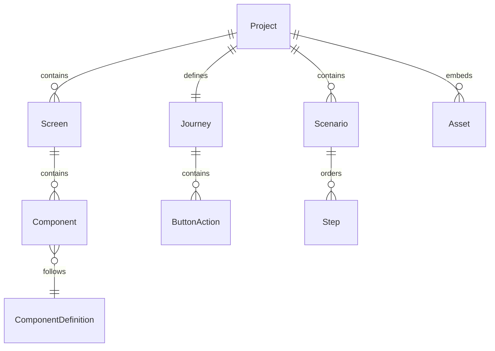

# Data Model: Gerador de Jornada

## Situação corrente — revisão 1.0.0.1

Composição em application.Document; sete famílias base e três compostos; Style/Enabled/ParentID na instância. JSON schemaVersion=3/catalogVersion=3. Não existe Document.AppearanceProfile, appearance tipada, skin.Profile ou adaptador visualprofile no código atual.

Este quadro e a [spec](spec.md#estado-verificado-1-0-0-1) descrevem a implementação atual. As seções datadas de expansão conservam decisões/requisitos e registros históricos: tipos, arquivos, testes e perfis ali citados só são evidência atual quando existem na árvore e estão cobertos pela seção 22 do [quickstart](../001-gerador-jornada/quickstart.md#22-reimplementação-visual-do-legado--2026-10-24). Não atribuir ao build atual resultados de uma revisão antiga.

**Date**: 2026-10-17 | **Spec**: [spec.md](spec.md)
**Status**: implementação parcial reconciliada com 1.0.0.1; expansão e homologação pendentes.

## Convenções

- IDs internos são UUID v4 em string canônica, gerados uma vez; não derivam de nome, posição, data ou índice. Duplicação gera novos IDs.
- Unidades de geometria são inteiros lógicos equivalentes a pixels a 96 DPI. Tempo é inteiro em milissegundos; cores são `#RRGGBB`.
- Strings são Unicode. Nomes visíveis não são nomes de pacote/classe automaticamente.
- Campos persistidos e nomes JSON estão em inglês; textos da interface estão em português.
- Tipos dos cinco domínios não carregam objetos Fyne; DTOs de arquivo fazem a tradução JSON. O perfil puro compartilhado `skin.Profile` já define suas próprias tags JSON e hash determinístico, sem bytes ou I/O; não confundir isso com tags adicionadas às entidades de negócio.
- Projeto conceitual é o documento completo. No código, `project.Project` guarda metadados/recursos e `application.Document` compõe telas, jornada, roteiros e opções de saída, evitando dependências cíclicas e um serviço gigante.
- Detalhes de wire format e limites de leitura estão em [project-format.md](contracts/project-format.md).

## Entidades e valores

| Tipo | Campos principais | Regras / responsabilidade |
| --- | --- | --- |
| Project | id, name, revision, catalogVersion, assets | Nome não vazio; revisão monotônica na sessão; metadados e recursos do documento, sem métodos de UI/exportação. |
| Document (aplicação) | project, screens, journey, scenarios, javaOptions, resources | Composição para sessão/snapshot; recursos copiados profundamente; sem perfil visual privado no modelo atual e sem regras de domínio duplicadas. |
| Screen | id, fileId, name, size, background, components | Nome não vazio; largura/altura positivas; ordem no array determina ordem na lista e na exploração PPT. |
| Component | id, fileId, name, kind, bounds, style, enabled, parentId, properties | Nome não vazio e único na tela; kind pertence ao catálogo; propriedades têm exatamente o tipo correspondente à família. |
| Bounds | x, y, width, height | Inteiros; x/y não negativos, largura/altura positivas e limites dentro da tela para prévia/exportação. |
| Style | fontFamily, fontSize, textColor, fillColor, borderColor, backgroundAssetId, textAlign, skin | Tamanho de fonte zero mantém padrão; personalizado deve ser positivo; cores válidas; estilos opcionais resolvidos pelo catálogo. Capacidade Java depende de perfil. |
| Definition (implementado) | kind, name, width, height | Catálogo embutido; metadados declarativos completos de propriedades/capacidades permanecem em 003-catalogo/T004 e T006. |
| Journey | startScreenId, actions | Uma inicial existente para executar; um binding no máximo por botão e evento click. |
| ButtonAction | sourceScreenId, sourceComponentId, kind, targetScreenId | kind `none` ou `navigate`; destino obrigatório apenas em navigate. Fonte deve ser botão da tela indicada. |
| Scenario | id, name, startScreenId, steps | Nome não vazio; inicial existente; ordem dos steps é ordem de execução. Lista finita, sem loops implícitos. |
| Step | id, kind, screenId, componentId, point, text, durationMs | Campos dependem de kind conforme contrato; duração estritamente positiva, intervalo 1..600000 ms. |
| Asset | id, path, mediaType, sha256, sizeBytes | Recurso PNG/JPEG local incorporado; path interno normalizado, hash e tamanho conferidos. |
| JavaOptions | packageName, profileId | Pacote Java válido para exportar; perfil identifica versão EFL homologada. Não armazena caminho de JAR nem JDK. |
| Diagnostic (parcial) | code, severity, message, screenId, componentId | Localização completa por roteiro/etapa/propriedade e warnings continuam no contrato alvo e em 001-gerador-jornada/T030/T046. |
| ExportArtifact (planejado) | relativePath, mediaType, sizeBytes, sha256 | Contrato alvo de resultado estruturado; tipo ainda ausente no serviço atual (001-gerador-jornada/T009/T038). Não é persistido no projeto. |

Propriedades específicas de Button, Label, Title, TextField, Radio, Report e NumericKeyboard estão em [component-catalog.md](contracts/component-catalog.md). Em Go, usar structs próprias para cada família e uma variante discriminada; `map[string]any` não deve atravessar os casos de uso como modelo de domínio.

## Relacionamentos

IDs de telas e componentes são únicos globalmente no projeto, mesmo que nomes visíveis se repitam entre telas. Componentes não têm hierarquia de filhos na v1: os grupos de formas são resultado de renderização. A ordem no array de componentes representa z-order, do fundo para a frente.

A jornada pode conter ciclos. O roteiro não é uma cópia do grafo: é uma lista finita de ações que o percorre. Recursos podem ser compartilhados por múltiplos componentes; remover um componente não remove automaticamente um recurso ainda utilizado. No diagrama, Project representa o documento conceitual completo, composto no código por application.Document.

## Ownership por domínio

| Dono das regras | Modelo detalhado | Integração |
| --- | --- | --- |
| Projeto | [Modelo](../002-projeto/data-model.md) | A aplicação agrega os demais domínios e projectzip serializa |
| Catálogo | [Modelo](../003-catalogo/data-model.md) | Screen e apresentação consomem definições |
| Tela | [Modelo](../004-tela/data-model.md) | Aplicação coordena histórico e referências externas |
| Jornada | [Modelo](../005-jornada/data-model.md) | Adaptadores traduzem ações em clique/link/listener |
| Demonstração | [Modelo](../006-demonstracao/data-model.md) | Prévia e PPT consomem interpretação comum |

## Invariantes e validação

| Nível | Verificação | Efeito |
| --- | --- | --- |
| Estrutural | ZIP/JSON legível, versão e catálogo conhecidos, IDs únicos, tipos/campos válidos, limites de leitura | Falha impede substituir a sessão ativa. |
| Domínio | Nomes, bounds, propriedades e referências válidas, inclusive destino do teclado | Permite abrir/salvar rascunho legível com diagnósticos; impede executar/exportar a parte inválida. |
| Jornada | Inicial e destinos existentes, bindings únicos e fontes do tipo botão | Exigido para prévia completa do projeto e para todos os slides exploratórios; a prévia isolada não executa a jornada. |
| Roteiro | Etapas coerentes com tela corrente, tempo válido e alvos presentes | Exigido somente para executar/exportar os roteiros selecionados. |
| Alvo | Recursos/fontes/capacidades compatíveis; pacote e perfil Java válidos | Bloqueia apenas o alvo correspondente. |

Campos obrigatórios desconhecidos ou tipo de componente desconhecido em v1 são erros estruturais. Não descartar propriedades desconhecidas e salvar por cima do arquivo. O contrato não prevê migração implícita.

## Estado de aplicação e transições

- **Sessão**: sem projeto → projeto limpo → projeto alterado → salvando → limpo na revisão salva. Se houver nova edição durante save, a sessão permanece alterada.
- **Histórico**: comando confirmado → entrada com inversa; undo/redo altera revisão; nova edição após undo elimina redo. Máximo 100 entradas; abrir outro projeto limpa histórico.
- **Prévia**: parada → tela inicial → navegação → parada. Entrada de cada tela restaura initialValue/selectedOptionId declarados. Estado runtime nunca é gravado como edição.
- **Roteiro**: parado → reproduzindo ↔ pausado → concluído; reiniciar sempre parte do estado inicial. Pausa não consome tempo.
- **Exportação**: validando → gerando → verificando → publicando → concluída; erro/cancelamento antes da publicação limpa staging e preserva destino.

São estados de sessão, não um enum persistido em Project.

## Operações que alteram referências

Duplicar tela remapeia IDs de seus componentes e vínculos internos de teclado. Ações de botões copiados mantêm destinos externos; referências à própria tela passam a apontar a cópia. Roteiros não são duplicados junto com uma tela.

Antes de excluir, mostrar o impacto. Ao confirmar, remover a entidade e ações de que ela é dona; referências de outras telas/roteiros permanecem como diagnósticos reparáveis. Undo restaura todo o comando. Não navegar silenciosamente para outra tela.

## Snapshot e evolução

Um snapshot de exportação contém a revisão do projeto, catálogo/perfil resolvidos e bytes dos recursos. Workers não compartilham mapas/slices mutáveis com a sessão.

A versão inicial do pacote é `schemaVersion: 1`, com `catalogVersion: 1`. Qualquer formato futuro exige contrato e estratégia de compatibilidade antes de mudar o leitor. IDs e significado de coordenadas não podem mudar implicitamente.

## Revisão de edição — 2026-10-18

textAlign pertence a Style no domínio Tela: left/center/right, vazio equivalente a left. É salvo com o componente e propagado pela representação visual compartilhada. A faixa de título pronta escolhe right. Uma mudança dessa propriedade não altera Bounds.

Seleção múltipla, caixa de seleção, cursor e geometria provisória continuam sendo estado de interface. O domínio Tela oferece somente consultas de interseção, caixa conjunta e translação limitada; a aplicação publica um comando de histórico para o conjunto. Duplicação remapeia vínculos internos e remoção preserva referências externas diagnosticáveis.

## Escopo da prévia de tela

A aplicação pode criar um snapshot de uma única tela selecionada, sem ações de navegação ou roteiros. A tela inicial do documento original não muda. Estado de campo/escolha permanece na sessão Preview; o modo de visualização não é persistido no projeto e não altera o modelo de domínio. Validar a composição e referências locais da tela ativa, sem exigir validade de outras telas.

## FileID e identidade interna

Screen.FileID/Component.FileID são nomes-base editáveis sem extensão, de 1 a 40 caracteres ASCII alfanuméricos, começando com letra. Screen exige Pnl + nome; Component não exige prefixo. FileID de tela é único no projeto e de componente na tela, sem distinguir caixa. Nomes Windows de dispositivos são inválidos. UUIDs não mudam ao editar FileID, e Name permanece Unicode. Migração de arquivo v1 preenche IDs ausentes; v2 exige valores explícitos válidos. Regras de valor ficam em screen/file_id.go; aplicação coordena colisões, sugestões e transações; adaptadores traduzem formulário, manifesto e nomes de fonte.

## Preferências de apresentação (fora do domínio)

A chave local editor.theme aceita Claro, Escuro e Azul, com Claro como fallback. É preferência de usuário gerenciada pelo adaptador Fyne, não propriedade do Projeto nem campo do manifesto. Tela cheia, visibilidade de Sair e diálogo de encerramento são estado transitório da janela. Nenhuma migração de dados ou revisão do projeto é necessária.

## Evolução pós-v1 — perfil visual e catálogo 2

O perfil por documento descrito nos registros de 2026-10-19 é histórico/plano de expansão; não existe na revisão 1.0.0.1. A implementação atual usa Style e biblioteca incorporada global, sem captura/selamento de revisões privadas. O histórico de build e validação continua no quickstart; não o repetir como evidência vigente deste modelo.

Perfil futuro deve manter ID/versão/hash, definições/estados/fontes/aliases/recursos, até 16 revisões diretas, integridade e origem/licença. A incorporação fica restrita aos bytes usados e permitidos, sem caminhos absolutos ou substituições silenciosas. Aparência normalizada com presença/RGBA e descritores de fonte/recurso continua pendente.

As tabelas anteriores registram a base v1/v2. A expansão autorizada acrescenta:

| Valor planejado | Responsabilidade / invariantes |
| --- | --- |
| SkinLibrary / SkinDefinition / SkinState | Biblioteca estática gerada de dados puros, versionada; chave composta por família, nome original e estado; proveniência e status de resolução. Sem bytes de UI ou código executável. |
| FontFace / ResourceRef | Hash, ID, nome interno, métricas, direitos de uso/embedding e origem; bytes ficam no adaptador/snapshot. Declaração bold/italic e efeito Java são evidências distintas. |
| Inventário de desenvolvimento / escolha de recurso | `resource_roots` identifica raízes comprovadas; `sources` conserva todas as origens equivalentes; `conflicts` conserva candidatos por hash e `selections` registra a origem/hash/justificativa escolhidos explicitamente. Configuração versionada fora do domínio; nova colisão ou pin alterado bloqueia o caminho. Escolha técnica não concede licença nem homologação. |
| AppearanceProfile | ID, versão, hash e snapshot de definições, descritores fontFaces e recursos usados; inclui faces referidas só por override. Descriptor unresolved preserva requestedFamily legado sem face/asset fictícios; bloqueia fidelidade dependente, não o round-trip do rascunho. Sem paths absolutos. |
| Component.appearance / overrides | Referência de skin/version e overrides tipados com presença explícita, incluindo RGBA, face/estilo/tamanho, alinhamento/espaçamento. Ausente não equivale a zero/falso. Style legado é traduzido sem perda. |
| Component.parentId | Opcional; pai contêiner da mesma tela, sem ciclos; lista e bounds absolutos mantidos. Ordem do array continua z-order entre irmãos; subárvore compõe grupo contíguo na pintura. Não reordenar implicitamente ao abrir. |
| Properties catálogo 2 | Preserva sete kinds e acrescenta toggleButton, textArea, passwordField, comboBox, table, alphaKeyboard, progressBar, panel e dialog. Duas legendas e subclasses Report são variantes; UF e Frame são presets. |
| RuntimeState | Foco, cursor, pressed, seleção corrente, scroll e modal derivados para prévia/roteiro; nunca persistidos. Somente valores e estados **iniciais** tipados pertencem ao componente. |

Limites, DTOs e migração são normativos em [project-format.md](contracts/project-format.md#expansão-pós-v1--schema-3-e-catálogo-2-2026-10-19); sem JSON livre no núcleo. O leitor aceita versões antigas explicitamente e escreve v3 após migração; leitores antigos recusam v3. Cópia profunda inclui novas propriedades/recursos. Snapshot captura revisão/perfil/hashes usados, não consulta biblioteca mutável durante exportação.

Projetos antigos recebem nova aparência em campos sem override; conteúdo, IDs/FileIDs, bounds, ordem e referências permanecem. Migração fixa left quando o alinhamento antigo era vazio; não transforma ausência histórica em center da nova skin. ParentID ausente continua raiz. Redimensionar pai não escala filhos implicitamente; mover pai move descendentes em transação, sem deslocar duas vezes um filho também selecionado. Report/teclados têm partes internas derivadas, não centenas de Component persistidos.

## Integração planejada — códigos de barras (2026-10-23)

FR-060 não cria agregado financeiro em Document. Fonte canônica das propriedades em [003/data-model](../003-catalogo/data-model.md#modelo-codigos-barras-2026-10-23); instâncias/IDs em 004; DTO/versionamento em 002; Journey/Scenario conservam seus modelos em 005/006. Não repetir esses dados em um objeto central.

Estado runtime planejado por `(screenID, componentID)` contém oito strings, índice ativo, erro local, captura em andamento e resultado aceito de entrada. Modal/foco e temporários de captura são da sessão; apenas resultado validado permite consultar derivados. Alterar/cancelar/reiniciar invalida o que for aplicável segundo 031; a revisita/fechamento descarta tudo. Captura inválida limpa essa instância, não o documento ou outras entradas. Snapshot exportado não lê widgets nem herda a prévia livre.

032 não requer estado bancário de execução: sua configuração processada é leitura do snapshot. Linha/bloco selecionado e popup do inspector pertencem ao rascunho de UI, não ao documento. Nenhum vínculo implícito transfere documento/nome entre entrada e ficha processada. Tipos, versões e valores novos continuam planejados, sem alteração do EXE nesta entrega.

## Integração planejada — sessão de menu

FR-061 não cria agregado Menu em Document nem copia árvore em Journey/Scenario. [003/modelo](../003-catalogo/data-model.md#modelo-menu-aplicacao-2026-10-23) é canônico; instância é 004, wire 002 e referências de destino 005.

Sessão por `(screenID, componentID, visita)` contém caminho de IDs de submenus, vista raiz/submenu selecionado, seleção simulada e estado transitório de foco/pressionado. Derivar caminho inicial de Root até InitialMenuID, contando raiz; Voltar remove último nível e não sai da raiz, Cancelar restaura só raiz. Reabrir/revisitar/restart recria inicial configurado, não o último caminho. Sair encerra sessão de prévia e descarta runtime; não publica edição, logoff ou pedido de encerramento do aplicativo.

Hit region leva componentID/itemID e comando explícito; não identificar controles por Label/MovementName/Shortcut. Ativação verifica enabled da instância e do caminho, abre submenu local ou pede a Jornada destino autorado; folha sem destino apenas informa seleção simulada. Prévia Tela Atual não segue TargetScreenID nem exige outras telas para explorar submenus locais. Canvas/quadros/PPT usam inicial do snapshot, nunca essa sessão. Rascunho do inspector e expansão de nós não são configuração; só árvore/InitialMenuID confirmados persistem em Properties.Menu.
