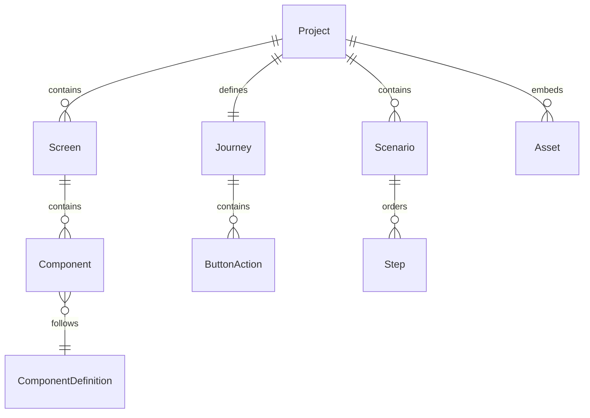

# Data Model: Gerador de Jornada

**Date**: 2026-10-17 | **Spec**: [spec.md](spec.md)
**Status**: modelo de projeto versão 1, a implementar.

## Convenções

- IDs são UUID v4 em string canônica, gerados uma vez; não derivam de nome, posição, data ou índice. Duplicação gera novos IDs.
- Unidades de geometria são inteiros lógicos equivalentes a pixels a 96 DPI. Tempo é inteiro em milissegundos; cores são `#RRGGBB`.
- Strings são Unicode. Nomes visíveis não são nomes de pacote/classe automaticamente.
- Campos persistidos e nomes JSON estão em inglês; textos da interface estão em português.
- Tipos de negócio não carregam tags JSON nem objetos Fyne. DTOs de arquivo fazem a tradução.
- Projeto conceitual é o documento completo. No código, `project.Project` guarda metadados/recursos e `application.Document` compõe telas, jornada, roteiros e opções de saída, evitando dependências cíclicas e um serviço gigante.
- Detalhes de wire format e limites de leitura estão em [project-format.md](contracts/project-format.md).

## Entidades e valores

| Tipo | Campos principais | Regras / responsabilidade |
| --- | --- | --- |
| Project | id, name, revision, catalogVersion, assets | Nome não vazio; revisão monotônica na sessão; metadados e recursos do documento, sem métodos de UI/exportação. |
| Document (aplicação) | project, screens, journey, scenarios, javaOptions | Composição para sessão/snapshot; sem regras de domínio duplicadas e sem métodos centrais de edição. |
| Screen | id, name, size, background, components | Nome não vazio; largura/altura positivas; ordem no array determina ordem na lista e na exploração PPT. |
| Component | id, name, kind, bounds, style, properties | Nome não vazio e único na tela; kind pertence ao catálogo; propriedades têm exatamente o tipo correspondente à família. |
| Bounds | x, y, width, height | Inteiros; x/y não negativos, largura/altura positivas e limites dentro da tela para prévia/exportação. |
| Style | fontFamily, fontSize, textColor, fillColor, borderColor, backgroundAssetId | Tamanho de fonte positivo; cores válidas; estilos opcionais resolvidos pelo catálogo. Capacidade Java depende de perfil. |
| ComponentDefinition | kind, displayName, defaultBounds, propertyDefinitions, capabilities | Catálogo embutido/versionado, não editável pelo projeto; sem callbacks serializados. |
| Journey | startScreenId, actions | Uma inicial existente para executar; um binding no máximo por botão e evento click. |
| ButtonAction | sourceScreenId, sourceComponentId, kind, targetScreenId | kind `none` ou `navigate`; destino obrigatório apenas em navigate. Fonte deve ser botão da tela indicada. |
| Scenario | id, name, startScreenId, steps | Nome não vazio; inicial existente; ordem dos steps é ordem de execução. Lista finita, sem loops implícitos. |
| Step | id, kind, screenId, componentId, point, text, durationMs | Campos dependem de kind conforme contrato; duração estritamente positiva, intervalo 1..600000 ms. |
| Asset | id, path, mediaType, sha256, sizeBytes | Recurso PNG/JPEG local incorporado; path interno normalizado, hash e tamanho conferidos. |
| JavaOptions | packageName, profileId | Pacote Java válido para exportar; perfil identifica versão EFL homologada. Não armazena caminho de JAR nem JDK. |
| Diagnostic | code, severity, message, location, target | severity error/warning; localização pode indicar tela, componente, roteiro, etapa e campo. |
| ExportArtifact | relativePath, mediaType, sizeBytes, sha256 | Saída já validada; caminho relativo seguro. Não é parte do projeto persistido. |

Propriedades específicas de Button, Label, Title, TextField, Radio, Report e NumericKeyboard estão em [component-catalog.md](contracts/component-catalog.md). Em Go, usar structs próprias para cada família e uma variante discriminada; `map[string]any` não deve atravessar os casos de uso como modelo de domínio.

## Relacionamentos

IDs de telas e componentes são únicos globalmente no projeto, mesmo que nomes visíveis se repitam entre telas. Componentes não têm hierarquia de filhos na v1: os grupos de formas são resultado de renderização. A ordem no array de componentes representa z-order, do fundo para a frente.

A jornada pode conter ciclos. O roteiro não é uma cópia do grafo: é uma lista finita de ações que o percorre. Recursos podem ser compartilhados por múltiplos componentes; remover um componente não remove automaticamente um recurso ainda utilizado. No diagrama, Project representa o documento conceitual completo, composto no código por application.Document.

## Ownership por domínio

| Dono das regras | Modelo detalhado | Integração |
| --- | --- | --- |
| Projeto | [Modelo](../002-projeto/data-model.md) | A aplicação agrega os demais domínios e projectzip serializa |
| Catálogo | [Modelo](../003-catalogo/data-model.md) | Screen e apresentação consomem definições |
| Tela | [Modelo](../004-tela/data-model.md) | Aplicação coordena histórico e referências externas |
| Jornada | [Modelo](../005-jornada/data-model.md) | Adaptadores traduzem ações em clique/link/listener |
| Demonstração | [Modelo](../006-demonstracao/data-model.md) | Prévia e PPT consomem interpretação comum |

## Invariantes e validação

| Nível | Verificação | Efeito |
| --- | --- | --- |
| Estrutural | ZIP/JSON legível, versão e catálogo conhecidos, IDs únicos, tipos/campos válidos, limites de leitura | Falha impede substituir a sessão ativa. |
| Domínio | Nomes, bounds, propriedades e referências válidas, inclusive destino do teclado | Permite abrir/salvar rascunho legível com diagnósticos; impede executar/exportar a parte inválida. |
| Jornada | Inicial e destinos existentes, bindings únicos e fontes do tipo botão | Exigido para prévia e para todos os slides exploratórios. |
| Roteiro | Etapas coerentes com tela corrente, tempo válido e alvos presentes | Exigido somente para executar/exportar os roteiros selecionados. |
| Alvo | Recursos/fontes/capacidades compatíveis; pacote e perfil Java válidos | Bloqueia apenas o alvo correspondente. |

Campos obrigatórios desconhecidos ou tipo de componente desconhecido em v1 são erros estruturais. Não descartar propriedades desconhecidas e salvar por cima do arquivo. O contrato não prevê migração implícita.

## Estado de aplicação e transições

- **Sessão**: sem projeto → projeto limpo → projeto alterado → salvando → limpo na revisão salva. Se houver nova edição durante save, a sessão permanece alterada.
- **Histórico**: comando confirmado → entrada com inversa; undo/redo altera revisão; nova edição após undo elimina redo. Máximo 100 entradas; abrir outro projeto limpa histórico.
- **Prévia**: parada → tela inicial → navegação → parada. Entrada de cada tela restaura initialValue/selectedOptionId declarados. Estado runtime nunca é gravado como edição.
- **Roteiro**: parado → reproduzindo ↔ pausado → concluído; reiniciar sempre parte do estado inicial. Pausa não consome tempo.
- **Exportação**: validando → gerando → verificando → publicando → concluída; erro/cancelamento antes da publicação limpa staging e preserva destino.

São estados de sessão, não um enum persistido em Project.

## Operações que alteram referências

Duplicar tela remapeia IDs de seus componentes e vínculos internos de teclado. Ações de botões copiados mantêm destinos externos; referências à própria tela passam a apontar a cópia. Roteiros não são duplicados junto com uma tela.

Antes de excluir, mostrar o impacto. Ao confirmar, remover a entidade e ações de que ela é dona; referências de outras telas/roteiros permanecem como diagnósticos reparáveis. Undo restaura todo o comando. Não navegar silenciosamente para outra tela.

## Snapshot e evolução

Um snapshot de exportação contém a revisão do projeto, catálogo/perfil resolvidos e bytes dos recursos. Workers não compartilham mapas/slices mutáveis com a sessão.

A versão inicial do pacote é `schemaVersion: 1`, com `catalogVersion: 1`. Qualquer formato futuro exige contrato e estratégia de compatibilidade antes de mudar o leitor. IDs e significado de coordenadas não podem mudar implicitamente.
