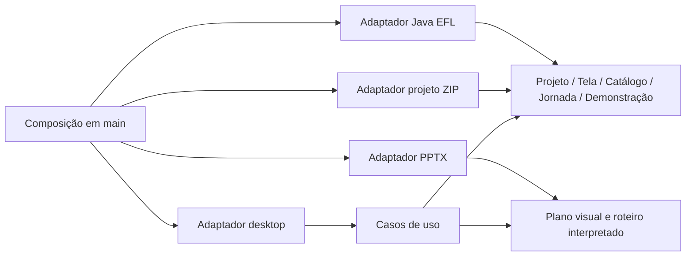

# Implementation Plan: Gerador de Jornada

## Situação corrente — revisão 1.0.0.1

Composição em application.Document; sete famílias base e três compostos; Style/Enabled/ParentID na instância. JSON schemaVersion=3/catalogVersion=3. Não existe Document.AppearanceProfile, appearance tipada, skin.Profile ou adaptador visualprofile no código atual.

Este quadro e a [spec](spec.md#estado-verificado-1-0-0-1) descrevem a implementação atual. As seções datadas de expansão conservam decisões/requisitos e registros históricos: tipos, arquivos, testes e perfis ali citados só são evidência atual quando existem na árvore e estão cobertos pela seção 22 do [quickstart](../001-gerador-jornada/quickstart.md#22-reimplementação-visual-do-legado--2026-10-24). Não atribuir ao build atual resultados de uma revisão antiga.


**Branch**: `001-gerador-jornada` (identificador, sem branch Git criada) | **Date**: 2026-10-17 | **Spec**: [spec.md](spec.md)
**Input**: Especificação funcional aprovada e análise estática do material legado.

## Summary

**Referência vigente:** consultar a situação corrente 1.0.0.1 acima. A regra de filtragem de dependências ausentes permanece; os inventários de perfis 214/206 e suas APIs são históricos/alvo de expansão.

Construir um editor desktop offline em Go/Fyne para Windows. Um projeto compartilhado descreve componentes EFL, telas, navegação e roteiro; adaptadores independentes exportam PPTX editável com links/animações e fontes Java 1.6/Swing com EFL.

A implementação está em andamento em apps/gerador-jornada, com documentação do código em português e testes automatizados. Homologações externas e aprovação manual permanecem pendentes. A execução futura está em [tasks.md](tasks.md), incluindo as oito sprints. A análise e as decisões arquiteturais estão em [research.md](research.md).

Atualização de 2026-10-18: [DESIGN.md](DESIGN.md) define a separação entre tema do editor e aparência da tela desenhada. As features 007 a 030 detalham cada componente/ferramenta, com DESIGN.md individual; seu inventário e origem estão em research.md. São recortes de requisitos dos domínios existentes e adaptadores, sem novos módulos Go ou domínios artificiais.

Recursos originais ficam em `internal/adapter/builtinassets`, incorporados com Go embed e copiados para os recursos do documento. Conjuntos informativos usam componentes comuns montados em `internal/application/presets.go`, sem novos discriminadores no manifesto. Imagem de fundo já configurada em arquivo existente não é trocada automaticamente.

## Technical Context

**Language/Version**: Go 1.27.2 Windows amd64, fixado nas ferramentas locais e em go.mod; as versões e hashes de preparação Windows são fixados em scripts/toolchains-windows.json; .tools contém apenas ferramentas/cache locais. Alvo gerado: Java SE 6, classfile 50.0.
**Primary Dependencies**: Fyne v2.8.2 e MinGW GCC 16.2.0 UCRT, com versões e hashes fixados; biblioteca padrão Go para JSON, ZIP, XML, templates e hashing. Sem Node, WebView, automação Office, framework DI ou biblioteca Java na execução do editor.
**Storage**: writer `.jornada` schemaVersion 3/catalogVersion 3; leitura dos pares 1/1, 2/1, 3/2 e 3/3 nos campos suportados. Sem perfil visual privado por documento; recursos de skin incorporados no executável.
**Testing**: testes Go unitários, contrato e integração; testes de widgets Fyne, fixtures determinísticas e homologação manual em Windows/PowerPoint/Java-EFL reais.
**Java Validation Tooling**: JDK 17 do usuário executa ECJ 3.33.0 com source/target 1.6; verificação estática com Animal Sniffer 1.24 e assinatura java16:1.1, além de classfile major 50. Scripts externos em `scripts/java6.py` e `scripts/java6/CheckJava6.java`; hashes em `scripts/java6-tools.json`. Sem compilação no editor. Execução Java 6/EFL permanece gate externo.
**Target Platform**: Windows 10 22H2 e Windows 11 x64; validar DPI 100%, 150% e 200%, hardware gráfico/driver disponível e ambiente de referência de spec.md.
**Project Type**: aplicação desktop, monólito modular, um módulo Go.
**Performance Goals**: NFR-007; exportação em worker com cancelamento cooperativo e progresso.
**Constraints**: offline, janela própria, EXE sem runtimes externos, sete famílias na v1 e todo o acervo visual Java/EFL na expansão de 2026-10-19, PowerPoint editável; Java permanece pausado.
**Scale/Scope**: uso individual; conjunto nominal de 10 telas com 50 componentes cada e roteiro de 50 etapas. Não é limite de negócio: arquivos maiores são admitidos dentro dos limites de leitura do contrato e têm desempenho a medir.

## Constitution Check

| Princípio | Aplicação no desenho | Estado documental |
| --- | --- | --- |
| I. Domínio | Pacotes por domínio; UI e serialização ficam nos adaptadores | Conforme |
| II. Contratos | Modelo tipado/IDs/snapshot implementados; serviço de exportação e diagnóstico completo ainda parciais | Parcial; T009/T030/T038/T046 |
| III. Offline | Recursos embutidos, sem Java/Office na geração | Conforme; execução ainda não homologada |
| IV. Documentação | GoDoc, comentários locais e Javadoc em português; revisão integral por declaração ainda necessária | Parcial; T002/T073 |
| V. Evidência | Contratos testados e homologações reais distintas | Conforme; dependência EFL externa explícita |
| VI. Simplicidade | Um módulo, construtores, arquivo local, sem infraestrutura distribuída | Conforme |
| VII. Sincronização | Artefatos reconciliados por domínio com evidências e lacunas locais; aceite separado | Reconciliação concluída em 2026-10-19; implementação integral não declarada |

Reavaliação pós-design: sem exceção arquitetural. Compatibilidade EFL permanece uma condição de conclusão da implementação, não uma decisão de tecnologia a adivinhar. A Sprint 7 não pode ser encerrada somente com dublês.

## Project Structure

### Documentation (this feature)

```text
specs/001-gerador-jornada/
├── spec.md
├── plan.md
├── research.md
├── data-model.md
├── quickstart.md
├── contracts/
│   ├── project-format.md
│   ├── component-catalog.md
│   ├── navigation-scenario.md
│   ├── export-service.md
│   ├── pptx-export.md
│   └── java-efl-export.md
├── checklists/
│   └── requirements.md
└── tasks.md
```

Constituição em `.specify/memory/constitution.md`; feature coordenadora registrada em `.specify/feature.json`. Análise do legado e decisões ficam em research.md; sprints em tasks.md. Não criar documentação avulsa de arquitetura/ADRs ou sprints nesta feature.

### Documentation by domain

Cada domínio é uma feature Spec Kit do mesmo produto, com `spec.md`, `plan.md`, `data-model.md` e `tasks.md` próprios:

- [Projeto](../002-projeto/spec.md): identidade, revisão e recursos.
- [Catálogo](../003-catalogo/spec.md): famílias e propriedades tipadas.
- [Tela](../004-tela/spec.md): composição e geometria.
- [Jornada](../005-jornada/spec.md): inicial e navegação.
- [Demonstração](../006-demonstracao/spec.md): etapas, tempo e ocorrências.

Esta feature coordena os contratos compartilhados, aplicação, adaptadores e homologação. As tarefas de domínio não são cópias das tarefas de integração. Os nomes de pastas não significam microserviços nem módulos Go distintos.

### Source Code (apps/gerador-jornada — raiz da aplicação)

```text
cmd/gerador-jornada/main.go
internal/
├── project/       # identidade, recursos e revisão do documento
├── catalog/       # definição tipada das sete famílias
├── screen/        # componentes, geometria e estilo
├── journey/       # ações e grafo de navegação
├── scenario/      # etapas e interpretação do roteiro
├── application/   # casos de uso, sessão, histórico e exportação
├── presentation/  # primitivas e conversões visuais sem Fyne/Open XML
└── adapter/
    ├── desktop/   # shell, canvas, paleta, inspector, timeline, prévia
    ├── projectzip/# manifesto, limites e ZIP; publicação delegada a atomicfile
    ├── pptx/      # pacote Open XML, formas, links, animações
    ├── javaefl/   # perfil e geração de fontes por responsabilidade
    ├── atomicfile/# publicação atômica nativa
    ├── builtinassets/ # recursos e ícone incorporados
    └── buildinfo/ # versão do software
scripts/           # PowerShell/Python, toolchains e build Windows
go.mod / go.sum    # módulo único e dependências fixadas
```

**Structure Decision**: termos em inglês nos pacotes; interface e documentação em português. Arquivos curtos por responsabilidade dentro de cada módulo, sem diretórios genéricos `utils`/`common`. A aplicação agora reside em apps/gerador-jornada, conforme solicitação do usuário; specs e .specify permanecem na raiz do workspace.

O caminho público do módulo Go será o endereço real do repositório quando houver hospedagem definida; não inventar organização GitHub. Até existir esse endereço, manter `gerador-jornada.local/editor` como identificador local, em um único `go.mod`.

## Design and Data Flow

### Dependências



Setas indicam dependência de código. Os casos de uso recebem persistência/exportadores por interfaces pequenas definidas em `application`; adaptadores não são importados por esse pacote. `main` monta as implementações.

`catalog` não importa os adaptadores. `screen` usa definições de catálogo. `journey` e `scenario` mantêm IDs e regras próprias; referências cruzadas são resolvidas por um validador de projeto na aplicação. Isso evita ciclos de importação entre domínios.

O tipo `project.Project` mantém metadados e recursos. `application.Document` compõe esse valor com telas, jornada, roteiros e opções de saída: é o agregado de persistência/snapshot, sem concentrar operações de todos os domínios. O DTO JSON continua com os campos de raiz do contrato. Assim Projeto não precisa importar os outros quatro domínios.

### Edição, prévia e histórico

1. UI transforma coordenadas de ponteiro em unidades lógicas, considerando zoom, scroll e DPI.
2. Durante arraste, a UI mostra geometria provisória. Ao soltar, envia um comando atômico; Escape cancela sem gravar.
3. Caso de uso valida e aplica o comando, incrementa revisão e registra inversa no histórico de até 100 entradas.
4. Autosave observa revisões confirmadas, com debounce de 2 s. Seu trabalho não usa widgets.
5. Prévia cria estado de execução separado. Ao entrar numa tela, restaura seus valores iniciais; fechar a prévia não altera o projeto.
6. Reprodução de roteiro usa o mesmo interpretador para gerar estados e eventos temporizados da prévia e do exportador PPT.

Salvar não limpa histórico. Nova edição após desfazer remove a pilha de refazer. Histórico, foco, seleção e zoom não são persistidos no projeto.

### Representação visual

Usar coordenadas inteiras em unidades lógicas com equivalência a pixels a 96 DPI. Java recebe bounds inteiros; PPT usa a conversão exata para EMU definida no contrato. Texto usa tamanho em unidades lógicas convertido para pontos; Fyne não deve aplicar mínimos intrínsecos que alterem o desenho silenciosamente.

`presentation` expande componentes em primitivas (retângulo, borda, texto, imagem e grupo) sem tipos Fyne/XML. Desktop e PPT consomem esse plano. Java usa dimensões e propriedades semânticas do domínio com mapeamento EFL homologado. Diferenças de métricas e skins são verificadas em homologação, sem exigir identidade de rasterização.

### Exportação e falhas

Ao iniciar, capturar snapshot imutável com revisão e recursos. Aplicar validação geral e do alvo. Exportar em área temporária, verificar integridade e só então publicar o pacote completo; nunca mesclar por cima de projeto Java manualmente editado.

Cada job aceita `context.Context`, publica progresso agregado e retorna diagnósticos estruturados. Permitir uma exportação por vez nesta versão; edição pode continuar, mas a saída representa a revisão capturada. Atualizações visuais de worker devem passar pelo mecanismo de UI thread do Fyne.

Falha ou cancelamento preserva destino anterior. Diagnósticos não devem incluir caminhos internos desnecessários nem conteúdo integral dos campos. Telemetria e servidor de rede não são necessários.

## Implementation Strategy

1. **Sprint 1:** comprovar drag/drop, edição visual PPT, cursor/digitação Open XML e levantar a API EFL real. Registrar ferramentas e evidências, sem transformar protótipos em um objeto central.
2. **Sprints 2–4:** construir projeto, catálogo, editor, navegação e roteiro, em incrementos verificáveis.
3. **Sprints 5–6:** implementar exportação PPT exploratória e demonstrativa.
4. **Sprint 7:** implementar e homologar fontes Java 1.6/EFL com a biblioteca do sistema hospedeiro.
5. **Sprint 8:** distribuir e homologar as duas saídas offline.

Manter catálogo e perfis de exportação internos/versionados, sem carregar código externo de projeto. Nenhuma implementação deve depender de copiar a estrutura React legada.

## Validation and Delivery

- Checks Go: formatação, `go vet`, testes de domínio/contrato/integração e verificação de dependências entre pacotes; verificar documentação exportada automaticamente e internos/locais em revisão.
- PPT: integridade OPC/XML, IDs/relacionamentos, geometria e execução no PowerPoint 2016/Microsoft 365. Sem macros e sem depender de vídeo para os controles.
- Java: referência determinística, compilação com API Java SE 6 e bibliotecas EFL reais; classfile 50.0, execução e navegação na EDT. Compilador moderno sem suporte a target 6 não serve como comprovação.
- Distribuição: build Windows nativo com dependências fixadas, recursos embutidos e manifesto DPI; testar máquina limpa e registrar dependências efetivas. Licenças e inventário acompanham o pacote de release, fora do EXE se necessário.
- Desempenho: medir metas de spec.md e cancelamento com conjunto nominal. Somente ampliar medição quando houver falha ou mudança relevante.

As evidências futuras devem registrar versão do editor, toolchain, bibliotecas, SO, DPI, versão do PowerPoint e perfil EFL. O roteiro detalhado é [quickstart.md](quickstart.md).

## Complexity Tracking

Nenhuma violação da constituição exige exceção. O exportador Open XML próprio aumenta o esforço, mas evita runtimes externos e oferece controle das animações; seu risco é tratado na primeira sprint. O perfil Java/EFL isola a tecnologia antiga do editor.

## Revisão de arquitetura da edição — 2026-10-18

- `internal/screen/selection.go`: interseção, caixa conjunta e translação limitada; regras geométricas sem widgets ou seleção persistida.
- `internal/application/transform.go` e `edit_selection.go`: comandos coletivos de movimento/duplicação/remoção, com transação e histórico únicos.
- `internal/screen.Style.TextAlign` e `internal/presentation.Primitive.TextAlign`: alinhamento textual compartilhado; adaptadores Fyne/DrawingML traduzem para suas tecnologias.
- `internal/adapter/desktop/selection.go`, `keyboard.go` e `board.go`: estado e eventos de interação; `board_renderer.go` contém o cache visual por sessão/revisão/escala.
- `properties_*.go`: formulários coesos por família e navegação. `inspector_actions.go` mantém confirmação fixa; `arrangement.go` trata posicionamento geométrico, separado de alinhamento do texto.
- `internal/adapter/pptx/transition.go`: efeitos de entrada nativos; o modelo de Demonstração e seu timing continuam independentes de PresentationML.

A suspensão Java/EFL afeta somente a disponibilidade da ação no desktop. Domínios e geração permanecem no código. A alteração de seleção não copia documentos nem grava histórico; alterações confirmadas continuam transacionais.

O ícone é um recurso do adaptador `builtinassets`, fornecido ao Fyne na composição em `cmd/gerador-jornada/main.go`. `scripts/windows-icon.ps1`, chamado pelo build, converte a imagem versionada em ICO multirresolução e gera `icon_windows_amd64.syso` com o windres já instalado. Essa dependência permanece no desenvolvimento; os modelos de domínio e os arquivos `.jornada` não recebem a identidade visual do programa.

## Menu e comandos de exclusão — 2026-10-18

`internal/adapter/desktop/component_menu.go` concentra hit-test compartilhado, menu contextual e foco de propriedades. `selection.go` atualiza a disponibilidade do botão Excluir após eventos de seleção e refresh. `operations.go` captura IDs e tela antes da confirmação Sim/Não e reutiliza `Session.DeleteComponents`; `keyboard.go` preserva o foco textual. Nenhuma nova dependência ou mudança no formato persistido é necessária.

Validação: testes de interação com o driver Fyne verificam alvo, foco, exclusão por menu/botão/teclado, cancelamento, confirmação única, grupo, Undo e disponibilidade após clique vazio e troca de tela. Geometria visual, driver Windows nativo e aceitação continuam sujeitos ao roteiro manual.

A distribuição 1.0.0.0 utiliza `internal/adapter/buildinfo/VERSION` como fonte única, incorporada em Go e lida pelo script de recursos Windows para FileVersion/ProductVersion. Essa identidade de build não altera o modelo ou a versão persistida dos projetos.

## Sessão de prévia da tela atual

`internal/application/screen_preview.go` resolve a tela por ID e prepara um escopo isolado de uma tela, sem ações de jornada ou roteiros, reutilizando validação, cópia profunda e estado runtime de Preview. `internal/adapter/desktop/preview.go` mantém entradas distintas para projeto/tela e compartilha montagem de janela/renderização em showPreview. Não adicionar dependências Fyne ao domínio ou persistir o modo de prévia. A identidade de distribuição continua 1.0.0.0, conforme solicitado; o hash do EXE identifica esta revisão.

## Arquitetura do ID de arquivo

- Tela: `internal/screen/file_id.go` centraliza limpeza, sugestões, prefixo e validação de valor. Screen/Component mantêm FileID e UUID separados.
- Aplicação: `internal/application/file_ids.go` coordena unicidade e migração; Session.Change valida somente IDs de arquivo além das regras específicas da operação, preservando rascunhos com outras pendências. Criação e duplicação sugerem IDs livres, sem reescrever originais.
- Desktop: `internal/adapter/desktop/file_id.go` trata a entrada comum; formulários de tela/componente salvam em transação. Não acoplar o domínio ao widget.
- Persistência histórica deste incremento: writer schemaVersion 2; reader v1 migra explicitamente e reader v2 exige campos válidos. Atual: writer3/reader1/2/3, conforme continuação abaixo. A alteração de formato impede que editores antigos descartem atributos silenciosamente.
- Java: usar FileID exato para painel e arquivo individual do componente; fábricas individuais ficam em `component/<fileIdDaTelaEmMinusculas>/<fileIdDoComponente>.java`, separando contextos que reutilizam nomes. A fábrica por tela delega aos arquivos individuais. Suportes derivados continuam distintos dos arquivos principais nomeados pelo usuário. O botão Java/EFL permanece suspenso.

Tradeoff: um atributo a mais evita misturar nome amigável, UUID e classe gerada. Uma pequena migração versionada custa mais que reutilizar Name, mas preserva as referências e impede renomeações silenciosas durante exportação. IDs de componentes são locais à tela para reduzir conflitos e permitir reutilização.

## Distribuição desktop de 64 bits

`apps/gerador-jornada/README.md` é o manual de produto/desenvolvimento; README da raiz aponta para ele. `scripts/build.py` coordena builds nativos, checa cabeçalhos PE/ELF/Mach-O sem executar o editor e gera pacote + inventário + SHA-256 em dist/<os>-<arch>. Windows mantém build.ps1, recursos PE e link estático de suporte C; o caminho legado dist/JornadaStudio.exe só é atualizado quando não está em uso. O novo pacote continua disponível sem encerrar o processo antigo.

Linux amd64 pode ser compilado em Docker, com imagem Go 1.27.2/Debian 12 fixada por digest e dependências gráficas de desenvolvimento. Seu binário depende das bibliotecas gráficas/glibc do sistema; não prometer portabilidade universal ou binário totalmente estático. A toolchain Windows passa a ser fixada em scripts/toolchains-windows.json, fora de .tools ignorada.

MacOS usa runner/Mac nativo Intel ou ARM64, SDK/Clang Apple e bundle .app com ícone ICNS, metadados e assinatura ad-hoc sem notarização. O workflow manual .github/workflows/desktop-distribution.yml possui os quatro alvos e ações fixadas por commit; não publica release nem dispara aprovação. A existência do workflow não comprova builds remotos executados.

`internal/adapter/desktop/recovery_path.go` isola a resolução nativa da recuperação. Não alterar regras de negócio ou formato .jornada por causa dos novos alvos. Versão 1.0.0.0, schemaVersion e catalogVersion são independentes: eram 2/1 nesta etapa histórica; atuais 3/2 por requisito visual posterior, não por plataforma.

## Apresentação da janela e captura Windows

`internal/adapter/desktop/window_mode.go` concentra estado transitório, botão e comandos de tela cheia, com Fyne.Window como dependência; não acessa Session. `window_message.go` traduz intenções de mensagens Win32 de forma testável, e `window_native_windows.go` captura somente a janela principal, encaminhando mensagens não tratadas ao procedimento anterior com CallWindowProcW. Chamadas de UI passam por fyne.Do; somente o indicador necessário ao callback é compartilhado de forma atômica. Repetição de F12 é consumida, Escape retorna sem alterar seleção e o procedimento anterior é restaurado ao fechar/destruir a janela.

`window_native_other.go` mantém os builds Linux/macOS livres de imports Windows; nesses sistemas permanecem o botão e as teclas encaminhadas pelo driver, sem afirmar interceptação de maximização. A composição principal mostra a janela antes de instalar o adaptador nativo e só então inicia o loop, evitando perder o primeiro Maximizar. Não usar polling de seleção ou mudança global da barra de tarefas. Não modificar schemaVersion/catalogVersion/software por esse estado visual.


ShowWindow primeiro mostra a janela nativa, instala a captura e só então solicita tela cheia pela mesma operação usada por F12; sincroniza o indicador atômico e a legenda Restaurar. newWindowMode apenas prepara o controle, preservando a configuração das dimensões de restauração antes da abertura. Não alterar os domínios ou a persistência.


## Temas e encerramento no adaptador desktop

window_mode.go controla visibilidade de Sair junto ao modo de janela. window_lifecycle.go compartilha a solicitação de encerramento entre botão e fechamento nativo, com confirmação única de alterações. theme.go contém paletas; theme_preferences.go seleciona/aplica o tema e usa fyne.Preferences por usuário. A preferência não entra no .jornada, no histórico nem nos modelos de domínio. Aplicar tema sem reconstruir inspector, selecionados ou artboard; textos do cabeçalho acompanham a paleta. Manter somente build Windows na entrega corrente.

O inspector compara valores com o formulário inicial para proteger rascunhos no encerramento, sem substituir OnChanged nem criar revisão de domínio. preview.go aplica ThemeOverride claro somente à superfície runtime, para que os widgets interativos também fiquem isolados do tema global. A janela principal é master para encerrar com prévias abertas após confirmação.


## Reconciliação com a implementação — 2026-10-18

Constituição vigente: 1.2.0. A árvore acima representa os pacotes atuais. Testes ficam
junto aos pacotes (`*_test.go`); os antigos caminhos planejados tests/integration,
tests/contract e templates/java não correspondem a diretórios implementados. Java
é emitido por javaefl/sources.go e component_source.go com perfil explícito.

O código atual mantém sessão/histórico em application/session.go, composição e
validação em application/document.go, manifesto em projectzip/wire.go e ZIP em
projectzip/package.go. UI e I/O de projeto/autosave ficam em desktop/files.go.
A organização por pacotes/domínios está preservada, mas há responsabilidades que
precisam completar o plano: job de exportação ainda é coordenado em desktop/export.go;
pausa/relógio ainda residem em desktop/player.go; metadados completos do catálogo e
diagnósticos com todas as localizações ainda não estão implementados. T009, T030,
T038, T045 e os backlogs de domínio registram essas lacunas sem alterar os requisitos.

Entrega corrente: somente Windows x64. A base Linux/macOS e seus resultados anteriores
permanecem como referência histórica; novos builds nesses alvos estão fora do escopo.
EFL real, PowerPoint nas duas versões-alvo e máquina Windows limpa continuam gates
próprios. A presença de código ou configuração não conclui essas homologações.

## Plano aprovado de paridade do acervo — 2026-10-19

Plano aprovado com implementação parcial já entregue; o estado da continuação está abaixo e no [quickstart](quickstart.md#7-incremento-do-acervo-javaefl--2026-10-19-evidência-vigente). Decisões D-10–D-16 e matriz de cobertura em [research.md](research.md); contratos evoluem no diretório existente. A constituição 1.2.0 continua vigente: sete famílias são o escopo inicial, a expansão foi autorizada depois, sem afrouxar arquitetura, evidências ou gate Java.

### Fronteiras e fluxo previsto

1. **Importação/fonte/skin (T108–T110)**: conversor de desenvolvimento nos scripts existentes lê o XML e o acervo somente para leitura; gera manifesto determinístico e biblioteca estática versionada. Caminhos físicos alternativos de fontes são explícitos; não mover originais. Implementação em `internal/skin/skin.go` e `data_generated.go` para dados puros sem filesystem/Fyne/XML Java/PPT; `internal/adapter/legacyskin` resolve e incorpora bytes via go:embed e hashes. Pacotes adicionais usam a raiz comprovada `outros_materiais/*/src/images`; cópias bin ficam fora da importação. Guardar todas as origens, bloquear colisões e aplicar apenas escolhas explícitas fixadas por origem/hash em configuração versionada (D-15). O domínio referencia dados tipados, nunca factories de adaptadores.
2. **Domínios**: Catálogo mantém união tipada/defaults/capacidades; Tela mantém aparência/overrides e hierarquia opcional; Projeto e projectzip cuidam de recursos/migração v3. Jornada valida capacidades locais sem negócio; Demonstração adapta alvos e estados sem comandos implícitos. Execução nos backlogs locais 002–006, não duplicada em 001.
3. **Apresentação (T111)**: evoluir `presentation.Component/Build/Primitive/Group` com contexto imutável, estado, fonte identificada, baseline, line-height/spacement, RGBA, fit e clipping. Resolver override explícito → skin/estado → default comprovado. Medição/quebra com face real; `TEXTBOX_BORDER=10` não significa padding simétrico 10. Estado inexistente exige herança comprovada ou diagnóstico.
4. **Desktop e prévia (T112–T115)**: canvas/miniaturas e widgets de interação compartilham cena/pintura; eventos/hit regions separados. FontSource por controle, sem troca de tema global; invalidar cache por revisão/zoom/perfil/hash/estado, não reler fontes por frame. Aplicação mantém sessão runtime independente, incluindo foco/cursor/seleção/scroll/modal. Preservar escopo de Prévia Tela Atual.
5. **PPT (T116)**: nomes internos das fontes, unidades calibradas, alpha/clipping/linhas e formas editáveis. Validar incorporação permitida; bloquear fidelidade portátil quando impossível, ou explicitar fontes exigidas no ambiente de homologação. Não achatar controles.

### Lotes e dependências

| Lote | Conteúdo e dono | Condição de saída |
| --- | --- | --- |
| A | T108–T110; Catálogo T009; contratos de Projeto/Tela | Inventário de cada referência, dados estáticos e recursos validados; faltantes localizados |
| B | 002/T009–T012, 003/T010–T016, 004/T009–T012; T111 | Modelo/migração/scene válidos e testes antes de UI por família |
| Piloto | Button/Label/Title, partes Panel e ReportEvent; 012/T001–T003 | Slice editor → prévia → salvar/reabrir → PPTX editável, pronto para comparação, não homologado automaticamente |
| C1 | 003/T011: duas legendas, Toggle, Radio/grupos, skins de rótulo/título | Cada classe/skin/estado com evidência própria |
| C2 | 003/T012: campos/máscaras/Password/TextArea, Combo/UF/Table; T013: teclados | Foco/edição/seleção local e geometria comprovados; 013 detalha teclado numérico |
| C3 | 003/T014: todas variantes Report e ProgressBar | Linha tipada, seleção, vazio/overflow/scroll e capacidade por alvo |
| C4 | 003/T015 e 004/T011: Panel/scroll/Dialog/Frame e composições 014–018 | Hierarquia/recorte e presets sem serviços reais; faltas de referência bloqueiam homologação |
| D | T117–T125 | Automatizados, revisão executável, manuais Windows/PPT e aprovação separados |

T112–T116 acompanham cada lote após estabilizar contrato; não liberar Kind somente por adicionar enum. Cobrir criação, Validate, deep-copy, duplicação/remapeio, remoção, Undo/Redo, inspector, codec, cena e capacidades de cada alvo. Piloto não substitui cobertura das outras classes. Fontes adicionais estão presentes, mas análise binária/licenças e recursos/delegates faltantes são gates, não testes aprovados.

### Estado técnico da continuação — 2026-10-19

`application.Document` contém `AppearanceProfile *skin.Profile`, com deep-copy.
`internal/skin/profile.go` sela/valida schema 1, até 16 revisões diretas e hash
determinístico incluindo arquivos; `library.go` resolve cópias privadas imutáveis
por revisão exata. `internal/adapter/visualprofile` conserva todos os metadados da
biblioteca original em cópias privadas: definições, fontes, aliases, recursos e
todas as revisões arquivadas, inclusive não usadas e todos os estados. Não enriquece
perfis privados com builtin nem faz upgrade; uso só limita diagnósticos e acréscimo
de entrada missing. Desvio arquitetural motivado pelo bug crítico save/reopen →
AddComponent `defaultconfirm`, preserva inserção de famílias/troca de variantes
futura. Não é incorporação binária integral: alvo SUBSET de bytes usados e permitidos
permanece e o payload selado mais amplo altera o hash. Sem copiar novos binários,
resolve recursos por
AssetID/hash/tamanho/MIME ou builtin de bytes exatos. O reader v3 aceita ausência
transitória de perfil; v1/v2 recusam o campo. Não consultar biblioteca global como
fallback de perfil inválido ou revisão desconhecida.

Desktop e PPT usam perfis por documento e cache por SHA/face exata. Galerias estáticas
das 16 famílias têm proveniência Java/XML, não screenshots Java nem validação DPI.
PPT mantém `FontEmbedding=false`/`CompleteFidelity=false` e recusa
`EmbedFonts`/`StrictFidelity` com `PPT_FONT_EMBEDDING_UNSUPPORTED`. Java/EFL segue desabilitado.

Mapeamento transitório: `Style` transporta skin/version e overrides suportados;
`Fonts/Aliases/Resources` transportam o perfil. Normalização `component.appearance`,
presença tipada completa, RGBA e descritores-alvo ainda são lacunas de implementação,
não requisitos removidos. `Capture` não autoriza cópia por declaração JSON `allowed`.

Evidências do main após correção integral de Capture: gofmt/vet PASS;
`go test -c -o ./build/compile-tests/ ./...` PASS de compilação de **15 suítes,
não executadas**, bloqueio prévio por política Windows preservado. Python **28 PASS**
(15 importador + 4 packaging + 9 Java 6, incluindo erro esperado de `String.strip`,
não homologação EFL); importer `--check` PASS, mesmo inventário 214/8/270/47.
Tarefa VS Code de compilação Windows PASS, novo EXE amd64 construído com hash/tamanho
no [quickstart](quickstart.md#novo-exe-pós-capture--pacote-e-homologação-pendentes).
Distribuição Windows gerada e verificada; checksum do ZIP no sidecar externo
`.zip.sha256`. Reempacotar documentos preserva o EXE. Entrega de build para revisão
realizada; T125 segue aberta pelo escopo dependente de T118/T123 e gates restantes.
Homologações e aceite continuam pendentes.

## Remoção do campo Recursos / referência — 2026-10-23

A pedido do usuário (o campo “nunca funcionou” e não é necessário), foram removidos o item **Recursos / referência** do inspector, o botão **Diagnóstico de recursos / referência…** da prévia e o registro automático no log via inspector (`appearanceFieldsWithLog`, `Editor.InspectorLogCapture`). `appearanceFields` mantém somente Skin, Face da fonte e Versão do perfil, aplicando o rascunho sem publicar. `componentDiagnostics`/`componentDiagnosticsWithLog` e `visualprofile.ComponentDiagnostics` permanecem como núcleo do **Log de aplicação**, cuja captura manual cobre o componente selecionado ou os componentes da tela atual (estado salvo). Sem mudança de schema/catálogo/domínio/perfil/recursos, de travas de exportação ou de aprovações `pending`. Seções de 2026-10-21 abaixo/acima sobre o campo e a captura automática são históricas. Tarefa: [T134](tasks.md#t134-remocao-recursos-referencia); evidências na [seção 16 do quickstart](quickstart.md#16-remocao-do-campo-recursos--referencia).

## Correção de Recursos / referência — 2026-10-21

Clarifica os diagnósticos existentes de FR-026/FR-050/FR-052 e 028/FR-016, sem mudança de domínio ou formato. A nova API `visualprofile.ComponentDiagnostics(document, component)`, em component_diagnostics.go (referência histórica/proposta sem arquivo nesta árvore: `../../apps/gerador-jornada/internal/adapter/visualprofile/component_diagnostics.go`), reutiliza `Diagnostics` com `Screens` temporárias contendo somente o componente/rascunho recebido. Limpa `ParentID` **apenas na cópia local**, evitando fabricar `PARENT_CLIP_UNRESOLVED` pela exclusão deliberada dos ancestrais. Não valida ancestralidade nesse recorte nem muda o componente original. Perfil completo, assets e recursos permanecem disponíveis à validação global: corrupção inclusive fora da revisão/uso selecionados continua `PROFILE_INVALID`; resolução por `SkinVersion` exata, sem fallback.

No adaptador desktop, inspector_appearance.go (referência histórica/proposta sem arquivo nesta árvore: `../../apps/gerador-jornada/internal/adapter/desktop/inspector_appearance.go`) passa a combinar essa API com a cena local em `componentDiagnostics`. Reúne todas as `group.Definitions`, partes compostas e fontes/imagens de todos os estados, além das primitivas; filtra diagnóstico de biblioteca pela definição exata quando há tipo/nome, ou por dependência de recurso quando não há definição, nunca só por caminho compartilhado entre variantes. Após medição local SFNT bem-sucedida, remove `TEXT_METRICS_REQUIRED` correspondente; prefere condições locais detalhadas às genéricas e deduplica por código/tipo/nome/estado/recurso, independentemente da mensagem.

`appearanceFields` mantém `widget.Label` completo/não editável com quebra em `container.NewVScroll`, mínimo configurado de 160 unidades lógicas e dica **Avisos somente deste componente. Role a lista para consultar os detalhes.** Skin/fonte/versão atualizam a consulta do rascunho sem publicar alterações. A ação de prévia completa já reutiliza `componentDiagnostics` para cada componente e recebe a correção sem novo caminho: deixa de multiplicar os avisos globais pelo número de componentes.

Regressões existentes novas: visualprofile/component_diagnostics_test.go (referência histórica/proposta sem arquivo nesta árvore: `../../apps/gerador-jornada/internal/adapter/visualprofile/component_diagnostics_test.go`) e desktop/resource_diagnostics_test.go (referência histórica/proposta sem arquivo nesta árvore: `../../apps/gerador-jornada/internal/adapter/desktop/resource_diagnostics_test.go`). Cobrem isolamento/rascunho/revisão exata, integridade global/imobilidade dos argumentos, partes/estados futuros, métricas/deduplicação e UI rolável/seletores. **Evidência final do executor principal para esta correção:** gofmt em quatro arquivos PASS; `go vet ./...` PASS; `go test -c -o ./build/compile-tests/ ./...` PASS, com 15 suítes **somente compiladas, não executadas**; quatro testes Python de empacotamento PASS; build Windows pela tarefa process do VS Code na raiz e empacotamento Python PASS. Integridade do pacote PASS (CRC, SHA256SUMS, sidecar SHA-256, PE amd64, README exato, inventário exato, ausência de backups terminados em `~` e ambas as cópias do EXE idênticas). Testes Go não executados por política Windows, sem contorno; UI nativa, DPI, revisão manual e aceite não realizados. T128 permanece aberta como verificação mista; identidades finais somente na [seção 10](quickstart.md#10-correção-de-recursos--referência--2026-10-21), sem equiparar compilação a execução ou build a homologação. Não alterar schemas, catálogo, domínios ou arquivos de camadas; hashes e aprovações anteriores são históricos, não evidência desta correção.

## Incremento: alinhamento textual universal — 2026-10-20

FR-055 reutiliza `Style.TextAlign` e o resolvedor textual compartilhado, sem schema/catálogo/domínio novo. O inspector mantém **Alinhamento do texto** sempre visível nas 16 famílias, mesmo vazias, depois do conteúdo e antes da aparência avançada; quatro opções (Padrão da skin/Esquerda/Centro/Direita), dica restrita ao texto e **Posição do elemento** separada nos comandos de geometria. Carregamento e Save/Discard/Undo/Redo usam o fluxo transacional existente; Tela conserva suas invariantes em 004/T013.

O resolvedor aplica override às regiões textuais sem alterar caixas externas/internas, pais/filhos, fundos ou hit areas. `showCombo` aplica o alinhamento resolvido aos `PopupOptions`, incluindo **Sem seleção**, antes sem efeito do override nesse popup. Células, áreas de relatório e legendas de teclas alinham texto em seus próprios limites. Persistência e PPT consomem o campo/cena já existentes, sem transformação geométrica ou rasterização adicional.

T126 concentra a integração e verificação incremental, sem repetir T083 ou encerrar as tarefas amplas de paridade. Quatro novos arquivos de regressões em desktop/presentation/projectzip/PPT contemplam 48 combinações (16 famílias × três overrides), com `goregular` permitida nas fixtures de fonte, não como substituição das fontes de produção nem aprovação de licenças do acervo. Após produção e esses testes, o executor principal informou em 20/10: gofmt/vet PASS, 15 suítes Go somente compiladas, quatro testes Python de empacotamento PASS e tarefa VS Code de compilação Windows PASS. Testes Go não executados pelo bloqueio prévio Windows, sem contorno; T126/004-T013 permanecem abertas com verificação parcial. Evidências técnicas e identidade do EXE na [seção 8 do quickstart](quickstart.md#8-alinhamento-textual-universal--2026-10-20); novo ZIP somente após README final e confirmação do executor principal, sem hash antecipado. Os 28 Python e referências de 19/10 são históricos, não reexecutados em 20/10. T120–T122, manuais Windows/DPI/PowerPoint, aceite e gates Java/fontes/PPT permanecem abertos e inalterados.

## Log de aplicação no adaptador desktop — 2026-10-21

**FR-057/T131**, sem novo domínio ou dependência externa. [application_log.go](../../apps/gerador-jornada/internal/adapter/desktop/application_log.go) concentra JSONL, identidade, privacidade e armazenamento usando a stdlib (`encoding/json`, `crypto/sha256`, `os`, `sync`, `log`). O [bootstrap](../../apps/gerador-jornada/cmd/gerador-jornada/main.go) abre `ApplicationLog` antes de criar Fyne, registra startup e injeta a instância em `desktop.New`; encerramento registra shutdown/closing e fecha o arquivo. Cada evento contém timestamp UTC, PID/sessão, basename/SHA-256 do EXE lido sem executá-lo, versão do produto/Go, SO e arquitetura. Standard log/Fyne passa por `Writer`: somente hash/bytes, não texto bruto. Erros de diálogo/status recebem categoria/tipo seguro, errno/código exato de perfil quando reconhecidos e fingerprint, sem transcrever erro/caminho arbitrário.

Armazenamento por `os.UserCacheDir` (**%LOCALAPPDATA%/GeradorJornada/logs** no Windows); cache indisponível/não gravável usa **os.TempDir()/GeradorJornada/logs**. Nome por timestamp UTC/PID, sessão independente, criação exclusiva. Mutex, append/Sync síncronos; **2 MiB/segmento + 3 backups**, retenção de **20 arquivos próprios removíveis**, sem percorrer pastas alheias, seguir symlinks ou encerrar processos para remover bloqueados. Snapshots deduplicados por componente/relatório/revisão em **2 s**, até **256 identidades**; captura manual força nova gravação, sem log por frame. `Path` expõe destino efetivo; `Err` conserva falha de persistência, distinta dos erros da aplicação registrados; status/popup tornam a falha consultável.

inspector_appearance.go (referência histórica/proposta sem arquivo nesta árvore: `../../apps/gerador-jornada/internal/adapter/desktop/inspector_appearance.go`) passa o mesmo resultado de `componentDiagnosticsWithLog` à legenda e ao snapshot: seleção e seletores Skin/Face da fonte/Versão do perfil consultam o rascunho sem salvar. [application_log_ui.go](../../apps/gerador-jornada/internal/adapter/desktop/application_log_ui.go) fornece popup **Log de aplicação**, caminho, **Registrar diagnóstico agora**, **Copiar caminho** e **Abrir pasta**. Abertura/captura explícita usa o callback do rascunho visível ou a tela atual sem seleção. O diagnóstico da prévia reutiliza a consulta com log.

Preservar diagnóstico técnico original por código/tipo/nome/estado/recurso, mesmo quando a UI apresenta disponibilidade amigável. `displayed` apenas indica presença do código no relatório; `report_sha256` correlaciona o texto real, nunca o persiste. Allowlist builtin admite metadados/mensagens exatos; desconhecidos/customizados viram hash ou omissão. Nenhum conteúdo de entrada/senha, nome de projeto/componente ou `FilePath`, nem envio pela rede. Resolução usa `sceneResourceData`/revisão exata, inclusive arquivada e partes/estados futuros: esperado SHA/tamanho/MIME/status/licença versus hash/tamanho observados, resolvido/código de erro. Não muda perfil, recursos, licença, políticas, fallback, documento ou histórico. GoDoc/comentários permanecem em português; schemas/catálogo/produto **3/2/1.0.0.0** e gates Java/PPT inalterados.

**Estado final técnico — pronto para coleta (2026-10-21):** produção concluída; 11 arquivos Go formatados (sete existentes e quatro novos, incluindo os dois de testes). Executor principal: `APPLICATION_LOG_VET_PASS` e `APPLICATION_LOG_COMPILE_ONLY_PASS`, **15 suítes compiladas, ZERO execuções Go**; os 9 testes de [application_log_test.go](../../apps/gerador-jornada/internal/adapter/desktop/application_log_test.go) e 3 de application_log_ui_test.go (referência histórica/proposta sem arquivo nesta árvore: `../../apps/gerador-jornada/internal/adapter/desktop/application_log_ui_test.go`) foram somente compilados. Quatro testes Python de empacotamento PASS; tarefa Windows na raiz exit 0; pacote sem `--check` e integridade somente leitura PASS. Ambos os EXEs atualizados/idênticos e ZIP identificado na [seção 13](quickstart.md#13-log-de-aplicação--2026-10-21); README congelado já empacotado, sem necessidade de alterá-lo.

**Verificação mista, T131 aberta:** fechar a instância antiga e abrir o novo EXE identificado para reproduzir/enviar o log. Falha continua relatada, causa não mapeada e solução não comprovada; nenhum aplicativo foi iniciado, startup/runtime do logger não observado e marcadores no binário não provam execução. Política Windows sem contorno; execução Go, UI nativa/DPI 100/150/200%, Office e aceite pendentes. T130/T120–T122 e aprovações `pending` preservados; não herdar evidência histórica nem gerar logs artificiais. Produto/schema/catálogo **1.0.0.0/3/2** inalterados.

<a id="plano-builtin-filtrado"></a>
## Plano de redução do builtin — 2026-10-21

Decisão de escopo posterior à expansão integral: variantes com dependências indisponíveis saem do builtin operacional até uma futura change de importação; legado e inventário original não são apagados. [FR-058](spec.md#builtin-filtrado-fr-058) define a regra, os oito nomes e a preservação; [003/FR-012](../003-catalogo/spec.md#builtin-filtrado-fr-012) delimita a disponibilidade no catálogo, sem duplicar implementação.

### Fronteiras e fluxo de dados

1. O [importador de desenvolvimento](../../apps/gerador-jornada/scripts/import_legacy_skin.py) inventaria recursos e projeta o XML original antes de particionar definições. Falhas de referência `imagePath`/`slider`/`font:type` (`RESOURCE_MISSING`, `RESOURCE_PATH_INVALID`, `RESOURCE_TYPE_MISMATCH`) retiram a definição inteira, inclusive estados não usados; falha em filho retira a composição inteira. Vínculos por `(Type, Name)` e raiz tipada real evitam exclusão de homônimos ou parentesco presumido por prefixo.
2. O manifesto existente (referência histórica/proposta sem arquivo nesta árvore: `../../apps/gerador-jornada/internal/adapter/legacyskin/assets/manifest.json`) mantém `source_tree`, `xml_sha256`, roots/origens, conflitos, seleções/pins, fontes e recursos disponíveis. `deferred_definitions` é aditivo: `type`, `name`, `definition`, `reasons`. As causas ficam auditáveis fora dos diagnósticos operacionais das entradas retiradas; avisos globais de integridade/licença permanecem, sem recuperação fictícia de arquivos.
3. A biblioteca gerada fornece **206 definições / 8 fontes / 270 recursos / 31 diagnósticos ativos**, com **8 definições adiadas / 16 referências missing**, conservando as **214 originais** entre os dois conjuntos. Versão **`legacy-skin-v1-8c7d5015ddc5d9b4b8903730576d8b03e2351f9ab86bb5eace97b2eb57120b0a`**; manifest/Profile/project/catalog/produto continuam **1/1/3/2/1.0.0.0**.
4. Novos projetos recebem o builtin filtrado completo. Captura não vira subset de definições por uso; não remover fontes ou bytes disponíveis sem uso. Perfil privado, arquivo/revisão arquivada e documento existente não são reescritos, enriquecidos, podados ou atualizados para essa revisão, nem resolvidos por fallback/homônimo. A redução não introduz migração adicional; políticas históricas de leitura continuam independentes.
5. Catálogo verifica disponibilidade por família e identidade tipada em [003/T017](../003-catalogo/tasks.md#t017-builtin-filtrado). Integração/resolver/captura/persistência/desktop ficam sob o executor principal e [001/T132](tasks.md#t132-builtin-filtrado); não repetir parser, modelos ou implementação dos lotes T108–T118. Runtime continua sem interpretar XML ou executar Java.

### Verificação e futura reimportação

- Evidência atual: **19 Python do importador PASS**, com descoberta/execução explícitas dos quatro novos métodos após corrigir o aninhamento; **4 Python de empacotamento e importador `--check` PASS**. A primeira execução de 15 casos era parcial e foi substituída por essa execução real de 19.
- Regressões Go de biblioteca, inserção/seletor, Capture e perfis próprios/arquivados implementadas. Gofmt/vet e **compile-only de 15 suítes PASS, ZERO execuções Go**; tarefa Windows e empacotamento sem `--check` PASS. Integridade somente leitura PASS: 549 referências XML ativas, 270 recursos/264 blobs e todas as origens, XML/pin claro, CRC/checksums/PE/manifesto/README congelado/sidecar e dois EXEs idênticos. Identidades reais na seção 14, sem herdar hashes históricos. Compilar não é executar testes Go; política Windows preservada sem contorno.
- Após identificar a revisão realmente compilada/empacotada, executar o [roteiro da seção 14](quickstart.md#14-builtin-filtrado): novas inserções, seletor 206/8, composição/homônimos, salvar/reabrir e projeto anterior/perfil próprio/arquivado. UI nativa/DPI, Office e aceite continuam separados e pendentes; fontes/licenças, `DELEGATE_MISSING`, `FIDELITY_UNVERIFIED` e gates Java/PPT não mudam.
- Reimportação é outra change: obter recursos exatos com origem/hash/licença, regenerar e verificar determinismo, manifesto, bytes, estados/composição e consumidores, preservando perfis/revisões anteriores. Só então rever os adiamentos pertinentes e identificar novo build; não desbloquear por substituição de recurso ou promessa de fidelidade total.

Esta finalização sincroniza as evidências reais da implementação e entrega; não fecha caixas de homologação, não cria domínio nem altera a constituição ou o README da raiz. O README da aplicação foi atualizado antes do empacotamento e permanece congelado no pacote.

### Atualização prevalente — dependências ausentes retiradas

Aplicar [FR-059](spec.md#dependencias-ausentes-fr-059): apresentação exclusivamente local Go, sem produtor/call sites dos delegates externos; excluir ação/callback/adaptador Java/EFL e ferramentas Java 6; retirar calculadora sem layout, mantendo leitura de documentos antigos e bloqueio explícito de suas ações. Não apagar o acervo legado nem dados do usuário, criar fallback, domínio, dependência ou alteração de schema.

O log real da entrega anterior confirmou seis resoluções exatas; o problema de delegates não era falta dos PNGs/fontes. A retirada é estrutural e não um filtro de códigos. Conservam-se condições reais de fonte/licença, escala, métricas, layouts locais e portabilidade. Registros anteriores de manter Java visível/desabilitado e delegates obrigatórios ficam superados por esta decisão.

Verificação vigente: 27 testes Python executados PASS (19 importador, quatro empacotamento, quatro estruturais de remoção); importador `--check`, gofmt/vet PASS; 14 suítes Go compiladas, ZERO execuções por política Windows. O pacote Java removido explica a redução de 15 para 14. Distribuição Windows e integridade são registradas na [seção 15](quickstart.md#15-dependencias-ausentes-removidas); revisão nativa/DPI/Office e aceite não decorrem da compilação. Acompanhar [T133](tasks.md#t133-dependencias-ausentes).

<a id="plano-codigos-barras-2026-10-23"></a>
## Plano coordenador — códigos de barras (2026-10-23)

**Status**: implementação parcial reconciliada com 1.0.0.1; expansão e homologação pendentes.

### Divisão e ordem por domínio

| Dono | Escopo único | Dependência / saída |
| --- | --- | --- |
| 003 Catálogo | União tipada/defaults, DV/conversões/derivados puros, blocos/linhas/enum processados | T018 funda; T019/T020 podem seguir em paralelo em arquivos distintos |
| 004 Tela | Instâncias, identidade/cópia/duplicação, comandos de configuração e vínculos locais | T015/T016 após tipos; não recalcular DVs |
| 002 Projeto | Codec estrito, compatibilidade planejada 3/3, migração/cópia/round-trip | T013/T014 após modelo estável; não duplicar entidades de Catálogo/Tela |
| 005 Jornada | Invariantes de rotas/capacidades, sem condição por DV | T011 após capacidades; reset runtime é aplicação |
| 006 Demonstração | Quadros estáticos/capacidades, rejeitar typeText não contratado nos compostos | T011 após tipos/instâncias; sem cálculo no PPT |
| 001 Integração | Sessão de entrada, UI de captura/modal/inspector, cena compartilhada e saída PPT | T135–T139 consomem os domínios acima |

**MVP funcional planejado**: 031/US1 (digitação e correção) com trilha completa modelo→instância→persistência→cena/prévia; depois captura integral/derivados. 032 pode avançar independentemente da matemática de 031 após a fundação de tipos. Compartilhar alterações nos arquivos centrais de catálogo/wire/dispatch de forma serial; marcar paralelismo somente nos arquivos próprios, não por equipe nominal.

### Integração e caminhos

- `internal/application/preview.go` / `preview_interaction.go`: coordenar estado por instância/visita, subcampo ativo, captura integral e conclusão; regras matemáticas são chamadas ao Catálogo, não copiadas. Preferir arquivo coeso planejado `preview_barcode.go` para a sessão local. Reabrir/revisitar limpa entrada e não muda o documento.
- `internal/adapter/desktop/palette.go`, `properties_family.go` e formulários próprios planejados: ofertar os tipos apenas com suporte completo; inspector de 032 edita listas/combos/valores em rascunho, confirma transação existente de Tela. Não adicionar novo domínio por formulário nem transformar estes seletores em combos dentro da jornada.
- `internal/adapter/desktop/preview.go`: modo explícito de leitura para dispositivo tipo teclado, colagem e diálogo exato; sem driver/câmera/heurística temporal. Campos não são preenchidos até a captura integral ser validada. Teclado numérico utiliza a mesma sessão de subcampo ativo.
- `internal/presentation/scene.go` e arquivo próprio planejado `barcodes.go`: gerar texto/formas/hit regions a partir do mesmo modelo e estado; não usar screenshot ou Entry opaca como substituto da pintura. Cores/estados de 031 vêm da skin identificada; 032 tem proposta visual não homologada por falta do anexo.
- `internal/adapter/pptx`: consumir a mesma cena, preservar textos editáveis e explicar limitações da apresentação. Não executar código de boleto, câmera, consulta ou popup de inspector no PPT. Regras de roteiro sem capacidade são recusadas no domínio 006 antes do job.

### Constituição, compatibilidade e gates

Um módulo Go e pacotes de domínio existentes, sem novas dependências executáveis, serviços, banco, parser Java ou plugin. GoDoc/comentários e variáveis de cada declaração futura seguem o princípio IV, inclusive testes; estado runtime não é configuração persistida. Catálogo 3 é alvo futuro distinto do writer atual 3/2; 002 controla aviso/cópia original para compatibilidade, sem alterar perfis privados/arquivados ou recursos.

Antes de alegar equivalência SISPL, comparar módulos/fixtures com classes reais, sobretudo SIGCB. Antes de alegar fidelidade aos anexos, receber as imagens e revisar os DESIGNs. Não bloquear a redação por essas ausências nem inventar evidência. T138 verifica integração/compilação/testes permitidos; T139 registra revisão executável, Windows/DPI/PPT, resultado observado e aceite explícito, separado da implementação. Não contornar a política Windows que já bloqueou execuções Go, nem reutilizar hashes/PASS de entregas anteriores.

<a id="plano-menu-aplicacao-2026-10-23"></a>
## Plano coordenador — Menu aplicação e lote autorizado 031/032/033

**Input**: FR-061, [033/spec](../033-menu-aplicacao-efl/spec.md), constituição 1.2.0 e templates Spec Kit vigentes. Incremento em monólito Go/Fyne offline Windows x64, persistência ZIP e cena/PPT existentes, sem dependência nova. Estrutura 033 contém spec/DESIGN/checklist; plano, dados, pesquisa, tarefas e roteiro ficam nos donos canônicos, não em backlog paralelo. Ponteiro ativo 031 preservado deliberadamente na coordenação.

### Fundação, histórias e divisão de trabalho

| Responsável | Trabalho novo, sem duplicar 031/032 | Saída / consumidor |
| --- | --- | --- |
| 003 | T021: modelos separados ApplicationMenu/Submenu e seed/regras puras; amplia T018 | Tipos/defaults/cópia para todos |
| 004 | T017: instância única, transações e identidade/remapeio | Comandos para inspector e snapshots |
| 002 | T015: codec de árvore e fixtures; reutiliza T013–T014 para matriz/backup | Manifesto 3/3 dos três tipos |
| 005 | T012: valida destinos explícitos de folhas e impacto de remoção | Índice de referências, não stack local |
| 006 | T012: quadros fixos pelo menu inicial e capacidades | Sem typeText; click visual até decisão |
| 001 | T140 sessão; T141 inspector; T142 cena/PPT; T143 integração/oferta; T144 manual/aceite | Revisão testável com evidências próprias |

US1/033 é autoria/persistência com seed; US2/033 é navegação local/destinos; US3/033 é estado fixo/exportado. MVP de menu: US1 com trilha modelo→instância→codec→cena e árvore editável; completar US2/US3 e 031/032 antes da entrega conjunta solicitada. Nenhuma tarefa anterior é fechada, repetida ou renumerada por isso.

### Caminhos e decisões de adaptação

- `internal/application/preview_menu.go` planejado coordena sessão por screenID/componentID/visita; regras/lookup puros vêm de Catálogo, validação de destino vem de Jornada. `preview.go`, `preview_interaction.go`, `screen_preview.go` aplicam escopo completo/individual e reset. Caminho inicial deriva dos ancestrais de InitialMenuID; Sair fecha prévia, sem chamar encerramento do editor.
- `internal/adapter/desktop/properties_menu.go` planejado edita rascunho tipado em árvore com callbacks dos comandos de Tela, escolha inicial e destino; `palette.go`/`properties_family.go` só roteiam. Itens legados agrupa os três compostos, sem liberar enum sem consumidores.
- `internal/presentation/application_menu.go` planejado fornece primitivas/medidas e hit regions por itemID; `scene.go`, desktop/preview e `internal/adapter/pptx` consomem o mesmo contrato. Layout do Java é fonte geométrica; não reintroduzir parser/execução Java/EFL. Imagem vazia não é referência visual.
- Código de movimento/opção/nome/atalho são texto inerte. Menu/Submenu em arquivos separados de Catálogo, composição em Screen, DTO no adaptador projectzip. Nenhuma regra de negócio no inspector ou exportador.

### Constituição e gates após desenho

I/VI: pacotes existentes, sem serviço/domínio financeiro; II: snapshot único/cópia/UUIDs e runtime não persistido; III: offline, sem Java; IV: futura implementação terá GoDoc português e variáveis documentadas; V/VII: tarefas abertas, contratos sincronizados e manual separado. Nenhuma exceção nova à constituição. Não executar setup scripts que troquem o ponteiro ativo; o fluxo usa os templates com destino explícito por domínio.

Preparação paralela apenas após contratos estabilizados: modelos de menu em arquivos próprios podem coexistir com matemática de barcode; codec, cena e formulário podem preparar fixtures em arquivos distintos. Serializar registros centrais/dispatch e edições do mesmo arquivo. T140 depende do contrato de hit regions T142, não da oferta final; T141 prepara formulário sem ativação; T143 só libera após todos os consumidores, evitando ciclo. Gates históricos abertos permanecem e a autorização atual é registrada em pesquisa/quickstart, nunca convertida em aprovação de checklist. Clique demonstrativo por item fica decisão principal; baseline é estático/click visual, sem typeText.

## Implementação visual corrente — 2026-10-24

Preservado o módulo Go/Fyne existente e suas alterações locais. `scripts/import_legacy_skin.py` gera `internal/skin/assets/library.json` a partir do XML e dos recursos disponíveis. `internal/skin/model.go` carrega JSON estático, verifica SHA-256/tamanho e fornece estados, famílias SFNT e flags físicas; o XML não é interpretado em runtime. A biblioteca corrente tem 205 chaves tipadas operacionais, oito definições indisponíveis e 224 recursos referenciados. Esses números descrevem esta implementação, não substituem os inventários históricos da expansão.

`internal/presentation/scene.go`, `legacy_parts.go`, `style_validation.go`, `menus.go` e `barcodes.go` resolvem decoração, tipografia, variantes e layout. `KeyboardKeys` e `RadioOptionBounds` são a origem das regiões de interação. `internal/adapter/desktop/scene_render.go` é compartilhado pelo board, demonstração e prévia; fontes físicas vêm dos bytes incorporados. `legacy_control.go` mantém a cena nos botões/opções/teclas. `legacy_entry.go` conserva o capturador nativo com fundo/borda transparentes sobre a cena. Estado runtime não entra no documento.

O inspector oferece skin compatível, família real incorporada, fonte/tamanho, cores de texto/fundo/borda e alinhamento. O adaptador PPT mantém imagens apenas nas decorações, texto/formas editáveis, fonte real, flags físicas, alpha, centralização e espaçamento entre linhas. Fontes não são redistribuídas dentro do PPT: sua instalação/licença e a renderização no Office de destino precisam de validação manual.

Este incremento não muda o schema vigente do código fornecido, não implementa os tipos adicionais ausentes do backlog e não declara os formatos/perfis portáteis de expansões anteriores como entregues.

## Menu integral e skins por item — 1.0.0.2

Importação XML ocorre no desenvolvimento e gera dados Go puros do Catálogo. `presentation.ApplicationMenuItem` resolve variantes/defaults e estados; o composto e os controles transparentes da prévia compartilham a mesma função. PPT incorpora os bytes originais e preserva texto autorado em formas separadas. O check Windows confere os dois importadores antes de vet/test/build. Nenhuma dependência nova ou versão de formato foi criada.

## Submenus derivados do Java — 1.0.0.3

`presentation/menu_layout.go` centraliza caixas e comandos derivados; `menus.go` usa a mesma geometria do hit-test. `preview_compounds_view.go` remove comandos opacos externos e reconstrói a página após navegar. A seleção por UUID pode ser consultada por MenuSelectedItem e mostra metadados, sem resolver um cadastro ausente. O inspector de árvore confirma Movement*/Shortcut já existentes. Formato permanece 3/3 e a compilação usa scripts/check.ps1 + scripts/build.ps1, sem empacotar. Cadastro movimento.xml é dependência aberta, não um parser fictício.

## Integração modular da inicialização — 1.0.0.9

Adicionar o pacote puro internal/startup (035) por solicitação explícita de separação do modelo. Eventos de carga/reprodução e liberação única não importam tecnologias. A spec 036 controla adaptadores desktop/builtinassets/nativevideo, janela de vídeo própria e composição em cmd/gerador-jornada. Nenhum serviço/módulo Go externo nem alteração do wire. Os domínios de autoria conservam seus próprios modelos; não colocar widgets/player dentro de Project/Document.

## Integração 1.0.0.10

Coordenador `desktop.StartDesktop` consulta `startup.Preference` antes de criar player/fullscreen. Adaptador JSON por usuário e Check do launcher implementam as specs 035/036/034 sem novo campo no projeto. Regressões e sequência de processos reais descritas em 036/quickstart. Entrega somente JornadaStudio.exe, conforme README.

## Integração 1.0.0.11

Apenas apresentação/adaptador 036 muda para janela normal centralizada, sem troca fullscreen. Domínio, preferências e formato permanecem como antes. Smoke deve conferir cliente/moldura, imagem em dois instantes, áudio e política; entregar somente JornadaStudio.exe e evidências em 036/quickstart.
