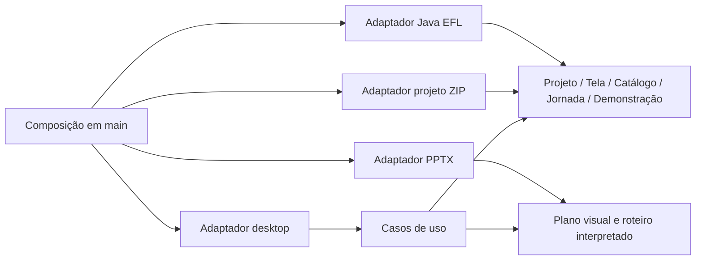

# Implementation Plan: Gerador de Jornada

**Branch**: `001-gerador-jornada` (identificador, sem branch Git criada) | **Date**: 2026-10-17 | **Spec**: [spec.md](spec.md)
**Input**: Especificação funcional aprovada e análise estática do material legado.

## Summary

Construir um editor desktop offline em Go/Fyne para Windows. Um projeto compartilhado descreve componentes EFL, telas, navegação e roteiro; adaptadores independentes exportam PPTX editável com links/animações e fontes Java 1.6/Swing com EFL.

A implementação está em andamento em apps/gerador-jornada, com documentação do código em português e testes automatizados. Homologações externas e aprovação manual permanecem pendentes. A execução futura está em [tasks.md](tasks.md), incluindo as oito sprints. A análise e as decisões arquiteturais estão em [research.md](research.md).

Atualização de 2026-10-18: [DESIGN.md](DESIGN.md) define a separação entre tema do editor e aparência da tela desenhada. As features 007 a 030 detalham cada componente/ferramenta, com DESIGN.md individual; seu inventário e origem estão em research.md. São recortes de requisitos dos domínios existentes e adaptadores, sem novos módulos Go ou domínios artificiais.

Recursos originais ficam em `internal/adapter/builtinassets`, incorporados com Go embed e copiados para os recursos do documento. Conjuntos informativos usam componentes comuns montados em `internal/application/presets.go`, sem novos discriminadores no manifesto. Imagem de fundo já configurada em arquivo existente não é trocada automaticamente.

## Technical Context

**Language/Version**: Go 1.27.2 Windows amd64, fixado nas ferramentas locais e em go.mod; os builds seguintes reutilizam as versões registradas em .tools/versions.json. Alvo gerado: Java SE 6, classfile 50.0.
**Primary Dependencies**: Fyne v2.8.2 e MinGW GCC 16.2.0 UCRT, com versões e hashes fixados; biblioteca padrão Go para JSON, ZIP, XML, templates e hashing. Sem Node, WebView, automação Office, framework DI ou biblioteca Java na execução do editor.
**Storage**: `.jornada`, ZIP com manifesto JSON versão 1 e recursos incorporados; autosave local separado do arquivo explícito.
**Testing**: testes Go unitários, contrato e integração; testes de widgets Fyne, fixtures determinísticas e homologação manual em Windows/PowerPoint/Java-EFL reais.
**Java Validation Tooling**: JDK 17 do usuário executa ECJ 3.33.0 com source/target 1.6; verificação estática com Animal Sniffer 1.24 e assinatura java16:1.1, além de classfile major 50. Scripts externos em `scripts/java6.py` e `scripts/java6/CheckJava6.java`; hashes em `scripts/java6-tools.json`. Sem compilação no editor. Execução Java 6/EFL permanece gate externo.
**Target Platform**: Windows 10 22H2 e Windows 11 x64; validar DPI 100%, 150% e 200%, hardware gráfico/driver disponível e ambiente de referência de spec.md.
**Project Type**: aplicação desktop, monólito modular, um módulo Go.
**Performance Goals**: NFR-007; exportação em worker com cancelamento cooperativo e progresso.
**Constraints**: offline, janela própria, EXE sem runtimes externos, sete famílias EFL, PowerPoint editável; Java fonte compilado fora do editor.
**Scale/Scope**: uso individual; conjunto nominal de 10 telas com 50 componentes cada e roteiro de 50 etapas. Não é limite de negócio: arquivos maiores são admitidos dentro dos limites de leitura do contrato e têm desempenho a medir.

## Constitution Check

| Princípio | Aplicação no desenho | Estado documental |
| --- | --- | --- |
| I. Domínio | Pacotes por domínio; UI e serialização ficam nos adaptadores | Conforme |
| II. Contratos | Modelo tipado, IDs estáveis, snapshot por exportação e diagnósticos | Conforme |
| III. Offline | Recursos embutidos, sem Java/Office na geração | Conforme; execução ainda não homologada |
| IV. Documentação | GoDoc, comentários locais e Javadoc em português, inclusive nas ferramentas de validação | Implementado nos arquivos atuais; revisão contínua |
| V. Evidência | Contratos testados e homologações reais distintas | Conforme; dependência EFL externa explícita |
| VI. Simplicidade | Um módulo, construtores, arquivo local, sem infraestrutura distribuída | Conforme |

Reavaliação pós-design: sem exceção arquitetural. Compatibilidade EFL permanece uma condição de conclusão da implementação, não uma decisão de tecnologia a adivinhar. A Sprint 7 não pode ser encerrada somente com dublês.

## Project Structure

### Documentation (this feature)

```text
specs/001-gerador-jornada/
├── spec.md
├── plan.md
├── research.md
├── data-model.md
├── quickstart.md
├── contracts/
│   ├── project-format.md
│   ├── component-catalog.md
│   ├── navigation-scenario.md
│   ├── export-service.md
│   ├── pptx-export.md
│   └── java-efl-export.md
├── checklists/
│   └── requirements.md
└── tasks.md
```

Constituição em `.specify/memory/constitution.md`; feature coordenadora registrada em `.specify/feature.json`. Análise do legado e decisões ficam em research.md; sprints em tasks.md. Não criar documentação avulsa de arquitetura/ADRs ou sprints nesta feature.

### Documentation by domain

Cada domínio é uma feature Spec Kit do mesmo produto, com `spec.md`, `plan.md`, `data-model.md` e `tasks.md` próprios:

- [Projeto](../002-projeto/spec.md): identidade, revisão e recursos.
- [Catálogo](../003-catalogo/spec.md): famílias e propriedades tipadas.
- [Tela](../004-tela/spec.md): composição e geometria.
- [Jornada](../005-jornada/spec.md): inicial e navegação.
- [Demonstração](../006-demonstracao/spec.md): etapas, tempo e ocorrências.

Esta feature coordena os contratos compartilhados, aplicação, adaptadores e homologação. As tarefas de domínio não são cópias das tarefas de integração. Os nomes de pastas não significam microserviços nem módulos Go distintos.

### Source Code (apps/gerador-jornada — raiz da aplicação)

```text
cmd/gerador-jornada/main.go
internal/
├── project/       # identidade, recursos e revisão do documento
├── catalog/       # definição tipada das sete famílias
├── screen/        # componentes, geometria e estilo
├── journey/       # ações e grafo de navegação
├── scenario/      # etapas e interpretação do roteiro
├── application/   # casos de uso, sessão, histórico e exportação
├── presentation/  # primitivas e conversões visuais sem Fyne/Open XML
└── adapter/
    ├── desktop/   # shell, canvas, paleta, inspector, timeline, prévia
    ├── projectzip/# DTOs JSON, limites, ZIP, gravação e recuperação
    ├── pptx/      # pacote Open XML, formas, links, animações
    └── javaefl/   # perfil, normalização, templates e relatório
assets/            # recursos do editor e catálogo, embutidos no build
templates/java/    # templates revisados e embutidos
tests/
├── integration/
├── contract/
└── testdata/       # projetos e saídas de referência
scripts/           # build e verificações em PowerShell
```

**Structure Decision**: termos em inglês nos pacotes; interface e documentação em português. Arquivos curtos por responsabilidade dentro de cada módulo, sem diretórios genéricos `utils`/`common`. A aplicação agora reside em apps/gerador-jornada, conforme solicitação do usuário; specs e .specify permanecem na raiz do workspace.

O caminho público do módulo Go será o endereço real do repositório quando houver hospedagem definida; não inventar organização GitHub. Na Sprint 1, até existir esse endereço, usar `gerador-jornada.local/editor` como identificador local, em um único `go.mod`.

## Design and Data Flow

### Dependências



Setas indicam dependência de código. Os casos de uso recebem persistência/exportadores por interfaces pequenas definidas em `application`; adaptadores não são importados por esse pacote. `main` monta as implementações.

`catalog` não importa os adaptadores. `screen` usa definições de catálogo. `journey` e `scenario` mantêm IDs e regras próprias; referências cruzadas são resolvidas por um validador de projeto na aplicação. Isso evita ciclos de importação entre domínios.

O tipo `project.Project` mantém metadados e recursos. `application.Document` compõe esse valor com telas, jornada, roteiros e opções de saída: é o agregado de persistência/snapshot, sem concentrar operações de todos os domínios. O DTO JSON continua com os campos de raiz do contrato. Assim Projeto não precisa importar os outros quatro domínios.

### Edição, prévia e histórico

1. UI transforma coordenadas de ponteiro em unidades lógicas, considerando zoom, scroll e DPI.
2. Durante arraste, a UI mostra geometria provisória. Ao soltar, envia um comando atômico; Escape cancela sem gravar.
3. Caso de uso valida e aplica o comando, incrementa revisão e registra inversa no histórico de até 100 entradas.
4. Autosave observa revisões confirmadas, com debounce de 2 s. Seu trabalho não usa widgets.
5. Prévia cria estado de execução separado. Ao entrar numa tela, restaura seus valores iniciais; fechar a prévia não altera o projeto.
6. Reprodução de roteiro usa o mesmo interpretador para gerar estados e eventos temporizados da prévia e do exportador PPT.

Salvar não limpa histórico. Nova edição após desfazer remove a pilha de refazer. Histórico, foco, seleção e zoom não são persistidos no projeto.

### Representação visual

Usar coordenadas inteiras em unidades lógicas com equivalência a pixels a 96 DPI. Java recebe bounds inteiros; PPT usa a conversão exata para EMU definida no contrato. Texto usa tamanho em unidades lógicas convertido para pontos; Fyne não deve aplicar mínimos intrínsecos que alterem o desenho silenciosamente.

`presentation` expande componentes em primitivas (retângulo, borda, texto, imagem e grupo) sem tipos Fyne/XML. Desktop e PPT consomem esse plano. Java usa dimensões e propriedades semânticas do domínio com mapeamento EFL homologado. Diferenças de métricas e skins são verificadas em homologação, sem exigir identidade de rasterização.

### Exportação e falhas

Ao iniciar, capturar snapshot imutável com revisão e recursos. Aplicar validação geral e do alvo. Exportar em área temporária, verificar integridade e só então publicar o pacote completo; nunca mesclar por cima de projeto Java manualmente editado.

Cada job aceita `context.Context`, publica progresso agregado e retorna diagnósticos estruturados. Permitir uma exportação por vez nesta versão; edição pode continuar, mas a saída representa a revisão capturada. Atualizações visuais de worker devem passar pelo mecanismo de UI thread do Fyne.

Falha ou cancelamento preserva destino anterior. Diagnósticos não devem incluir caminhos internos desnecessários nem conteúdo integral dos campos. Telemetria e servidor de rede não são necessários.

## Implementation Strategy

1. **Sprint 1:** comprovar drag/drop, edição visual PPT, cursor/digitação Open XML e levantar a API EFL real. Registrar ferramentas e evidências, sem transformar protótipos em um objeto central.
2. **Sprints 2–4:** construir projeto, catálogo, editor, navegação e roteiro, em incrementos verificáveis.
3. **Sprints 5–6:** implementar exportação PPT exploratória e demonstrativa.
4. **Sprint 7:** implementar e homologar fontes Java 1.6/EFL com a biblioteca do sistema hospedeiro.
5. **Sprint 8:** distribuir e homologar as duas saídas offline.

Manter catálogo e perfis de exportação internos/versionados, sem carregar código externo de projeto. Nenhuma implementação deve depender de copiar a estrutura React legada.

## Validation and Delivery

- Checks Go: formatação, `go vet`, testes de domínio/contrato/integração e verificação de dependências entre pacotes; verificar documentação exportada automaticamente e internos/locais em revisão.
- PPT: integridade OPC/XML, IDs/relacionamentos, geometria e execução no PowerPoint 2016/Microsoft 365. Sem macros e sem depender de vídeo para os controles.
- Java: referência determinística, compilação com API Java SE 6 e bibliotecas EFL reais; classfile 50.0, execução e navegação na EDT. Compilador moderno sem suporte a target 6 não serve como comprovação.
- Distribuição: build Windows nativo com dependências fixadas, recursos embutidos e manifesto DPI; testar máquina limpa e registrar dependências efetivas. Licenças e inventário acompanham o pacote de release, fora do EXE se necessário.
- Desempenho: medir metas de spec.md e cancelamento com conjunto nominal. Somente ampliar medição quando houver falha ou mudança relevante.

As evidências futuras devem registrar versão do editor, toolchain, bibliotecas, SO, DPI, versão do PowerPoint e perfil EFL. O roteiro detalhado é [quickstart.md](quickstart.md).

## Complexity Tracking

Nenhuma violação da constituição exige exceção. O exportador Open XML próprio aumenta o esforço, mas evita runtimes externos e oferece controle das animações; seu risco é tratado na primeira sprint. O perfil Java/EFL isola a tecnologia antiga do editor.
