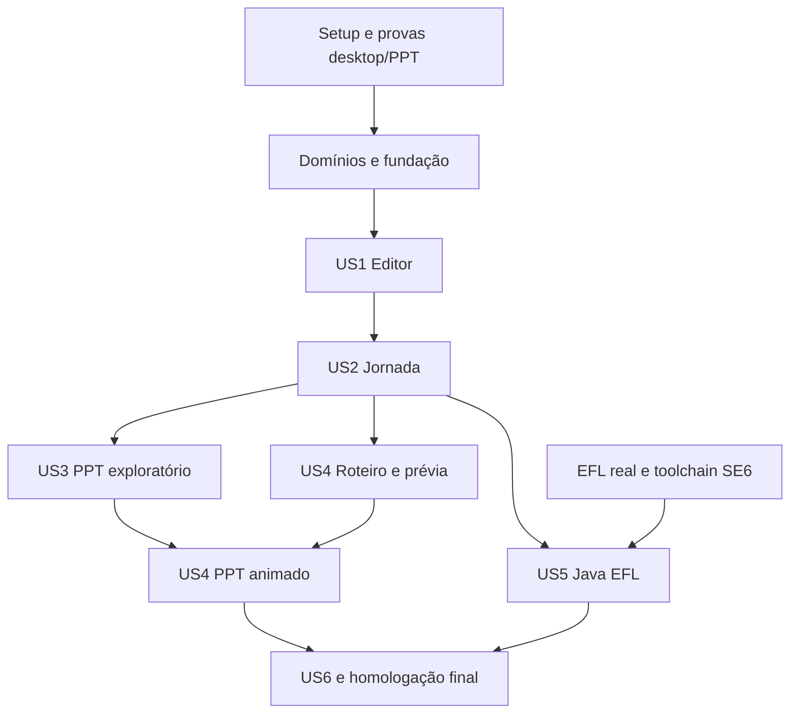

# Tasks: Gerador de Jornada

**Input**: [spec.md](spec.md), [plan.md](plan.md), [research.md](research.md), [data-model.md](data-model.md) e contracts/.
**Prerequisites**: constituição 1.1.1 e contratos revisados.
**Status**: implementação em andamento. Tarefas sem evidência integral permanecem abertas; a correção da toolchain Java 6 está registrada em T077 e quickstart.md. Homologação EFL e aprovação manual continuam pendentes.
**Tests**: incluídos porque os testes de contrato, integração e homologação fazem parte do plano aprovado.

## Format: `[ID] [P?] [Story] Description`

Txxx é local a esta feature; referenciar tarefas de domínio pelo caminho da feature + ID. [P] identifica trabalho sem conflito de arquivos após os pré-requisitos. US referencia as histórias de spec.md. Caminhos de código são relativos a apps/gerador-jornada; caminhos specs/ são relativos à raiz do workspace.

## Domain ownership

| Domínio | Especificação | Backlog detalhado | Responsabilidade |
| --- | --- | --- | --- |
| Projeto | [spec](../002-projeto/spec.md) | [tasks](../002-projeto/tasks.md) | Documento, recursos, revisão e invariantes de identidade |
| Catálogo | [spec](../003-catalogo/spec.md) | [tasks](../003-catalogo/tasks.md) | Definições e propriedades tipadas das sete famílias |
| Tela | [spec](../004-tela/spec.md) | [tasks](../004-tela/tasks.md) | Composição, geometria, camadas e duplicação |
| Jornada | [spec](../005-jornada/spec.md) | [tasks](../005-jornada/tasks.md) | Inicial e ações de navegação |
| Demonstração | [spec](../006-demonstracao/spec.md) | [tasks](../006-demonstracao/tasks.md) | Etapas, interpretação, tempo e ocorrências |

As tarefas de domínio implementam suas regras; as tarefas desta feature verificam sua conclusão e implementam integração/adaptadores. Não executar duas vezes a mesma alteração. Persistência e exportadores são adaptadores, não novos domínios de negócio.

## Phase 1: Setup — provas e preparação (Sprint 1)

**Goal**: reduzir riscos antes de desenvolver o produto.
**Independent Test**: provas registradas com ferramentas e resultados, sem declarar produto pronto.

- [ ] T001 Fixar versões Go/Fyne/C em `go.mod`, `go.sum` e `scripts/build.ps1`; usar módulo local temporário descrito no plano.
- [ ] T002 [P] Preparar checks de formatação, vet, importações e documentação em `scripts/check.ps1`; incluir revisão explícita de comentários privados/variáveis locais.
- [ ] T003 Provar drag/drop, limites visuais e DPI 100/150/200% em `tests/integration/desktop_spike_test.go`, registrando resultado em research.md.
- [ ] T004 Provar PPT com formas editáveis, links, cursor e digitação em `tests/integration/pptx_spike_test.go`; homologar PowerPoint 2016/Microsoft 365 e registrar em research.md.
- [ ] T005 Levantar JARs, dependências e exemplo do hospedeiro EFL em `internal/adapter/javaefl/profile.go`; registrar inventário verificável em research.md, sem assinaturas inventadas.
- [ ] T006 Confirmar assinaturas das sete famílias e build SE 6 em `tests/integration/javaefl_profile_test.go`; registrar perfil e gate G-03/G-04 em research.md.

**Checkpoint**: G-01/G-02 resolvidos para iniciar adaptação definitiva. T005/T006 dependem dos mantenedores EFL; sua ausência não impede os domínios/editor/PPT, mas impede concluir a entrega Java.

## Phase 2: Foundational — integração dos domínios (Sprint 2)

- [ ] T007 Verificar conclusão de Projeto e Catálogo pelos respectivos tasks.md e integrar seus contratos em `internal/application/project.go`; sem duplicar entidades de `internal/project`/`internal/catalog`.
- [ ] T008 Verificar conclusão dos modelos Tela/Jornada/Demonstração e compor validação entre IDs em `internal/application/validation.go`, sem ciclos de importação.
- [ ] T009 Definir sessão, interfaces consumidoras de persistência/exportação e revisão de snapshot em `internal/application/session.go` e `internal/application/export.go`.
- [ ] T010 Criar fixtures das sete famílias e teste de round-trip/erros em `tests/contract/project_format_test.go`, conforme project-format.md.
- [ ] T011 Implementar DTOs, leitura com limites e gravação atômica em `internal/adapter/projectzip/reader.go` e `internal/adapter/projectzip/writer.go`.
- [ ] T012 Implementar autosave com debounce de 2 s e recuperação em `internal/adapter/projectzip/recovery.go`, preservando revisões não salvas.
- [ ] T013 Validar falhas de escrita, ZIP, hashes, versão e recuperação em `tests/integration/project_storage_test.go`.

**Checkpoint**: é possível criar projeto de teste, salvar/reabrir e recuperar sem UI completa. Todas as interfaces têm consumidor e finalidade.

## Phase 3: User Story 1 — editor visual (Priority: P1; Sprint 3)

**Goal**: desenhar e preservar uma tela com as sete famílias.
**Independent Test**: V-01 e V-02 em quickstart.md.

- [ ] T014 [US1] Implementar expansão visual sem Fyne/XML em `internal/presentation/scene.go`, consumindo o catálogo e bounds dos domínios.
- [ ] T015 [US1] Montar shell e lista de telas em `internal/adapter/desktop/shell.go`; conectar criar/renomear/reordenar/duplicar/remover telas e comandos de arquivo aos casos de uso.
- [ ] T016 [US1] Implementar paleta das sete famílias em `internal/adapter/desktop/palette.go`, sem instanciar regras por reflexão.
- [ ] T017 [US1] Implementar canvas, conversão zoom/DPI, seleção e drag/drop em `internal/adapter/desktop/canvas.go`.
- [ ] T018 [US1] Implementar inspector tipado e mensagens por propriedade em `internal/adapter/desktop/inspector.go`.
- [ ] T019 [US1] Conectar mover, redimensionar, alinhar, duplicar e camadas às regras de Tela em `internal/application/edit_screen.go`.
- [ ] T020 [US1] Implementar histórico de 100 entradas e operação única por arraste em `internal/application/history.go`; nova edição após undo remove redo.
- [ ] T021 [US1] Implementar zoom 25..400%, atalhos e cancelamento de arraste em `internal/adapter/desktop/shortcuts.go`, respeitando foco de texto.
- [ ] T022 [US1] Conectar salvar/abrir/recuperar com diagnóstico e sessão limpa/alterada em `internal/adapter/desktop/files.go`.
- [ ] T023 [US1] Validar operações e histórico em `internal/application/history_test.go`, incluindo undo de remoção referenciada.
- [ ] T024 [US1] Validar widgets, posições de drop e foco em `internal/adapter/desktop/canvas_test.go`.
- [ ] T025 [US1] Executar V-01/V-02 e registrar evidências em quickstart.md, sem marcar domínio concluído com teste apenas de widget.

## Phase 4: User Story 2 — jornada navegável (Priority: P1; Sprint 4)

**Goal**: experimentar fluxo de três telas sem exportação.
**Independent Test**: V-03.

- [ ] T026 [US2] Integrar ações none/navigate e tela inicial de Jornada em `internal/application/edit_journey.go`.
- [ ] T027 [US2] Implementar painel de destinos e impacto de remoção em `internal/adapter/desktop/navigation.go`.
- [ ] T028 [US2] Implementar sessão de prévia isolada em `internal/application/preview.go`, restaurando valores iniciais a cada entrada de tela.
- [ ] T029 [US2] Renderizar prévia interativa com campo, seleção e teclado vinculado em `internal/adapter/desktop/preview.go`.
- [ ] T030 [US2] Implementar navegação/localização de diagnósticos na UI em `internal/adapter/desktop/diagnostics.go`.
- [ ] T031 [US2] Testar ciclos, remoções, estado isolado e reset em `internal/application/preview_test.go`.
- [ ] T032 [US2] Executar V-03 e registrar evidências em quickstart.md.

## Phase 5: User Story 3 — PPT navegável (Priority: P1; Sprint 5)

**Goal**: compartilhar exploração editável sem depender de roteiro.
**Independent Test**: V-05 sem demonstração.

- [ ] T033 [US3] Preparar fixtures e testes OPC/links/formas em `tests/contract/pptx_export_test.go`.
- [ ] T034 [US3] Implementar partes OPC, tema, master e layout em `internal/adapter/pptx/package.go`.
- [ ] T035 [US3] Mapear primitivas a formas/grupos/textos em `internal/adapter/pptx/shapes.go`, usando 9525 EMU por unidade lógica.
- [ ] T036 [US3] Implementar slides de menu/exploração e mapa de destinos em `internal/adapter/pptx/navigation.go`.
- [ ] T037 [US3] Incluir recursos decorativos e diagnósticos de layout em `internal/adapter/pptx/resources.go`, sem rasterizar controles.
- [ ] T038 [US3] Implementar staging, progresso e publicação do job PPT em `internal/application/export_pptx.go`.
- [ ] T039 [US3] Implementar opções de percurso e aviso sobre entrada simulada em `internal/adapter/desktop/export_pptx.go`.
- [ ] T040 [US3] Testar determinismo, cancelamento e falha antes de publicar em `tests/integration/pptx_export_test.go`.
- [ ] T041 [US3] Homologar navegação, edição e geometria nas duas versões do PowerPoint e registrar V-05 em quickstart.md.
- [ ] T042 [US3] Corrigir divergências da homologação em `internal/adapter/pptx/shapes.go`/`navigation.go` e repetir somente cenários afetados.

## Phase 6: User Story 4 — demonstração guiada (Priority: P2; Sprints 4 e 6)

**Goal**: roteiro explícito reproduzível na prévia e no PPT.
**Independent Test**: V-04 e V-06.

- [ ] T043 [US4] Integrar modelo/interpretador de Demonstração em `internal/application/edit_scenario.go`, respeitando clique visual e navigate separado.
- [ ] T044 [US4] Implementar CRUD/reordenação de roteiros e etapas em `internal/adapter/desktop/timeline.go`.
- [ ] T045 [US4] Conectar reprodução, pausa, continuação e restart em `internal/adapter/desktop/scenario_preview.go`, com relógio controlado.
- [ ] T046 [US4] Implementar validação incremental e localização de etapa em `internal/application/validate_scenario.go`.
- [ ] T047 [US4] Testar reset, Unicode, tempo e revisitas em `tests/integration/scenario_preview_test.go`.
- [ ] T048 [US4] Executar V-04 e registrar evidência em quickstart.md; este checkpoint encerra a parte da Sprint 4.
- [ ] T049 [US4] Implementar ocorrências temporizadas e árvore timing em `internal/adapter/pptx/timing.go`.
- [ ] T050 [US4] Implementar trajetória de cursor e realce de clique em `internal/adapter/pptx/cursor.go`.
- [ ] T051 [US4] Implementar prefixos de digitação editáveis por cluster Unicode em `internal/adapter/pptx/typing.go`.
- [ ] T052 [US4] Integrar blocos de demonstração, replay e separação da exploração em `internal/adapter/pptx/scenario.go`.
- [ ] T053 [US4] Testar estados/tempos, revisitas e integridade de alvos em `tests/contract/pptx_timing_test.go`.
- [ ] T054 [US4] Homologar V-06 nas duas versões-alvo e registrar tolerância SC-004 em quickstart.md.

## Phase 7: User Story 5 — fontes Java/EFL (Priority: P2; Sprint 7)

**Goal**: entregar projeto-fonte integrado e comprovado no ambiente real.
**Independent Test**: V-07; depende de T005/T006 concluídas.

- [ ] T055 [US5] Consolidar perfil EFL homologado e capacidades por propriedade em `internal/adapter/javaefl/profile.go`.
- [ ] T056 [US5] Criar testes de identificadores, colisões e escape em `internal/adapter/javaefl/names_test.go`.
- [ ] T057 [US5] Implementar nomes e escape de literais/Javadoc em `internal/adapter/javaefl/names.go` e `escaping.go`.
- [ ] T058 [US5] Implementar templates das sete famílias em `templates/java/component/`, com documentação e APIs homologadas.
- [ ] T059 [US5] Implementar painéis/fábricas por tela em `templates/java/screen/`, sem classe central de todas as telas.
- [ ] T060 [US5] Implementar navegação e integração na EDT em `templates/java/navigation/` e `templates/java/integration/`.
- [ ] T061 [US5] Implementar projeto fonte, resources, sources.list e instruções em `internal/adapter/javaefl/export.go`, sem publicar em diretório existente.
- [ ] T062 [US5] Conectar diálogo e job Java em `internal/adapter/desktop/export_java.go` e `internal/application/export_java.go`.
- [ ] T063 [US5] Compilar fixtures com Java SE 6/EFL real, verificar classfile 50.0 e executar navegação em `tests/integration/javaefl_compile_test.go`.
- [ ] T064 [US5] Homologar sete famílias, estilos suportados e integração V-07; registrar versões/evidências em quickstart.md.

## Phase 8: User Story 6 — distribuição Windows (Priority: P1; Sprint 8)

**Goal**: instalar nada e trabalhar offline.
**Independent Test**: V-08.

- [ ] T065 [US6] Montar composição final por construtores em `cmd/gerador-jornada/main.go`, mantendo o entrypoint sem regras de negócio.
- [ ] T066 [US6] Empacotar recursos/templates e manifesto DPI em `scripts/build.ps1`.
- [ ] T067 [US6] Montar ZIP de release com EXE, licenças e inventário em `scripts/package.ps1`.
- [ ] T068 [US6] Validar UI thread, um job ativo, progresso e cancelamento em `tests/integration/export_job_test.go`.
- [ ] T069 [US6] Executar V-08 em Windows 10/11 x64 limpos e offline, registrando dependências efetivas em quickstart.md.
- [ ] T070 [US6] Validar paths com acentos/espaços e falhas de permissão em `tests/integration/windows_paths_test.go`.

## Phase 9: Polish & Cross-Cutting Concerns (Sprint 8)

- [ ] T071 Medir tempos nominais NFR-007 em `tests/integration/performance_test.go`, registrando ambiente e mediana em quickstart.md.
- [ ] T072 Executar integração completa V-09 e registrar evidências em quickstart.md.
- [ ] T073 Revisar GoDoc de pacotes/tipos/métodos/campos e comentários de todas as variáveis em `internal/` e `cmd/`, além de Javadoc em `templates/java/`.
- [ ] T074 Executar checks de importação, vet, contratos e regressões com `scripts/check.ps1`; corrigir falhas pertinentes.
- [ ] T075 Atualizar exemplos e inventário de distribuição em quickstart.md e research.md, distinguindo testes reais de dublês.
- [ ] T076 Revisar rastreabilidade e fechar somente tarefas com evidência em tasks.md e checklists/requirements.md.

## Dependencies & Execution Order

Catálogo precede Tela; Projeto agrega dados via aplicação; Jornada/Demonstração usam IDs, sem importar adaptadores. Domínios podem ter seus modelos preparados antes da UI. T005/T006 são gates apenas da geração Java.

US3 pode ser desenvolvida com fixture de jornada e sem US4. US5 não depende de PPT. O teste independente de cada história usa fixtures prontas para dispensar repetir criação manual das histórias anteriores.

## Sprint Planning

Sprints de duas semanas como referência, sem data de início nem promessa de prazo sem capacidade de equipe definida.

| Sprint | Tarefas desta feature / domínio | Entrega verificável |
| --- | --- | --- |
| 1 | T001–T006 | Provas desktop/PPT e levantamento EFL; registrar bloqueios externos sem inventar conclusão |
| 2 | T007–T013 + modelos dos cinco domínios | Contratos integrados, round-trip e recuperação |
| 3 | T014–T025 + conclusão de Tela/Catálogo | Editor utilizável, histórico e arquivos |
| 4 | T026–T032 e T043–T048 + Jornada/Demonstração | Prévia navegável e roteiro explícito |
| 5 | T033–T042 | PPT exploratório editável homologado |
| 6 | T049–T054 | PPT demonstrativo homologado |
| 7 | T055–T064 | Fontes Java/EFL homologadas |
| 8 | T065–T076 | Release offline e validação ponta a ponta |

A ordem no arquivo segue histórias, conforme Spec Kit; a execução temporal de US4 está explicitada na tabela. Sprint concluída exige entrega e evidência; tarefa externa ausente permanece aberta, mesmo se outro incremento avançar.

## Parallel Opportunities

Após fundação, plano visual e paleta podem ser feitos em arquivos distintos; PPT e Java podem avançar de forma independente após jornada válida. Dentro de US4, cursor e digitação podem ser implementados separadamente depois de timing estável. Essas possibilidades não autorizam delegação automática nem eliminam dependências.

## Implementation Strategy

MVP interno: US1 mais distribuição de desenvolvimento para validar desenho/salvamento. Primeiro incremento compartilhável: US1/US2/US3 e empacotamento mínimo validado. A release completa exige as seis histórias e os gates reais, incluindo Java/EFL.

Em cada tarefa: implementar responsabilidade coesa, documentar todos os elementos conforme constituição, executar testes pertinentes e atualizar sua evidência. Não marcar todas as tarefas da sprint somente por ter criado arquivos.

## Matriz de rastreabilidade

| Requisitos | História / tarefas | Validação |
| --- | --- | --- |
| FR-001, FR-009, FR-010; NFR-005 | US1; T007, T009–T013, T022, T025 | V-01, V-02 |
| FR-002 a FR-008; NFR-002 | US1; T007–T008, T014–T024; domínios Catálogo/Tela | V-01 |
| FR-011 a FR-013 | US2; T026–T032; Jornada | V-03 |
| FR-014 a FR-016 | US3; T033–T042 | V-05 |
| FR-017 a FR-019 | US4; T043–T048; Demonstração | V-04 |
| FR-020, FR-021 | US4; T049–T054 | V-06 |
| FR-022 a FR-025 | US5; T005–T006, T055–T064 | V-07 |
| FR-026 a FR-028 | US3/US5/US6; T038–T040, T062, T068, T070 | V-05, V-07, V-08 |
| NFR-001, NFR-006 | US6; T065–T070 | V-08 |
| NFR-003 | Todas; T002, T073 | V-09 |
| NFR-004 | T010, T033, T040, T056, T061 | V-02, V-05, V-07 |
| NFR-007 | T068, T071 | V-08, V-09 |
| NFR-008 | T004–T006, T041, T054, T063–T064 | V-05, V-06, V-07 |
| SC-001 a SC-007 | T025, T032, T041, T054, T064, T069, T071–T072 | V-01 a V-09 |

## Phase 10: Correção da toolchain Java (US5)

- [X] T077 [US5] Validar o alvo Java 1.6 usando o JDK 17 informado, conforme FR-022/FR-025 e contrato java-efl-export.md: implementar ECJ com versões/hashes fixados em `scripts/java6.py` e `scripts/java6-tools.json`, conferir bytecode major 50 e APIs SE 6 com `scripts/java6/CheckJava6.java`, exercitar incompatibilidades em `scripts/test_java6.py` e compilar os fontes do gerador em `internal/adapter/javaefl/toolchain_test.go`; atualizar instruções e registrar a evidência em quickstart.md.

T077 conclui a verificação estática e não conclui T005/T006, T063/T064 ou a história US5: continuam necessárias as bibliotecas reais, o bootstrap e a execução Java 6/EFL. O perfil estrutural de teste não é uma saída EFL publicável.

## Phase 11: Fundo e especificações individuais dos componentes

- [X] T078 [US1] Incorporar a imagem original ao EXE e aos novos projetos, oferecer seleção/troca de fundo, preservar arraste e histórico sobre a imagem, incluir fundo na prévia/demonstração e testar sua persistência e incorporação no PPT; separar a paleta da lista de telas e disponibilizar estrutura e conjuntos informativos do legado. Evidência: `internal/adapter/builtinassets/background_test.go`, `internal/adapter/desktop/background_test.go` e captura registrada em quickstart.md. Homologação humana continua pendente.
- [X] T079 [US1] Criar spec.md, DESIGN.md e checklist documental para cada uma das 24 responsabilidades individuais, relacionar o catálogo existente e os domínios, registrar origem legada, tokens, estados, critérios de aceitação e lacunas; conferir seções/IDs/links locais e preservar a seleção da feature 001. Inventário em research.md.

As features 007 a 030 permanecem Draft. T079 conclui sua documentação solicitada, não toda a implementação das capacidades que elas descrevem. O teclado de 14 teclas, o mapeamento integral dos estilos e a visualização de fontes com perfil EFL real precisam de planejamento e validação próprios; não são aprovados por estas caixas.
