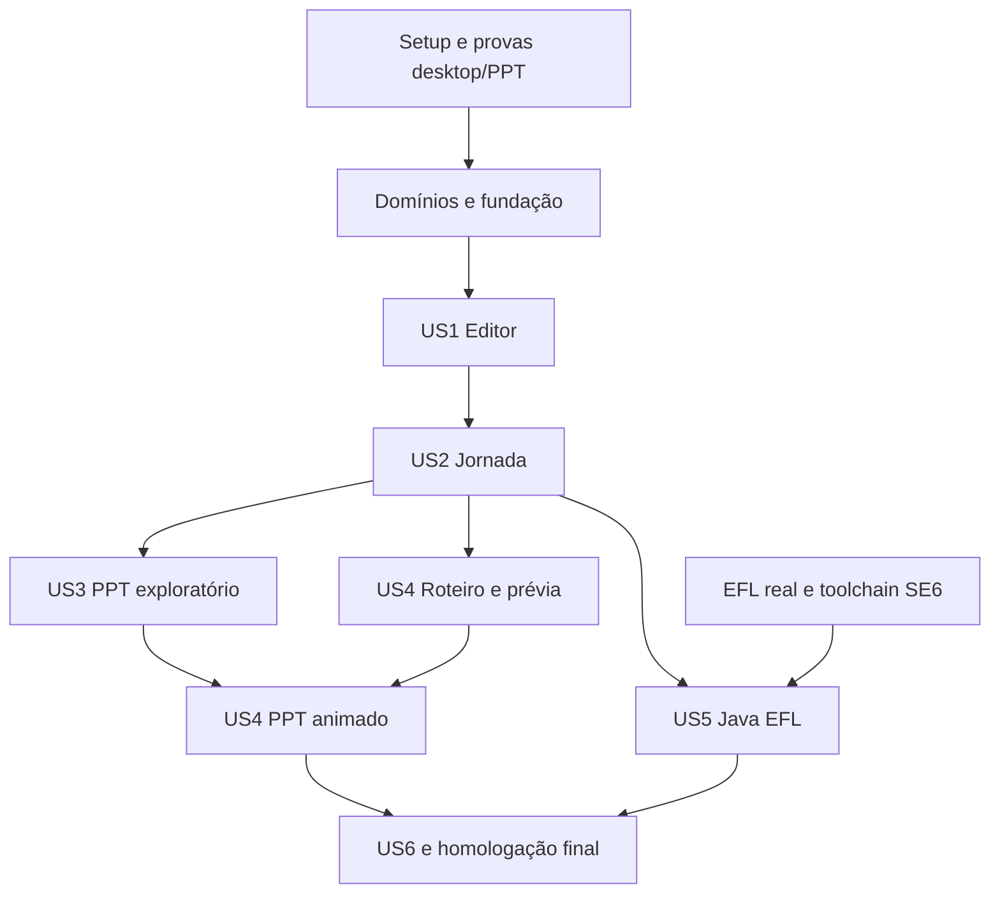

# Tasks: Gerador de Jornada

**Reconciliação documental — 2026-10-24 / 1.0.0.1:** a spec identifica código existente e lacunas atuais. Evidências datadas anteriores são históricas; uma referência a arquivo ausente não comprova capacidade atual. Tarefas reabertas conservam a descrição anterior e o motivo. Testes de um recorte não concluem tarefas de expansão ou homologação. Checklists de qualidade e aceite humano não foram marcados por esta revisão documental.

**Input**: [spec.md](spec.md), [plan.md](plan.md), [research.md](research.md), [data-model.md](data-model.md) e contracts/.
**Prerequisites**: constituição 1.2.0 e contratos revisados.
**Status**: implementação em andamento; backlog reconciliado em 2026-10-18. Caixas abertas podem ter implementação/cobertura parcial já existente, conforme notas individuais. Tarefas sem evidência integral permanecem abertas; a correção da toolchain Java 6 está registrada em T077 e quickstart.md. Homologação EFL e aprovação manual continuam pendentes.
**Tests**: incluídos porque os testes de contrato, integração e homologação fazem parte do plano aprovado.

**Instrução vigente — 2026-10-21:** [T132](#t132-builtin-filtrado) verifica a redução do builtin de [FR-058](spec.md#builtin-filtrado-fr-058), ainda aberta. Registros de 214 definições/47 diagnósticos e PASS anteriores são históricos **antes da redução**; não reabrir/fechar caixas antigas nem tratá-los como checks da nova revisão. Estado e roteiro atuais na [seção 14 do quickstart](quickstart.md#14-builtin-filtrado).

## Format: `[ID] [P?] [Story] Description`

Txxx é local a esta feature; referenciar tarefas de domínio pelo caminho da feature + ID. [P] identifica trabalho sem conflito de arquivos após os pré-requisitos. US referencia as histórias de spec.md. Caminhos de código são relativos a apps/gerador-jornada; caminhos specs/ são relativos à raiz do workspace.

## Domain ownership

| Domínio | Especificação | Backlog detalhado | Responsabilidade |
| --- | --- | --- | --- |
| Projeto | [spec](../002-projeto/spec.md) | [tasks](../002-projeto/tasks.md) | Documento, recursos, revisão e invariantes de identidade |
| Catálogo | [spec](../003-catalogo/spec.md) | [tasks](../003-catalogo/tasks.md) | Definições e propriedades tipadas das sete famílias |
| Tela | [spec](../004-tela/spec.md) | [tasks](../004-tela/tasks.md) | Composição, geometria, camadas e duplicação |
| Jornada | [spec](../005-jornada/spec.md) | [tasks](../005-jornada/tasks.md) | Inicial e ações de navegação |
| Demonstração | [spec](../006-demonstracao/spec.md) | [tasks](../006-demonstracao/tasks.md) | Etapas, interpretação, tempo e ocorrências |

As tarefas de domínio implementam suas regras; as tarefas desta feature verificam sua conclusão e implementam integração/adaptadores. Não executar duas vezes a mesma alteração. Persistência e exportadores são adaptadores, não novos domínios de negócio.

## Phase 1: Setup — provas e preparação (Sprint 1)

**Goal**: reduzir riscos antes de desenvolver o produto.
**Independent Test**: provas registradas com ferramentas e resultados, sem declarar produto pronto.

- [X] T001 Fixar versões Go/Fyne/C em `go.mod`, `go.sum` e `scripts/build.ps1`; usar módulo local temporário descrito no plano. **Evidência técnica (2026-10-18)**: Versões confirmadas em go.mod/go.sum, scripts/toolchains-windows.json e build.ps1.
- [ ] T002 [P] Preparar checks de formatação, vet, importações e documentação em `scripts/check.ps1`; incluir revisão explícita de comentários privados/variáveis locais. **Estado parcial/pendência**: check.ps1 já executa formatação/vet/testes; falta auditoria integral de comentários/importações conforme NFR-003-catalogo/T073.
- [ ] T003 Provar drag/drop, limites visuais e DPI 100/150/200% em `internal/adapter/desktop/background_test.go`, registrando resultado em research.md. **Estado parcial/pendência**: testes de arraste/limites são headless; falta DPI 100/150/200% e prova nativa G-01.
- [ ] T004 Provar PPT com formas editáveis, links, cursor e digitação em `internal/adapter/pptx/export_test.go`; homologar PowerPoint 2016/Microsoft 365 e registrar em research.md. **Estado parcial/pendência**: XML/formas/animações testados; falta executar nas duas versões PowerPoint (G-02).
- [ ] T005 Levantar JARs, dependências e exemplo do hospedeiro EFL em `internal/adapter/javaefl/profile.go`; registrar inventário verificável em research.md, sem assinaturas inventadas. **Estado parcial/pendência**: CurrentProfile é não verificado; faltam JARs, dependências e bootstrap dos mantenedores.
- [ ] T006 Confirmar assinaturas das sete famílias e build SE 6 em `internal/adapter/javaefl/toolchain_test.go`; registrar perfil e gate G-03/G-04 em research.md. **Estado parcial/pendência**: T077 valida Java 6 estaticamente; faltam assinaturas EFL e execução real.

**Checkpoint**: G-01/G-02 resolvidos para iniciar adaptação definitiva. T005/T006 dependem dos mantenedores EFL; sua ausência não impede os domínios/editor/PPT, mas impede concluir a entrega Java.

## Phase 2: Foundational — integração dos domínios (Sprint 2)

- [ ] T007 Verificar conclusão de Projeto e Catálogo pelos respectivos tasks.md e integrar seus contratos em `internal/application/document.go`; sem duplicar entidades de `internal/project`/`internal/catalog`. **Estado parcial/pendência**: modelos já estão integrados e testados; conclusão integral de Projeto/Catálogo depende das lacunas em seus backlogs.
- [ ] T008 Verificar os modelos Tela/Jornada/Demonstração e completar validação de identidade entre domínios em `internal/application/document.go`, sem ciclos de importação. **Estado parcial/pendência**: telas/componentes e referências de navegação são validados; Scenario.Interpret recusa step ID vazio/duplicado dentro de um roteiro. Falta demonstrar UUID canônico e unicidade global incluindo todos os roteiros/etapas e colisões com outras entidades, conforme 002-projeto/FR-002 e 006-demonstracao/data-model.md. Testes atuais aprovados não fecham essa matriz.
- [ ] T009 Definir sessão, interfaces consumidoras de persistência/exportação e revisão de snapshot em `internal/application/session.go` e `internal/adapter/desktop/export.go`. **Estado parcial/pendência**: Session/snapshot existem; faltam ExportProject/Result/Artifact e fronteira consumidora na aplicação. Coordenação atual é desktop.startExport.
- [X] T010 Criar fixtures das sete famílias e teste de round-trip/erros em `internal/adapter/projectzip/package_test.go`, conforme project-format.md. **Evidência técnica (2026-10-18)**: TestRoundTripAllFamilies, TestRejectUnknownFieldAndTraversal e TestFileIDPersistenceAndMigration aprovados.
- [X] T011 Implementar DTOs, leitura com limites e gravação atômica em `internal/adapter/projectzip/package.go` e `internal/adapter/projectzip/wire.go`. **Evidência técnica (2026-10-18)**: Manifesto em wire.go, ZIP em package.go e publicação em atomicfile/write.go implementados; testes de pacote aprovados. Matriz adicional de falhas permanece em T013.
- [X] T012 Implementar autosave com debounce de 2 s e recuperação em `internal/adapter/desktop/files.go`, preservando revisões não salvas. **Evidência técnica (2026-10-18)**: scheduleAutosave/OfferRecovery em desktop/files.go usam cópia, debounce de 2 s e caminho nativo. Recuperação por interrupção real permanece em T013/T025.
- [ ] T013 Validar falhas de escrita, ZIP, hashes, versão e recuperação em `internal/adapter/projectzip/package_test.go`. **Estado parcial/pendência**: round-trip, campo desconhecido, traversal e migração testados; faltam todos os limites/hash, interrupção/recuperação, disco cheio e falhas de publicação.

**Checkpoint**: é possível criar projeto de teste, salvar/reabrir e recuperar sem UI completa. Todas as interfaces têm consumidor e finalidade.

## Phase 3: User Story 1 — editor visual (Priority: P1; Sprint 3)

**Goal**: desenhar e preservar uma tela com as sete famílias.
**Independent Test**: V-01 e V-02 em quickstart.md.

- [X] T014 [US1] Implementar expansão visual sem Fyne/XML em `internal/presentation/scene.go`, consumindo o catálogo e bounds dos domínios. **Evidência técnica (2026-10-18)**: presentation/scene.go puro é consumido pelo editor/PPT; testes estruturais de exportação aprovados.
- [X] T015 [US1] Montar shell e lista de telas em `internal/adapter/desktop/editor.go`; conectar criar/renomear/reordenar/duplicar/remover telas e comandos de arquivo aos casos de uso. **Evidência técnica (2026-10-18)**: Shell em editor.go, lista em tools.go e comandos em operations.go; TestEditorComposition e regressões desktop aprovados. Homologação nativa em T025.
- [X] T016 [US1] Implementar paleta das sete famílias em `internal/adapter/desktop/palette.go`, sem instanciar regras por reflexão. **Evidência técnica (2026-10-18)**: palette.go e sete Definitions implementados sem reflexão de instanciação; TestEditorComposition e round-trip aprovados.
- [X] T017 [US1] Implementar canvas, conversão zoom/DPI, seleção e drag/drop em `internal/adapter/desktop/board.go`. **Evidência técnica (2026-10-18)**: board.go, board_renderer.go e selection.go implementados; testes de arraste/seleção aprovados. DPI real permanece em T003.
- [ ] T018 [US1] Implementar inspector tipado e mensagens por propriedade em `internal/adapter/desktop/inspector.go`. **Estado parcial/pendência**: inspector tipado/Save/Discard testados; falta diagnóstico uniforme localizado por propriedade para toda a matriz.
- [X] T019 [US1] Conectar mover, redimensionar, alinhar, duplicar e camadas às regras de Tela em `internal/application/edit_screen.go`. **Evidência técnica (2026-10-18)**: Comandos em edit_screen.go/edit_selection.go/transform.go e arrangement.go usam Session.Change; regressões de geometria/seleção aprovadas. Conferir alinhamentos restantes em 004-tela/T004.
- [X] T020 [US1] Implementar histórico de 100 entradas e operação única por arraste em `internal/application/session.go`; nova edição após undo remove redo. **Evidência técnica (2026-10-18)**: Session limita histórico a 100, Change limpa redo e Board.DragEnd confirma uma operação. TestHistoryAndSnapshot/TestMultipleSelectionAndHistory aprovados; matriz 100/101 permanece em T023.
- [X] T021 [US1] Implementar zoom 25..400%, atalhos e cancelamento de arraste em `internal/adapter/desktop/keyboard.go`, respeitando foco de texto. **Evidência técnica (2026-10-18)**: keyboard.go/board.go implementam foco, atalhos e cancelamento; regressões desktop aprovadas. Teclas/DPI nativos continuam no teste manual.
- [X] T022 [US1] Conectar salvar/abrir/recuperar com diagnóstico e sessão limpa/alterada em `internal/adapter/desktop/files.go`. **Evidência técnica (2026-10-18)**: Fluxos implementados em desktop/files.go; leitura válida antecede troca da sessão. Testes de pacote aprovados; falhas de escrita/permissão em T013/T070.
- [ ] T023 [US1] Validar operações e histórico em `internal/application/session_test.go`, incluindo undo de remoção referenciada. **Estado parcial/pendência**: histórico, seleção e remoção têm testes; ampliar limite 100/101, limpeza de redo após nova Change e referências removidas.
- [ ] T024 [US1] Validar widgets, posições de drop e foco em `internal/adapter/desktop/selection_test.go`. **Estado parcial/pendência**: há regressões de seleção/foco/grupo/fundo/menu; completar posições de drop da paleta e matriz de resize/atalhos.
- [ ] T025 [US1] Executar V-01/V-02 e registrar evidências em quickstart.md, sem marcar domínio concluído com teste apenas de widget. **Estado**: teste/homologação manual integral não executado; roteiro em quickstart.md.

## Phase 4: User Story 2 — jornada navegável (Priority: P1; Sprint 4)

**Goal**: experimentar fluxo de três telas sem exportação.
**Independent Test**: V-03.

- [X] T026 [US2] Integrar ações none/navigate e tela inicial de Jornada em `internal/adapter/desktop/navigation.go`. **Evidência técnica (2026-10-18)**: Bind/Destination e configuração de inicial integrados; TestBindAndCycle/TestPreviewReset aprovados.
- [X] T027 [US2] Implementar painel de destinos e impacto de remoção em `internal/adapter/desktop/navigation.go`. **Evidência técnica (2026-10-18)**: Destinos em navigation.go e contagem de impacto em operations.go implementados. Localizador e alcançabilidade continuam em T030 e 005-jornada/T006.
- [X] T028 [US2] Implementar sessão de prévia isolada em `internal/application/preview.go`, restaurando valores iniciais a cada entrada de tela. **Evidência técnica (2026-10-18)**: Preview isolado implementado; TestPreviewReset e testes de escopo individual aprovados.
- [X] T029 [US2] Renderizar prévia interativa com campo, seleção e teclado vinculado em `internal/adapter/desktop/preview.go`. **Evidência técnica (2026-10-18)**: Campos, escolhas e teclado em desktop/preview.go implementados; regressões de prévia aprovadas. Fluxo nativo completo em T032.
- [ ] T030 [US2] Implementar navegação/localização de diagnósticos na UI em `internal/adapter/desktop/editor.go`. **Estado parcial/pendência**: Diagnostic tem Code/Severity/Message/ScreenID/ComponentID e diálogo textual; faltam lista clicável e localização completa de campo/roteiro/etapa.
- [ ] T031 [US2] Testar ciclos, remoções, estado isolado e reset em `internal/application/session_test.go`. **Estado parcial/pendência**: binding/reset testados; faltam todas as combinações de ciclos, remoção inválida e cenário A-B-C-A.
- [ ] T032 [US2] Executar V-03 e registrar evidências em quickstart.md. **Estado**: teste/homologação manual integral não executado; roteiro em quickstart.md.

## Phase 5: User Story 3 — PPT navegável (Priority: P1; Sprint 5)

**Goal**: compartilhar exploração editável sem depender de roteiro.
**Independent Test**: V-05 sem demonstração.

- [X] T033 [US3] Preparar fixtures e testes OPC/links/formas em `internal/adapter/pptx/export_test.go`. **Evidência técnica (2026-10-18)**: TestEditableNavigationAndTiming e testes de transição verificam OPC/XML, vínculos e formas. Não homologa execução Office.
- [X] T034 [US3] Implementar partes OPC, tema, master e layout em `internal/adapter/pptx/parts.go`. **Evidência técnica (2026-10-18)**: Partes OPC em parts.go verificadas por ValidatePackage e testes de exportação.
- [X] T035 [US3] Mapear primitivas a formas/grupos/textos em `internal/adapter/pptx/xml.go`, usando 9525 EMU por unidade lógica. **Evidência técnica (2026-10-18)**: xml.go emite formas/grupos/texto com 9525 EMU por unidade; estrutura aprovada, visual em T041.
- [X] T036 [US3] Implementar slides de menu/exploração e mapa de destinos em `internal/adapter/pptx/export.go`. **Evidência técnica (2026-10-18)**: Menu e mapa de slides/links em pptx/export.go; estrutura de destinos aprovada nos testes.
- [ ] T037 [US3] Incluir recursos decorativos e diagnósticos de layout em `internal/adapter/pptx/export.go`, sem rasterizar controles. **Estado parcial/pendência**: recursos decorativos são incorporados sem rasterizar controles; diagnóstico completo de layout/capacidades ainda é parcial.
- [ ] T038 [US3] Implementar staging, progresso e publicação do job PPT em `internal/adapter/desktop/export.go`. **Estado parcial/pendência**: job/snapshot/progresso/publicação existem no desktop/adaptadores; falta caso de uso na aplicação conforme export-service.md. Caminho indicado aponta a implementação atual, não um caso de uso já extraído.
- [X] T039 [US3] Implementar opções de percurso e aviso sobre entrada simulada em `internal/adapter/desktop/export.go`. **Evidência técnica (2026-10-18)**: Diálogo implementado em desktop/export.go com opções de percursos e aviso de entrada simulada.
- [ ] T040 [US3] Testar determinismo, cancelamento e falha antes de publicar em `internal/adapter/pptx/export_test.go`. **Estado parcial/pendência**: cancelamento prévio/rota inválida/determinismo testados; faltam falhas durante gravação/commit e destino anterior preservado.
- [ ] T041 [US3] Homologar navegação, edição e geometria nas duas versões do PowerPoint e registrar V-05 em quickstart.md. **Estado**: teste/homologação manual integral não executado; roteiro em quickstart.md.
- [ ] T042 [US3] Corrigir divergências da homologação em `internal/adapter/pptx/xml.go`/`navigation.go` e repetir somente cenários afetados. **Estado parcial/pendência**: correções concretas dependem de T041; nenhum resultado esperado foi apresentado como homologação executada.

## Phase 6: User Story 4 — demonstração guiada (Priority: P2; Sprints 4 e 6)

**Goal**: roteiro explícito reproduzível na prévia e no PPT.
**Independent Test**: V-04 e V-06.

- [X] T043 [US4] Integrar modelo/interpretador de Demonstração em `internal/adapter/desktop/scenarios.go`, respeitando clique visual e navigate separado. **Evidência técnica (2026-10-18)**: Interpret integrado com clique visual e navigate separados; TestRevisitAndUnicode/TestEditableNavigationAndTiming aprovados.
- [ ] T044 [US4] Implementar CRUD/reordenação de roteiros e etapas em `internal/adapter/desktop/scenarios.go`. **Estado parcial/pendência**: CRUD e reordenação de etapas existem; reordenação da lista de roteiros de FR-017 não está implementada.
- [ ] T045 [US4] Conectar reprodução, pausa, continuação e restart em `internal/adapter/desktop/player.go`, com relógio controlado. **Estado parcial/pendência**: pausa/continuação/reinício existem em player.go; falta controle temporal na aplicação com relógio controlado em testes.
- [ ] T046 [US4] Implementar validação incremental e localização de etapa em `internal/scenario/model.go`. **Estado parcial/pendência**: Interpret valida etapas e retorna erros; localização estruturada e navegação ao campo/etapa continuam parciais.
- [ ] T047 [US4] Testar reset, Unicode, tempo e revisitas em `internal/scenario/model_test.go`. **Estado parcial/pendência**: teste cobre revisita/grafemas/duração inválida; falta matriz de quadros, tempos, pausa e reinício.
- [ ] T048 [US4] Executar V-04 e registrar evidência em quickstart.md; este checkpoint encerra a parte da Sprint 4. **Estado**: teste/homologação manual integral não executado; roteiro em quickstart.md.
- [X] T049 [US4] Implementar ocorrências temporizadas e árvore timing em `internal/adapter/pptx/timing.go`. **Evidência técnica (2026-10-18)**: timing.go gera árvore temporizada; testes estruturais aprovados.
- [X] T050 [US4] Implementar trajetória de cursor e realce de clique em `internal/adapter/pptx/timing.go`. **Evidência técnica (2026-10-18)**: timing.go gera trajetória e realce; estrutura animada testada, reprodução real em T054.
- [X] T051 [US4] Implementar prefixos de digitação editáveis por cluster Unicode em `internal/adapter/pptx/timing.go`. **Evidência técnica (2026-10-18)**: scenario.Graphemes e timing.go emitem prefixos Unicode; testes de grafemas/exportação aprovados.
- [X] T052 [US4] Integrar blocos de demonstração, replay e separação da exploração em `internal/adapter/pptx/export.go`. **Evidência técnica (2026-10-18)**: export.go integra blocos/ocorrências e exploração isolada; estrutura aprovada, PowerPoint em T054.
- [ ] T053 [US4] Testar estados/tempos, revisitas e integridade de alvos em `internal/adapter/pptx/export_test.go`. **Estado parcial/pendência**: estrutura XML/links/animações testada; falta matriz temporal completa e revisita A-B-A.
- [ ] T054 [US4] Homologar V-06 nas duas versões-alvo e registrar tolerância SC-004 em quickstart.md. **Estado**: teste/homologação manual integral não executado; roteiro em quickstart.md.

## Phase 7: User Story 5 — fontes Java/EFL (Priority: P2; Sprint 7)

**Goal**: entregar projeto-fonte integrado e comprovado no ambiente real.
**Independent Test**: V-07; depende de T005/T006 concluídas.

- [ ] T055 [US5] Consolidar perfil EFL homologado e capacidades por propriedade em `internal/adapter/javaefl/profile.go`. **Estado parcial/pendência**: faltam JARs e bootstrap reais; perfil Swing exclusivo de teste não conclui a integração EFL.
- [X] T056 [US5] Criar testes de identificadores, colisões e escape em `internal/adapter/javaefl/names_test.go`. **Evidência técnica (2026-10-18)**: TestNamesAndEscaping, TestSourceFileIDs e validação de colisões FileID aprovados; independem de EFL real.
- [X] T057 [US5] Implementar nomes e escape de literais/Javadoc em `internal/adapter/javaefl/names.go` e `names.go`. **Evidência técnica (2026-10-18)**: Identifier/Literal/Comment/ValidatePackageName em names.go testados com Unicode e compilação estática Java 6.
- [ ] T058 [US5] Implementar templates das sete famílias em `internal/adapter/javaefl/component_source.go`, com documentação e APIs homologadas. **Estado parcial/pendência**: component_source.go implementa geração por fábrica; construções EFL reais das sete famílias não estão homologadas. Não existe diretório templates/java/component nesta revisão.
- [ ] T059 [US5] Implementar painéis/fábricas por tela em `internal/adapter/javaefl/sources.go`, sem classe central de todas as telas. **Estado parcial/pendência**: sources.go/component_source.go separam fontes/fábricas e passam em compilação estrutural; integração de painéis EFL real segue pendente.
- [ ] T060 [US5] Implementar navegação e integração na EDT em `internal/adapter/javaefl/sources.go` e `internal/adapter/javaefl/sources.go`. **Estado parcial/pendência**: controlador/EDT são gerados e compilados em perfil estrutural; HostSource e bootstrap EFL reais precisam de homologação.
- [ ] T061 [US5] Implementar projeto fonte, resources, sources.list e instruções em `internal/adapter/javaefl/profile.go`, sem publicar em diretório existente. **Estado parcial/pendência**: staging/resources/sources.list/instruções existem em profile.go; falta validar inventário/capacidades com perfil real antes de concluir saída EFL.
- [ ] T062 [US5] Conectar diálogo e job Java em `internal/adapter/desktop/export.go` e `internal/adapter/desktop/export.go`. **Estado parcial/pendência**: diálogo/job preservados no desktop; ação está visível e desabilitada por FR-029. Falta fronteira na aplicação e integração real; não reabilitar por revisão documental.
- [ ] T063 [US5] Compilar fixtures com Java SE 6/EFL real, verificar classfile 50.0 e executar navegação em `internal/adapter/javaefl/toolchain_test.go`. **Estado parcial/pendência**: JDK 17/ECJ/Animal Sniffer comprovam sintaxe/bytecode/API em perfil estrutural; falta compilar/executar com EFL real.
- [ ] T064 [US5] Homologar sete famílias, estilos suportados e integração V-07; registrar versões/evidências em quickstart.md. **Estado parcial/pendência**: faltam ambiente real e homologação das sete famílias/estilos; checks estáticos não substituem V-07.

## Phase 8: User Story 6 — distribuição Windows (Priority: P1; Sprint 8)

**Goal**: instalar nada e trabalhar offline.
**Independent Test**: V-08.

- [X] T065 [US6] Montar composição final por construtores em `cmd/gerador-jornada/main.go`, mantendo o entrypoint sem regras de negócio. **Evidência técnica (2026-10-18)**: main.go compõe adaptadores; pacote cmd compila e vet/suite passaram.
- [ ] T066 [US6] Empacotar recursos/templates e manifesto DPI em `scripts/build.ps1`. **Estado parcial/pendência**: ícone/recursos/VERSIONINFO embutidos; manifesto DPI Windows explícito e validação de escalas continuam pendentes.
- [ ] T067 [US6] Montar ZIP de release com EXE, licenças e inventário em `scripts/build.py`. **Estado parcial/pendência**: build.py gera pacote/inventário/hashes; faltam inventário completo de licenças distribuídas e verificação de conteúdo para release.
- [ ] T068 [US6] Validar UI thread, um job ativo, progresso e cancelamento em `internal/adapter/desktop/export.go`. **Estado parcial/pendência**: worker/fyne.Do/contexto e bloqueio de segundo job implementados; faltam testes da fronteira em export.go para transições de job/cancelamento/publicação e responsividade.
- [ ] T069 [US6] Executar V-08 em Windows 10/11 x64 limpos e offline, registrando dependências efetivas em quickstart.md. **Estado**: teste/homologação manual integral não executado; roteiro em quickstart.md.
- [ ] T070 [US6] Validar paths com acentos/espaços e falhas de permissão em `internal/adapter/desktop/files.go`. **Estado parcial/pendência**: há suporte Unicode/caminhos nativos; falta matriz de paths com acentos/espaços, arquivo bloqueado e falhas de permissão em Windows.

## Phase 9: Polish & Cross-Cutting Concerns (Sprint 8)

- [ ] T071 Medir tempos nominais NFR-007 em `internal/adapter/desktop/selection_bench_test.go`, registrando ambiente e mediana em quickstart.md. **Estado parcial/pendência**: BenchmarkSelect500 anterior não substitui NFR-007 (10×50 componentes/50 etapas), três execuções e mediana. Criar cenários nominais além do benchmark existente.
- [ ] T072 Executar integração completa V-09 e registrar evidências em quickstart.md. **Estado**: teste/homologação manual integral não executado; roteiro em quickstart.md.
- [ ] T073 Revisar GoDoc de pacotes/tipos/métodos/campos e comentários de todas as variáveis em `internal/` e `cmd/`, além de Javadoc em `internal/adapter/javaefl/`. **Estado parcial/pendência**: comentários em português presentes; falta revisão integral por declaração/variável e do Javadoc gerado. Vet/testes não comprovam documentação completa.
- [X] T074 Executar checks de importação, vet, contratos e regressões com `scripts/check.ps1`; corrigir falhas pertinentes. **Evidência técnica (2026-10-18)**: check.ps1 com JDK 17 executado: gofmt/vet, três testes de empacotador, nove testes Java e suite Go aprovados.
- [X] T075 Atualizar exemplos e inventário de distribuição em quickstart.md e research.md, distinguindo testes reais de dublês. **Evidência técnica (2026-10-18)**: Inventário, ambiente e evidências atualizados em quickstart.md/research.md com limites de cada verificação.
- [X] T076 Revisar rastreabilidade e fechar somente tarefas com evidência em tasks.md e checklists/requirements.md. **Evidência técnica (2026-10-18)**: Specs/planos/modelos/backlogs reconciliados por domínio nesta revisão; somente evidências técnicas fecham caixas técnicas. Checklists de aprovação não foram marcados.

## Dependencies & Execution Order

Catálogo precede Tela; Projeto agrega dados via aplicação; Jornada/Demonstração usam IDs, sem importar adaptadores. Domínios podem ter seus modelos preparados antes da UI. T005/T006 são gates apenas da geração Java.

US3 pode ser desenvolvida com fixture de jornada e sem US4. US5 não depende de PPT. O teste independente de cada história usa fixtures prontas para dispensar repetir criação manual das histórias anteriores.

## Sprint Planning

Sprints de duas semanas como referência, sem data de início nem promessa de prazo sem capacidade de equipe definida.

| Sprint | Tarefas desta feature / domínio | Entrega verificável |
| --- | --- | --- |
| 1 | T001–T006 | Provas desktop/PPT e levantamento EFL; registrar bloqueios externos sem inventar conclusão |
| 2 | T007–T013 + modelos dos cinco domínios | Contratos integrados, round-trip e recuperação |
| 3 | T014–T025 + conclusão de Tela/Catálogo | Editor utilizável, histórico e arquivos |
| 4 | T026–T032 e T043–T048 + Jornada/Demonstração | Prévia navegável e roteiro explícito |
| 5 | T033–T042 | PPT exploratório editável homologado |
| 6 | T049–T054 | PPT demonstrativo homologado |
| 7 | T055–T064 | Fontes Java/EFL homologadas |
| 8 | T065–T076 | Release offline e validação ponta a ponta |

A ordem no arquivo segue histórias, conforme Spec Kit; a execução temporal de US4 está explicitada na tabela. Sprint concluída exige entrega e evidência; tarefa externa ausente permanece aberta, mesmo se outro incremento avançar.

## Parallel Opportunities

Após fundação, plano visual e paleta podem ser feitos em arquivos distintos; PPT e Java podem avançar de forma independente após jornada válida. Dentro de US4, cursor e digitação podem ser implementados separadamente depois de timing estável. Essas possibilidades não autorizam delegação automática nem eliminam dependências.

## Implementation Strategy

MVP interno: US1 mais distribuição de desenvolvimento para validar desenho/salvamento. Primeiro incremento compartilhável: US1/US2/US3 e empacotamento mínimo validado. A release completa exige as seis histórias e os gates reais, incluindo Java/EFL.

Em cada tarefa: implementar responsabilidade coesa, documentar todos os elementos conforme constituição, executar testes pertinentes e atualizar sua evidência. Não marcar todas as tarefas da sprint somente por ter criado arquivos.

## Matriz de rastreabilidade

| Requisitos | História / tarefas | Validação |
| --- | --- | --- |
| FR-001, FR-009, FR-010; NFR-005 | US1; T007, T009–T013, T022, T025 | V-01, V-02 |
| FR-002 a FR-008; NFR-002 | US1; T007–T008, T014–T024; domínios Catálogo/Tela | V-01 |
| FR-011 a FR-013 | US2; T026–T032; Jornada | V-03 |
| FR-014 a FR-016 | US3; T033–T042 | V-05 |
| FR-017 a FR-019 | US4; T043–T048; Demonstração | V-04 |
| FR-020, FR-021 | US4; T049–T054 | V-06 |
| FR-022 a FR-025 | US5; T005–T006, T055–T064 | V-07 |
| FR-026 a FR-028 | US3/US5/US6; T038–T040, T062, T068, T070 | V-05, V-07, V-08 |
| NFR-001, NFR-006 | US6; T065–T070 | V-08 |
| NFR-003 | Todas; T002, T073 | V-09 |
| NFR-004 | T010, T033, T040, T056, T061 | V-02, V-05, V-07 |
| NFR-007 | T068, T071 | V-08, V-09 |
| NFR-008 | T004–T006, T041, T054, T063–T064 | V-05, V-06, V-07 |
| SC-001 a SC-007 | T025, T032, T041, T054, T064, T069, T071–T072 | V-01 a V-09 |

## Phase 10: Correção da toolchain Java (US5)

- [X] T077 [US5] Validar o alvo Java 1.6 usando o JDK 17 informado, conforme FR-022/FR-025 e contrato java-efl-export.md: implementar ECJ com versões/hashes fixados em `scripts/java6.py` e `scripts/java6-tools.json`, conferir bytecode major 50 e APIs SE 6 com `scripts/java6/CheckJava6.java`, exercitar incompatibilidades em `scripts/test_java6.py` e compilar os fontes do gerador em `internal/adapter/javaefl/toolchain_test.go`; atualizar instruções e registrar a evidência em quickstart.md.

T077 conclui a verificação estática e não conclui T005/T006, T063/T064 ou a história US5: continuam necessárias as bibliotecas reais, o bootstrap e a execução Java 6/EFL. O perfil estrutural de teste não é uma saída EFL publicável.

## Phase 11: Fundo e especificações individuais dos componentes

- [X] T078 [US1] Incorporar a imagem original ao EXE e aos novos projetos, oferecer seleção/troca de fundo, preservar arraste e histórico sobre a imagem, incluir fundo na prévia/demonstração e testar sua persistência e incorporação no PPT; separar a paleta da lista de telas e disponibilizar estrutura e conjuntos informativos do legado. Evidência: `internal/adapter/builtinassets/background_test.go`, `internal/adapter/desktop/background_test.go` e captura registrada em quickstart.md. Homologação humana continua pendente.
- [X] T079 [US1] Criar spec.md, DESIGN.md e checklist documental para cada uma das 24 responsabilidades individuais, relacionar o catálogo existente e os domínios, registrar origem legada, tokens, estados, critérios de aceitação e lacunas; conferir seções/IDs/links locais e preservar a seleção da feature 001. Inventário em research.md.

As features 007 a 030 permanecem Draft. T079 conclui sua documentação solicitada, não toda a implementação das capacidades que elas descrevem. O teclado de 14 teclas, o mapeamento integral dos estilos e a visualização de fontes com perfil EFL real precisam de planejamento e validação próprios; não são aprovados por estas caixas.

## Phase 12: Revisão de edição e apresentação

- [X] T080 [US1] Implementar regras de seleção/transformação de grupo em `internal/screen/selection.go` e comando transacional em `internal/application/transform.go`; Ctrl/Shift+clique, caixa de seleção, Ctrl+A, Escape, setas e Shift+setas nos adaptadores desktop. Fontes: 004-tela/FR-006–FR-007; 020-elemento-edicao/FR-008–FR-011.
- [X] T081 [US1] Separar renderer e eventos do canvas, reutilizar primitivas por revisão/zoom, evitar reconstrução de inspector na mesma seleção e medir 500 controles; cursores de movimento e resize. Fontes: 019-canvas-edicao/FR-009–FR-010; 020-elemento-edicao/FR-012.
- [X] T082 [US1] Oferecer Salvar alterações/Descartar em rodapé fixo e estado coletivo para multisseleção; dividir formulários por responsabilidade/família. Fontes: 028-propriedades/FR-008–FR-011; 027-painel-direito/FR-008–FR-009.
- [X] T083 [US1] Adicionar alinhamento textual ao modelo Tela, à persistência opcional e aos renderers editor/prévia/PPT; faixa pronta à direita, arquivos anteriores à esquerda. Fontes: 004-tela/FR-008; 018-faixa-titulo/FR-008–FR-009.
- [X] T084 [US3] Gerar transições nativas fade/deslizar/revelar/nenhuma, fade 300 ms por padrão; manter avanço e animações existentes, testar estrutura OPC/XML e entregar artefato para homologação PowerPoint. Fontes: 006-demonstracao/FR-007–FR-008 e contrato pptx-export.md.
- [X] T085 [US5] Manter botão Java/EFL visível e desabilitado, preservando implementação para retomada. Fontes: 025-barra-ferramentas/FR-008; 030-visualizacao-codigo/FR-008.
- [X] T086 [US1] Executar regressões de grupo, formulário, texto alinhado, foco, transições e benchmark comparável; recompilar EXE e registrar build e roteiro manual em quickstart.md. Homologação manual não é concluída por testes automáticos.
- [X] T087 [US6] Incorporar a imagem fornecida como ícone do aplicativo e recurso PE multirresolução, automatizar sua geração no build, ignorar intermediários e conferir os sete quadros no EXE. Fontes: FR-035; 025-barra-ferramentas/FR-010. Revisão visual humana em quickstart.md permanece pendente.

## Phase 13: Menu contextual e exclusão explícita

- [X] T088 [US1] Registrar FR-036–FR-037 e critérios por responsabilidade nas specs 004-tela, 020-elemento-edicao e 025-barra-ferramentas, com seus designs e plano; preservar confirmação fora do domínio.
- [X] T089 [US1] Implementar hit-test compartilhado/menu contextual no desktop, foco do formulário, Excluir à direita de Ajustar habilitado pela seleção e confirmação única Sim/Não compartilhada com Delete; reutilizar exclusão transacional existente.
- [X] T090 [US1] Testar menu, foco, cancelamento, confirmação, grupo, Undo e disponibilidade do botão; executar suite/vet, recompilar EXE e registrar hash/roteiro manual sem antecipar aprovação humana.
- [X] T091 [US6] Definir versão 1.0.0.0 com fonte única no adaptador buildinfo, exibir na interface e incorporar VERSIONINFO ao PE; compilar e verificar FileVersion/ProductVersion sem executar o EXE. Referência: FR-038.

## Phase 14: Prévia individual da tela

- [X] T092 [US1] Especificar a prévia individual nas responsabilidades Tela/Prévia/Barra; implementar `internal/application/screen_preview.go` com snapshot de uma tela sem navegação, manter prévia completa e adicionar botão Prévia Tela Atual com disponibilidade por tela ativa; testar isolamento, valores, escopo de validação e janelas, executar checks/build e registrar roteiro manual. Fontes: FR-039; 004-tela/FR-010; 029-previa-interativa/FR-008–FR-010; 025-barra-ferramentas/FR-014.

## Phase 15: IDs de arquivo por tela e componente

- [X] T093 [US1] Modelar FileID separado do UUID no domínio Tela; validar ASCII, prefixo Pnl somente em telas, limite inclusivo de 40 e dispositivos Windows. Implementar unicidade por contexto, sugestões/duplicação e transações de edição sem alterar vínculos. Fontes: FR-040–FR-041; 004-tela/FR-011–FR-012.
- [X] T094 [US1] Adicionar campo ID comum no inspector, limpeza de acentos/especiais e validação de tamanho/prefixo; preservar Name Unicode e salvar/desfazer separadamente do UUID. Fontes: 003-catalogo/FR-006; 028-propriedades/FR-012–FR-013; designs das famílias.
- [X] T095 [US1] Versionar manifesto em schemaVersion 2 com fileId; migrar v1 deterministicamente, recusar v2 inválida e versões desconhecidas, testar ida/volta e preservação de UUID. Fonte: FR-042; 002-projeto/FR-006; contrato project-format.md.
- [X] T096 [US5] Usar IDs confirmados para nomes exatos de arquivos/classes de tela/componente, separar fontes por tela e responsabilidades, manter gate Java/EFL; testar nomes, compilar os fontes estruturais para Java 1.6 com JDK 17/ECJ e registrar evidências, regressões, build e roteiro manual. Fonte: FR-041–FR-042; contrato java-efl-export.md.

## Phase 16: README e pacotes desktop de 64 bits

- [X] T097 [US6] Criar README completo da aplicação e portal na raiz, descrevendo componentes, propósito, versões, arquitetura, requisitos, build e limites reais; conferir links locais e registrar pendências de homologação. Fonte: FR-043.
- [X] T098 [US6] Preparar build/empacotamento por alvo em dist, metadados e checksums, validação PE/ELF/Mach-O e manifesto Windows versionado; compilar/testar Windows x64 e Linux x64 via Docker, preservar EXE antigo se estiver em uso e resolver recuperação por plataforma. Fontes: FR-044–FR-045; 002-projeto/FR-007.
- [X] T099 [US6] Configurar workflow manual nativo para Windows/Linux/macOS Intel/ARM64, SDK e bundle Apple, sem publicação automática; validar estrutura local e documentar ausência de execução remota/Mac nesta estação. Fonte: FR-044.
- [ ] T100 [US6] **Adiada; fora do escopo corrente por orientação do usuário (2026-10-18).** Executar os builds em Mac/runner Intel e ARM64, registrar versão de SDK/OS e validar janela, ícone, bundle, recuperação, projeto e PPT; homologar distribuição e aprovação humana em máquina limpa por plataforma. Não concluir esta tarefa apenas por configuração do workflow ou fixtures Mach-O.

## Phase 17: Maximização e tela cheia

- [X] T101 [US6] Isolar estado de janela e tradução de mensagens no adaptador desktop; converter Maximizar Windows em API Fyne de tela cheia, capturar F12/Escape sem polling e com repetição suprimida, restaurar procedimento ao fechar e manter implementação neutra nos outros alvos; adicionar botão Tela cheia/Restaurar sem alterar domínios/persistência. Fontes: FR-046–FR-047; 025-barra-ferramentas/FR-015; 019-canvas-edicao/FR-011.
- [X] T102 [US6] Testar traduções de mensagem, alternância, foco, rascunho/seleção/zoom/histórico preservados e ações após fechamento; executar vet/suite e recompilar o EXE Windows, atualizar README/specs e roteiro manual. A base Linux/macOS permanece como referência, sem novos builds exigidos no escopo corrente. Teste unitário de mensagens não conclui inspeção nativa das barras, monitores e DPI; homologação humana permanece pendente.

- [X] T103 [US6] Abrir o editor em tela cheia por padrão no adaptador desktop; manter Restaurar/F12/Escape, verificar estado inicial e retorno no teste existente, atualizar FR-047 e 025/FR-015, documentação e recompilar somente Windows x64. Homologação visual permanece manual.

- [X] T104 [US6] Corrigir a ordem de abertura no adaptador desktop: ShowWindow mostra a janela antes de solicitar tela cheia, pelo mesmo comando de F12. Testar sequência de estado inicial, retorno e preservação; executar checks e recompilar somente Windows. Teste nativo manual continua pendente.

## Phase 18: Temas e encerramento em tela cheia

- [X] T105 [US6] Implementar 025/FR-016: Sair somente em tela cheia e encerramento compartilhado com confirmação única Sim/Não para alterações e rascunhos (028/FR-014); janela principal encerra também com prévias abertas.
- [X] T106 [US6] Implementar 025/FR-017–FR-018: paletas Claro/Escuro/Azul, seletor, preferência local/fallback e atualização de controles/cabeçalho sem alterar domínio ou rascunhos; isolar controles de prévia (029/FR-011).
- [X] T107 [US6] Testar visibilidade, encerramento/cancelamento, preferência e isolamento, conferir contraste das paletas, atualizar documentação, executar checks e entregar EXE Windows para teste manual.

## Evidências e interpretação do backlog — reconciliação 2026-10-18

IDs preservados. Caminhos planejados foram substituídos pelos pontos reais da implementação;
responsabilidades e testes ainda ausentes permanecem abertos nas notas individuais.
Não executar novamente uma implementação existente apenas porque seu arquivo foi reorganizado.

Checks desta revisão: [quickstart.md](quickstart.md#reconciliação-documental-por-domínio--2026-10-18).
T100 está adiada por decisão do usuário, não aprovada. Esta revisão é documental:
sem novos builds Linux/macOS, sem mudança de código e sem substituição do EXE atual.

## Phase 19: Expansão pós-v1 — todo o acervo visual Java/EFL (autorizada 2026-10-19)

FR-049–FR-054; decisões D-10–D-15 e matriz C01–C26 em [research.md](research.md#matriz-de-cobertura-javaefl--expansão-2026-10-19). As tarefas começaram abertas no marco documental; execução e resultados reais estão no [quickstart vigente](quickstart.md#7-incremento-do-acervo-javaefl--2026-10-19-evidência-vigente). IDs T001–T107/estados anteriores não são renumerados nem homologam esta expansão. Checklist Catálogo 13/2 mantido, prosseguimento autorizado pelo usuário. O agente resolveu o prerequisite selecionando explicitamente a feature de catálogo, sem alterar o checklist.

### A — Importador, fontes e biblioteca skin (não domínio/persistência)

- [ ] T108 Inventariar integralmente classes/helpers/documentos, cada tipo/nome/estado de skin.xml e dependências em scripts de desenvolvimento; expandir matriz C01–C26 e gerar manifesto determinístico com origem/hash/licença/recursos/estados/consumidores e faltantes localizados. Incluir outras_fontes e roots XML; não alterar material-legado ou executar Java. Teste do importador deve provar que nenhuma entrada/referência foi omitida, inclusive chaves duplicadas/colisões. FR-049–FR-050. Evidência: matriz C01–C26, manifesto completo de 214 definições/270 recursos e 15 regressões Python PASS, incluindo classpath dos 18 pacotes adicionais, origens duplicadas, colisão/pin explícito e drift; 16 caminhos ainda ausentes permanecem diagnosticados, não homologados. **Reaberta na reconciliação documental de 2026-10-24 / 1.0.0.1:** O inventário completo com licenças/proveniência, source_tree e cobertura integral não está disponível nesta árvore. O importador visual 1.0.0.1 cobre um recorte; não conclui o escopo original.
- [ ] T109 Validar fontes referenciadas e extras por parser TTF: hash, cmap/name/OS2, face/métricas e permissões de uso/distribuição/embedding; mapear /fonts para outras_fontes explicitamente. Distinguir bold/italic XML do Font efetivo do builder e bloquear associação/substituição sem prova. Depende do inventário T108; não repetir diagnóstico antigo de Futura/Vera ausentes. FR-050/FR-053.
- [ ] T110 Gerar biblioteca estática tipada pura em internal/skin e recursos via internal/adapter/legacyskin/go:embed, versionados/deduplicados por SHA-256. Testar regeneração idêntica, integridade de imagens/TTFs e diagnóstico estrito de dependência ausente; runtime não lê XML legado nem executa Java. Depende T108/T109 e 003/T009. FR-050.

### B — Apresentação, desktop, sessão de prévia e PPT (sem duplicar regras dos domínios)

- [ ] T111 Evoluir presentation.Component/Build/Primitive/Group com resolução de skin/overrides/estado, fonte real/métricas, RGBA, baseline/spacement, fit e clipping, sem Fyne/I/O/PPTX; testar cena determinística e precedência campo a campo. Depende T110, 003/T010, 004/T009 e contrato de 002/T009; integra cada lote 003/T011–T015. FR-052.
- [ ] T112 Adaptar canvas/miniaturas/board_renderer à cena comum com FontSource e recursos por hash; invalidar cache por revisão/escala/perfil/estado relevante sem reconstruir na seleção inalterada ou reler fontes por frame. Preservar zoom, bounds, alças transitórias e tema da chrome. Depende T111; testar no desktop sem declarar DPI nativo homologado. FR-052.
- [ ] T113 Integrar paleta por família/galeria de skins e inspector tipado com origem, estado de disponibilidade, fonte/face, overrides presentes e restauração ao padrão; incluir todos os novos tipos, duas legendas, variantes Report e presets UF/Frame. Não inventar controles prontos para entradas bloqueadas. Depende 003/T010–T015, 004/T009–T011 e T110; 028/FR-015–FR-016. FR-049/FR-051.
- [ ] T114 Ampliar application.Preview/NewScreenPreview com estado local por componente/capacidade, foco/cursor, máscara, seleção simples/múltipla, scroll/modal e reset por visita; preservar snapshot/documento/histórico e escopo de tela isolada. Depende regras 003–006 e T111; testar alvos/remapeio/fechamento sem negócio externo. FR-052; 029/FR-012–FR-014.
- [ ] T115 Compartilhar pintura/cena entre desktop preview e canvas, com hit regions/eventos/widgets custom quando necessário, sem sobreposição opaca que restaure skin Fyne. Integrar entradas, teclados/TAB, grupos, Table/Report, scroll e dialog por lote; testes de evento isolados da pintura. Depende T112/T114; não alterar tema global. FR-052.
- [ ] T116 Adaptar PPTX à cena por família/estado, typeface interno/face efetiva, alpha, linhas/baseline/spacement e clipping do conteúdo visível; texto/formas editáveis e imagens decorativas. Implementar incorporação de fontes permitida ou diagnóstico de modo fiel indisponível/ambiente exigido, sem Arial silencioso nem pacote parcial. Depende T111/002-T009 e lotes do catálogo; testes OPC/XML/tipo de fonte/recursos não homologam PowerPoint. FR-053.

### C — Verificação automatizada, revisão executável, homologação e aprovação separadas

- [ ] T117 Montar galeria de fixtures com cobertura granular classe/skin/estado, conteúdo/IDs/bounds/overrides e referências de origem independentes; conectar verificações de cena e golden por lote. Captura do renderer novo é resultado, não referência Java. Depende T108 e contratos das famílias; 012/013 mantêm apenas fixtures específicas, sem duplicar os mecanismos. FR-049/FR-054.
- [ ] T118 Executar regressões integradas: importer/skin/fontes, cópia/undo/remapeio/hierarquia, v1/v2→v3/recursos, foco/teclados/máscaras/seleção/scroll, navegação/roteiros, cena e PPT editável; checks Windows existentes e limites ZIP. Registrar comandos/revisão/resultados reais; execução bloqueada por política permanece bloqueada, sem contorno. Depende testes locais 002–006, T110–T117; não abrange manuais. FR-051–FR-054.
- [ ] T119 Obter dos mantenedores recursos/delegates/referências faltantes G-06/G-08, com origem/revisão e autorização de uso; localizar impacto por classe/skin/estado e confrontar fonte declarada/pintada. Evidência estática insuficiente exige captura/execução do legado fora do editor, sem reativar geração Java. Bloqueios permanecem na matriz até prova suficiente. FR-054.
- [ ] T120 Homologar manualmente editor e prévias Windows nas fixtures de todas as entradas aplicáveis, DPI 100/150/200% e zoom, comparando geometria, faces/métricas, imagens/alpha, quebras, estados, foco/máscaras/seleção/scroll/modal e preservação v1/v2. Registrar ambiente, revisão/hash, executor, observado e divergências; diferenças de rasterização precisam aceite explícito. Depende T118/T119 para as entradas testadas e revisão executável T125. Não concluir acervo integral com bloqueios. FR-054.
- [ ] T121 Homologar manualmente PPT no PowerPoint 2016 e Microsoft 365: abertura sem reparo, editabilidade, fontes/recursos, geometria/recorte, links e demonstrações/revisitas. Registrar ambiente/fontes instaladas ou incorporadas/revisão/resultados observados, sem tratar XML aprovado como execução. Depende T116/T118/T119/T125; acompanha T120. FR-053–FR-054.
- [ ] T122 Obter aprovação explícita do usuário da revisão executável testada após T120/T121, registrando cobertura e exceções; corrigir/retestar diferenças antes do aceite atualizado. Aprovar piloto/lote não encerra todo o acervo e recurso obrigatório ausente impede fidelidade total. Autorização de implementar não fecha esta tarefa. FR-054.
- [ ] T123 Verificar por regressão que Java continua visível/pausado e JAVA_PROFILE_UNVERIFIED impede liberação por estes novos Kinds/skins; diagnóstico de capacidade não pode fingir suporte EFL real. Não retomar implementação/homologação Java. FR-049/FR-054; caso de regressão incorporado à execução T118, sem depender da conclusão de T118 para ser preparado.
- [ ] T124 Conferir integração/rastreabilidade de 002–006, 007–018/028/029 e matriz granular com tarefas, consumidores e evidências por revisão; nenhuma classe/skin/estado sem classificação, nenhuma tarefa técnica fechada por semelhança e nenhum manual fechado por automatizado. Depende dos registros por lote; revisão final após T120–T123. Sem backlog avulso. FR-049–FR-054.
- [ ] T125 Entregar revisão executável Windows e roteiro verificável para o lote em teste, com inventário/hashes/licenças e limites conhecidos. **Entrega de build para revisão realizada**: distribuição Windows gerada e verificada, README e quickstart atualizados; checksum do ZIP no sidecar externo `.zip.sha256`. Reempacotar documentos preserva o EXE. Permanece aberta pelo escopo dependente de T118/T123 e gates restantes; não depende de homologação manual futura nem a conclui. FR-054.

### Ordem e propriedade do trabalho pós-v1

**Execução parcial — continuação de 2026-10-19:** T109/T110 têm parsers, dados
estáticos e recursos incorporados implementados; licenças/embedding e execução Go
continuam pendentes. Há `Document.AppearanceProfile *skin.Profile`, cópia profunda,
hash determinístico incluindo arquivos (até 16 diretos), `Library` imutável com
revisão exata e captura integral dos metadados da biblioteca original em cópias privadas:
definições/fontes/aliases/recursos e todas as revisões arquivadas, inclusive não usadas
e todos os estados. Não enriquece perfis privados com builtin nem faz upgrade; uso
só limita diagnósticos e acréscimo de entrada missing. Desvio arquitetural justificado
pelo bug crítico save/reopen → AddComponent `defaultconfirm`, preserva inserir famílias/
trocar variantes após reopen. Não é incorporação binária integral: alvo SUBSET de bytes
usados e permitidos permanece; payload selado mais amplo altera o hash.
Captura não acrescenta binários, nem com JSON `allowed`; `ResourceData` verifica
AssetID/hash/tamanho/MIME ou builtin com bytes exatos. Desktop/PPT integram perfil
por documento/cache SHA/face exata. Galerias estáticas das 16 famílias baseadas em
Java/XML atendem parte de T117, **não screenshots Java/goldens reais ou DPI**.

T111–T116 continuam abertos: `Style`/RGB/`FillAlpha` opcional e DTOs
`Fonts/Aliases/Resources` ainda não são aparência normalizada/overrides com presença
completa/RGBA/descritores-alvo; calculadora não calcula. PPT permanece
`FontEmbedding=false`/`CompleteFidelity=false`, com erro explícito
`PPT_FONT_EMBEDDING_UNSUPPORTED` em EmbedFonts/StrictFidelity. Não encerrar embedding.
T118 após correção integral de Capture, conforme main: gofmt/vet PASS;
`go test -c -o ./build/compile-tests/ ./...` **PASS de compilação de 15 suítes,
não executadas**; bloqueio prévio por política Windows preservado, sem contorno.
Python discovery `test_*.py`: **28 PASS** (15 importador + 4 packaging + 9 Java 6,
incluindo erro esperado de `String.strip`, não homologação EFL); importer `--check`
PASS, mesmo inventário 214 definições/8 fontes/270 recursos/47 diagnósticos.
Regressões novas de T118/002-T012: save/reopen/addButton (`defaultconfirm`), inserir
família/trocar variant após reopen, transient states conservados nas definições,
custom namespace sem builtin/upgrade e revisões não usadas preservadas: incluídas
na compilação pós-correção pelo main, **sem execução ou PASS dos testes Go**.
T125 parcial: tarefa VS Code `process: Jornada Studio: compilar Windows` PASS;
novo EXE amd64 com 34.589.696 bytes e SHA-256
`2ECEE6C700B06C245D704F497EA00D143B801EA17812E8870246FDE477C001ED`.
Distribuição Windows **gerada e verificada** por `python scripts/build.py --target windows --arch amd64`:
CRC do ZIP, SHA256SUMS de cada arquivo, PE amd64, README com normalização de quebras
de linha, manifesto/inventário/build-info e sidecar `.zip.sha256` PASS; as duas cópias
do EXE são idênticas. **Entrega de build para revisão realizada**; T125 permanece
aberto pelo escopo dependente de T118/T123 e gates restantes, não por falta de pacote.
Reempacotar documentos preserva o EXE e atualiza os checksums externos.
EXE/ZIP anteriores ficam históricos; `manualApproval` e `redistributionApproval`
permanecem `pending`. Conferência estática de 4 estados com XML e 14 geometrias de
teclas com Java PASS, **não homologação visual**.
T119 mantém 16 recursos
ausentes, 8 licenças desconhecidas, 7 fontes restritas e delegates/referências.
T120–T124 seguem abertos: compilação e galeria estática não homologam Windows/DPI,
PowerPoint ou aceite. Java/EFL permanece visível/desabilitado. Nenhuma caixa nova
foi concluída apenas pela atualização documental ou por teste somente compilado.

T108/003-T009 → T109/T110 → modelos locais (002/T009–T012, 003/T010–T016, 004/T009–T012, 005/T009–T010, 006/T009–T010) → T111 → T112–T116 por lote → T117/T118/T123 → T125 → T120/T121 → T122/T124. T119 pode avançar em paralelo desde T108; sua falta bloqueia homologação dependente, não pesquisa/implementação independente. Contratos são definidos antes dos modelos; validações dos tipos novos podem evoluir por lote com suas fixtures, sem aguardar todo o catálogo para testar o piloto.

012/T001–T005 coordena o piloto ReportEvent e 013/T001–T005 o teclado numérico, referenciando estes donos em vez de repetir implementação. Documentação aprovada do plano não fecha automaticamente nenhuma das caixas acima. Evidências pós-Capture do executor principal estão no quickstart; execuções e homologações restantes exigem registros próprios com revisão e resultado real.

## Phase 20: Alinhamento textual universal — 2026-10-20

- [ ] T126 [US1] Integrar e verificar FR-055/028-FR-017: Alinhamento do texto sempre visível nas 16 famílias, inclusive vazias, após conteúdo e antes da aparência avançada; Padrão da skin/Esquerda/Centro/Direita, dica somente texto e Posição do elemento separada. Reutilizar `Style.TextAlign`/resolvedor compartilhado e propagar o alinhamento ao popup do combo, inclusive Sem seleção, sem alterar bounds, pais/filhos, fundos ou hit areas. Conferir carregamento, Save/Discard, Undo/Redo e round-trip; consumir invariantes de 004/T013, sem novo schema/catálogo/domínio. **Estado parcial informado pelo executor principal em 20/10, após produção e quatro novos arquivos de testes:** UI/popup e regressões desktop/presentation/projectzip/PPT para 48 combinações (16 × três overrides), usando `goregular` permitida nas fixtures de fonte; gofmt/vet PASS, 15 suítes Go compiladas sem execução, quatro testes Python de empacotamento PASS e tarefa VS Code de compilação Windows PASS. Comandos/resultados e identidade do EXE na [seção 8 do quickstart](quickstart.md#8-alinhamento-textual-universal--2026-10-20); novo ZIP aguarda geração/confirmação, sem hash antecipado. Não herdar os 28 Python/referências históricos de 19/10 como reexecução em 20/10. Permanece aberta: execução Go não realizada pelo bloqueio prévio de política Windows, sem contorno nem PASS dos testes. Manuais Windows/DPI/PowerPoint e aceite seguem em T120–T122, sem fechá-los por compilação; gates Java/fontes/PPT permanecem inalterados.

T001–T125 e seus estados preservados. T126 é o incremento universal, não reexecução documental das 25 features nem duplicação da implementação histórica T083. Evidências técnicas de 20/10 informadas pelo executor principal registradas como parciais; T126 e 004/T013 continuam abertas, nenhuma caixa encerrada nesta edição documental.

## Phase 21: Sobreposição de componentes — 2026-10-20

- [ ] T127 [US1] Integrar/verificar FR-056 e [028/FR-018](../028-propriedades/spec.md#sobreposição-de-componentes--2026-10-20), consumindo [004/T014](../004-tela/tasks.md#sobreposição-de-componentes--2026-10-20): formulário Sobreposição/referência nas 16 famílias, rascunho neutro e confirmação atômica com outras propriedades, Descartar/Undo/Redo e persistência somente da ordem canônica. Preservar Frente ↑/Fundo ↓ de um passo e camadas independentes dos filhos. **Produção e regressões implementadas** em desktop/layer_test.go (referência histórica/proposta sem arquivo nesta árvore: `../../apps/gerador-jornada/internal/adapter/desktop/layer_test.go`), screen/layer_test.go (referência histórica/proposta sem arquivo nesta árvore: `../../apps/gerador-jornada/internal/screen/layer_test.go`), projectzip/layer_test.go (referência histórica/proposta sem arquivo nesta árvore: `../../apps/gerador-jornada/internal/adapter/projectzip/layer_test.go`) e presentation/layer_test.go (referência histórica/proposta sem arquivo nesta árvore: `../../apps/gerador-jornada/internal/presentation/layer_test.go`). **Verificação parcial informada pelo executor principal:** gofmt dos sete arquivos alterados PASS; `go vet ./...` PASS; `go test -c -o ./build/compile-tests/ ./...` PASS de compilação de 15 suítes, **não executadas**; quatro testes Python de test_build.py PASS; tarefa VS Code `process: Jornada Studio: compilar Windows` PASS, usando a raiz do workspace `c:\Desenvolvimento\ia\gerador-jornada`, não o módulo; pacote `python scripts/build.py --target windows --arch amd64` PASS. CRC, todos os checksums, sidecar, PE amd64, README atual, inventário exato do manifesto, exclusão do backup e identidade dos dois EXEs PASS. Evidências e hashes/tamanhos desta revisão na [seção 9 do quickstart](quickstart.md#9-sobreposição-de-componentes--2026-10-20), sem herdar PASS/hashes de T126 ou revisões históricas. T127 e 004/T014 permanecem abertas: testes Go não executados por política Windows, sem contorno; UI nativa, Office, DPI e aprovação manual não realizados. Aceite e homologações permanecem em T120–T122, abertos; sem duplicar regras de Tela ou fechar caixas por documentação.

T001–T126 e seus estados preservados; T127 permanece aberta, sem aprovação manual ou do produto.

## Phase 22: Correção de Recursos / referência — 2026-10-21

- [ ] T128 [US1] Verificar integradamente a correção dos diagnósticos existentes FR-026/FR-050/FR-052 e [028/FR-016](../028-propriedades/spec.md#aparência-e-famílias-pós-v1--2026-10-19), sem novo FR: API `visualprofile.ComponentDiagnostics` isolada no componente/rascunho e revisão exata, `Screens` temporárias com ParentID limpo somente na cópia local; preservar integridade global do perfil/recursos e ausência de fallback. Conferir no desktop todas as `group.Definitions`/partes/estados, filtro por definição exata versus caminho compartilhado, métricas SFNT já medidas, preferência local sobre genérico e deduplicação por código/tipo/nome/estado/recurso (não mensagem). Validar texto completo/não editável com quebra e rolagem vertical de referência de 160 unidades, dica exata e atualização por skin/fonte/versão sem publicar rascunho; prévia completa não deve repetir avisos do documento inteiro por componente. **Produção e dois arquivos de regressões implementados:** visualprofile/component_diagnostics_test.go (referência histórica/proposta sem arquivo nesta árvore: `../../apps/gerador-jornada/internal/adapter/visualprofile/component_diagnostics_test.go`) e desktop/resource_diagnostics_test.go (referência histórica/proposta sem arquivo nesta árvore: `../../apps/gerador-jornada/internal/adapter/desktop/resource_diagnostics_test.go`). **Evidência final do executor principal para esta correção:** gofmt em quatro arquivos PASS; `go vet ./...` PASS; `go test -c -o ./build/compile-tests/ ./...` PASS, com 15 suítes **somente compiladas, não executadas**; quatro testes Python de empacotamento PASS; build Windows pela tarefa process do VS Code na raiz e empacotamento Python PASS. Integridade do pacote PASS (CRC, SHA256SUMS, sidecar SHA-256, PE amd64, README exato, inventário exato, ausência de backups terminados em `~` e ambas as cópias do EXE idênticas); identidades finais somente na [seção 10 do quickstart](quickstart.md#10-correção-de-recursos--referência--2026-10-21). **Verificação mista, tarefa permanece aberta:** testes Go **não executados** por política Windows, sem contorno; compilação não equivale a execução. UI nativa do inspector/seletores/rolagem/prévia, DPI 100/150/200%, revisão manual e aceite não realizados e continuam pendentes, sem fechar T120–T122. Não herdar evidências históricas de T126/T127 nem alterar schemas, catálogo, domínios ou camadas.

T001–T127, estados e evidências anteriores preservados. T128 é verificação integrada desta correção já implementada, não uma segunda implementação nem homologação por documentação.

## Phase 23: Redimensionamento do painel de propriedades — 2026-10-21

- [ ] T129 [US1] Verificar integradamente a correção do divisor existente de [027/FR-003/FR-008](../027-painel-direito/spec.md#functional-requirements) e [028/FR-008](../028-propriedades/spec.md#atualização-solicitada-em-2026-10-18--confirmação-de-alterações), sem novo FR ou segunda implementação. Em `Editor.design`, corpo do inspector de `container.NewVScroll` para `container.NewScroll` (ambos os eixos); `right` com `container.NewBorder`, cabeçalho e rodapé fixos preservados. O Split Fyne limita o arraste por MinSize; seletores/caminhos de fontes/versões extensos não devem propagar a largura do formulário ao painel. Preservar dados e acesso horizontal, mínimo natural dos controles fixos, Save/Discard/rascunho/histórico; sem largura fixa, botões estreitados ou colapso ilimitado. **Produção e quatro testes implementados** em desktop/inspector_split_test.go (referência histórica/proposta sem arquivo nesta árvore: `../../apps/gerador-jornada/internal/adapter/desktop/inspector_split_test.go`): interface real em janela Fyne de teste 1280 × 720 (driver em memória, não janela nativa), tela/16 famílias/múltipla, largura/posição efetivas versus Offset, campos longos, rolagem bidirecional, rascunho/histórico intactos e rodapé fixo com hit-test de Salvar/Descartar renderizados. **Evidência final do executor principal (2026-10-21):** gofmt em dois arquivos PASS; `go vet ./...` PASS; `go test -c -o ./build/compile-tests/ ./...` concluiu a compilação de 15 suítes, **sem executá-las**; quatro testes Python de empacotamento PASS; build Windows pela tarefa process do VS Code na raiz e empacotamento Python PASS. Integridade PASS: CRC, todos os SHA256SUMS, sidecar SHA-256, PE amd64, ambas as cópias do EXE idênticas, README definitivo, manifesto com aprovações pendentes e ausência de backups terminados em `~`. Identidades finais e evidências somente no [quickstart, seção 11](quickstart.md#11-redimensionamento-do-painel-de-propriedades--2026-10-21), sem herdar PASS/hashes anteriores. **Verificação mista, tarefa aberta:** testes Go não executados por política Windows, sem contorno; UI/arraste nativos, DPI, revisão manual e aceite não realizados e permanecem pendentes, sem fechar T120–T122. `manualApproval` e `redistributionApproval` continuam `pending`; compilação/build não equivalem a execução dos testes ou homologação.

T001–T128, seus estados e hashes históricos preservados. T129 não altera schemas, catálogo, camadas do usuário, gates Java/EFL, fontes/licenças/recursos ou PPT sem embedding; documentação não conclui execução nem homologação.

## Phase 24: Disponibilidade local e portabilidade de recursos — 2026-10-21

- [ ] T130 [US1] Verificar integradamente a clarificação de [028/FR-016](../028-propriedades/spec.md#aparência-e-famílias-pós-v1--2026-10-19), sem novo FR ou segunda implementação: em `componentDiagnostics`, para `PROFILE_RESOURCE_NOT_EMBEDDED`, consultar `sceneResourceData(document, group.SkinVersion, path)` com SHA-256/tamanho/MIME exatos. Exibir **Disponível no aplicativo · PATH (não incluído no arquivo do projeto)** uma vez por caminho e um único aviso comum de portabilidade, não de carregamento, dependência do acervo exato e ausência de comprovação de licença/fidelidade. Se não resolver, conservar código/localização e mensagem **Recurso indisponível**; não ocultar faltas, bloqueios, `PROFILE_INVALID`, carregamento ou avisos legais. **Estado parcial:** captura fornecida pelo usuário efetivamente visualizada pelo executor principal, com o código nos dois PNGs pressionados; bytes/hash/dimensões dos dois recursos já incorporados conferidos por Python. A causa é a confusão entre portabilidade do projeto e disponibilidade local, não perda das imagens; a correção anterior de escopo não a tratava. Produção em inspector_appearance.go (referência histórica/proposta sem arquivo nesta árvore: `../../apps/gerador-jornada/internal/adapter/desktop/inspector_appearance.go`) e nove testes em resource_availability_test.go (referência histórica/proposta sem arquivo nesta árvore: `../../apps/gerador-jornada/internal/adapter/desktop/resource_availability_test.go`) implementados, incluindo o subteste de recurso já incorporado e validado com aviso persistido obsoleto, sem anunciar dependência externa inexistente. Conferir builtin/captura/pacote, deduplicação por caminho, estados futuros, revisão exata, recusa de identidade divergente, faltas/bloqueios/corrupção, avisos legais, imutabilidade e seletores no rascunho. Manter `visualprofile.Diagnostics`, `visualprofile.ComponentDiagnostics`, `Capture`, diagnósticos persistidos e PPT estrito inalterados, sem cópia de recursos, licença nova ou alteração de modelo/schema.

    **Checks finais do executor principal (2026-10-21), após a última edição de produção/regressões:** gofmt dos dois Go PASS; `go vet ./...` PASS (`RESOURCE_FINAL_VET_PASS`); `go test -c -o ./build/compile-tests/ ./...` PASS (`RESOURCE_FINAL_COMPILE_PASS`), **15 suítes somente compiladas, ZERO execuções**; `python -X utf8 -m unittest discover -s scripts -p test_build.py`: **4 PASS**. Revisão Explore somente leitura sem defeito concreto apontado, **não teste executado**. Build pela tarefa VS Code `process: Jornada Studio: compilar Windows` na raiz terminou com exit 0; `python -X utf8 scripts/build.py --target windows --arch amd64`, sem `--check`, concluiu o pacote. Integridade canônica PASS: CRC de todas as entradas, SHA256SUMS de todos os bytes e output local, conjunto exato sem backups `~`, sidecar SHA-256, manifesto exato/hash em build-info, produto/PE amd64, novo aviso literal dentro do EXE e README congelado exato com normalização de fins de linha/ícone do pacote.

    **Histórico de entrega preservado:** inicialmente EXE canônico e ZIP foram atualizados; a primeira cópia de compatibilidade foi bloqueada por estar em uso e conservou identidade anterior. A checagem ad hoc inicial falhou somente por exigir incorretamente cópias idênticas naquele momento, não por falha de build/ZIP; a leitura independente posterior validou a distribuição canônica.

    **Compatibilidade RESOLVIDA (2026-10-21):** após o usuário informar **“fechei a aplicação”**, o executor principal realizou `Copy-Item` do [EXE canônico](../../apps/gerador-jornada/dist/windows-amd64/JornadaStudio.exe) para a [cópia de compatibilidade](../../apps/gerador-jornada/dist/JornadaStudio.exe) e `Get-FileHash` independentemente nos dois caminhos PASS: `COMPATIBILITY_COPY_UPDATED_AND_VERIFIED_PASS SHA256=48cdf163c61be34f46b035bd9fb29d1f1a89dc90da24debfc475c728d87a6a0d`. **Ambos agora têm 34.608.128 bytes e o mesmo SHA-256.** ZIP não refeito: conserva **20.408.876 bytes**, SHA-256 `b40cc96c901b51d00ca042831c419c222f44f90709b7d0328baf70695d8bdf01` e os checks já PASS. README congelado e pacote preservados, sem necessidade de reempacotar; identidades atuais, mensagem histórica do empacotador e resolução na [seção 12 do quickstart](quickstart.md#12-disponibilidade-local-e-portabilidade-de-recursos--2026-10-21).

    **Verificação mista, tarefa aberta:** 15 suítes Go somente compiladas, não executadas por política Windows, sem contorno; quatro testes Python e build/empacotamento PASS. Nenhum aplicativo ou teste Go foi iniciado nesta finalização, nenhum processo foi encerrado pelo agente e nenhuma política foi alterada. Captura histórica analisada não equivale a UI da nova revisão verificada. Validação nativa, DPI 100/150/200%, Office e aceite pendentes; `manualApproval` e `redistributionApproval` continuam `pending`. T120–T122 e os demais gates permanecem abertos/inalterados; igualdade das cópias e PASS acima são somente técnicos, não herdados de revisões anteriores.

T001–T129, seus estados, evidências e hashes históricos preservados. T130 registra verificação integrada da apresentação já implementada, não recuperação de imagens, autorização de redistribuição ou homologação. README da raiz, camadas e regressões do divisor permanecem fora desta edição documental.

**Aviso de link histórico preservado:** em “Evidências e interpretação do backlog — reconciliação 2026-10-18”, o link existente para a reconciliação documental do quickstart continua com a âncora antiga quebrada. A referência não foi removida nem corrigida nesta finalização; não é um link novo ou evidência de validação atual.

## Phase 25: Log de aplicação — 2026-10-21

- [ ] T131 [US1] Integrar/verificar [FR-057](spec.md#log-de-aplicação--2026-10-21) e a [clarificação de 028/FR-016](../028-propriedades/spec.md#log-da-consulta-visível--clarificação-de-fr-016-2026-10-21): startup anterior ao Fyne com identidade real do EXE; JSONL local por sessão, caminho/cache/fallback visível, Sync/mutex, 2 MiB + 3 backups, retenção de 20 próprios removíveis e dedup 2 s/256 identidades com captura forçada. Correlacionar relatório visível/rascunho e revisão exata com códigos/localização originais, `displayed`/`report_sha256` sem relatório bruto e resolução esperado/observado de partes/estados futuros, inclusive revisão arquivada. Conferir erros de diálogo/status, `Err`/falha visível, popup e suas três ações, consulta automática por seleção/skin/fonte/versão, captura sem seleção da tela atual e diagnóstico da prévia. Validar redação de conteúdo/senha/nomes/`FilePath` e strings customizadas, standard log somente hash/bytes, sem rede ou mudanças de política/perfil/documento/histórico. **Produção concluída e 12 testes somente compilados:** [application_log_test.go](../../apps/gerador-jornada/internal/adapter/desktop/application_log_test.go) (9 de núcleo) e application_log_ui_test.go (referência histórica/proposta sem arquivo nesta árvore: `../../apps/gerador-jornada/internal/adapter/desktop/application_log_ui_test.go`) (3 de UI), **não executados**.

    **Checks técnicos PASS pelo executor principal (2026-10-21):** 11 arquivos Go formatados (sete existentes e quatro novos); `APPLICATION_LOG_VET_PASS`; `APPLICATION_LOG_COMPILE_ONLY_PASS`, **15 suítes compiladas e ZERO execuções Go**; quatro testes Python de empacotamento PASS; tarefa `process: Jornada Studio: compilar Windows` na raiz exit 0; empacotamento Python Windows amd64 sem `--check` PASS. Integridade somente leitura PASS: CRC, SHA256SUMS/bytes locais, inventário exato sem backups `~`, manifesto idêntico/hash, PE amd64/ícone, README congelado exato com normalização CRLF, sidecar SHA-256 e cinco marcadores do logger no EXE. Ambos os EXEs atualizados/idênticos e ZIP com identidades reais na [seção 13](quickstart.md#13-log-de-aplicação--2026-10-21).

    **Verificação mista, ABERTA — pronto para coleta, não solução:** falha continua relatada, causa não mapeada e solução não comprovada até reproduzir/enviar o log real. Fechar a instância antiga e abrir o novo EXE identificado; nenhum aplicativo foi executado nesta entrega e os marcadores binários não provam startup/uso. Startup/runtime do logger, execução dos testes Go, UI nativa/DPI 100/150/200%, Office, reteste e aceite **PENDENTES**; política Windows preservada sem contorno. Não criar logs artificiais nem afirmar que o usuário já usou o novo EXE. T130/T120–T122 continuam abertas e `manualApproval`/`redistributionApproval` seguem `pending`; nenhum PASS herdado.

T001–T130 e seus estados/evidências/hashes permanecem históricos e intactos. Sem novo domínio, alteração de schemaVersion 3/catalogVersion 2/produto 1.0.0.0 ou relaxamento de gates Java/fontes/PPT. Esta finalização altera **somente os seis documentos autorizados**; README da raiz/aplicação, código, testes e artefatos permanecem intocados. O README da aplicação está congelado e já foi incluído no pacote validado pelo executor principal.

## Phase 26: Builtin filtrado por dependências indisponíveis — 2026-10-21

- [ ] T132 [US1] Verificar integradamente [FR-058](spec.md#builtin-filtrado-fr-058), consumindo a verificação local [003/T017](../003-catalogo/tasks.md#t017-builtin-filtrado), sem segunda implementação do importador/catálogo. Conferir exclusão da definição inteira por `imagePath`/`slider`/`font:type` ausente/inválida, caminho recusado ou tipo incompatível, em qualquer estado; falha de filho adia pai e todos os filhos, sem órfãos ou exclusão de homônimos de outro tipo/prefixos independentes. Verificar preservação de `source_tree`, `xml_sha256`, origens/conflitos/pins/bytes/fontes e `deferred_definitions` aditivo (`type`, `name`, `definition`, `reasons`). Reconciliar **206 definições/8 fontes/270 recursos/31 diagnósticos ativos + 8 definições adiadas/16 referências missing = 214 definições originais**, sem apagar legado. Conferir a skin **`legacy-skin-v1-8c7d5015ddc5d9b4b8903730576d8b03e2351f9ab86bb5eace97b2eb57120b0a`**, manifest/Profile/project/catalog/produto **1/1/3/2/1.0.0.0** inalterados.

    **Verificação mista — ABERTA:** **19 testes Python do importador PASS**, com descoberta/execução explícitas dos quatro novos métodos após corrigir o aninhamento; **4 Python de empacotamento e importador `--check` PASS**. A primeira execução parcial de 15 casos não era evidência dos quatro novos; a execução atual de 19 é comprovada.

    **Implementação e checks técnicos concluídos:** regressões em skin/builtin_filter_test.go (referência histórica/proposta sem arquivo nesta árvore: `../../apps/gerador-jornada/internal/skin/builtin_filter_test.go`) e desktop/builtin_filter_test.go (referência histórica/proposta sem arquivo nesta árvore: `../../apps/gerador-jornada/internal/adapter/desktop/builtin_filter_test.go`), mais adaptação do cenário de perfil anterior incompleto. Gofmt/vet PASS; **15 suítes Go somente compiladas, ZERO execuções**, sem contornar política Windows. Tarefa Windows, empacotamento sem `--check` e integridade somente leitura PASS: 549 referências XML ativas, 270 recursos/264 blobs e origens exatas, XML/pin claro, CRC/checksums/PE/manifesto/README congelado/sidecar e dois EXEs idênticos. Identidades reais na seção 14. Continuam pendentes execução Go e roteiros de nova inserção/seletor, salvar/reabrir e preservação de perfis próprios/arquivados; Capture foi coberto por regressões compiladas, não por execução nem novo ciclo de disco comprovado.

    **Roteiro e limites:** [seção 14 do quickstart](quickstart.md#14-builtin-filtrado); oito variantes nomeadas em FR-058, sem oferta operacional para novas inserções/trocas, mas auditáveis no manifesto. Reimportar em change futura somente com recursos exatos, origem/hash/autorização, regeneração e validação dos consumidores. Preservar fontes/licenças, `DELEGATE_MISSING`, `FIDELITY_UNVERIFIED`, gates Java/PPT e aprovações `pending`; UI nativa/DPI, Office e aceite continuam pendentes em T120–T122. Sem promessa de 100% de fidelidade.

T001–T131 e suas caixas permanecem intactos. T132/003-T017 são verificações complementares, não duplicação de implementação nem aceite por documentação; os registros 214/47 e hashes anteriores continuam históricos **antes da redução**. README da aplicação atualizado e empacotado; README da raiz, arquivos de camadas/alinhamento/divisor protegidos e constituição preservados.

- [ ] T133 — Verificar a retirada completa de referências/ações sem implementação conforme [FR-059](spec.md#dependencias-ausentes-fr-059). **Implementação concluída:** produtor/call sites de delegates ausentes excluídos; Java/EFL sem botão/callback/adaptador/toolchain; calculadora sem oferta/helper/formas/hit areas/comandos, com leitura legada preservada. Cinco novas regressões Go comportamentais e regressões existentes adaptadas; são código compilado, não testes executados. **Verificação concluída:** 27 Python executados PASS, importador `--check`, gofmt/vet e 14 suítes Go compile-only PASS, ZERO execuções Go. **Pendente:** executar Go quando permitido, revisar UI nativa/novo log e documentos antigos/salvar/reabrir, DPI/Office e aceite. Distribuição/identidades na [seção 15](quickstart.md#15-dependencias-ausentes-removidas).

A instrução posterior prevalece sobre trechos históricos de T132/003-T017 que pediam conservar delegates/gate Java como ações do produto. Gates reais de PPT, licenças e portabilidade continuam; não fechar esta tarefa mista nem caixas anteriores por documentação ou build.

- [ ] T134 — Remover o campo **Recursos / referência** (2026-10-23), a pedido do usuário. **Implementação concluída:** item de inspector, botão de diagnóstico da prévia e captura automática do inspector removidos; `appearanceFields` mantém Skin/Face/Versão; Log de aplicação preservado com captura do componente selecionado ou da tela atual. Testes ajustados (`TestInspectorSemCampoRecursos` e adaptações), código compilado, não executado. Supera parcialmente T128/T130/T131 no que tange ao campo e ao registro automático; as caixas anteriores permanecem intactas. **Pendente:** execução Go quando permitido, revisão nativa/DPI/Office e aceite. Evidências e roteiro na [seção 16](quickstart.md#16-remocao-do-campo-recursos--referencia).

**Entrega T133 concluída no alcance técnico:** tarefa Windows e empacotamento sem `--check` PASS; conferência somente leitura de PE, dois EXEs idênticos, exclusões no binário, 264 blobs originais incorporados, manifesto inalterado, ZIP/CRC/inventário/checksums/README/ícone/sidecar PASS. EXE canônico SHA-256 `65c9c9d18d4ef39de8617ad48e0855a5f0878d52118a4f6c8bccbfa30f9416c0` (build com identificador `sispl-efl-uc-…`, botão Nova tela e PPT sobre `modelo_jornada.pptx` com o identificador na capa; a cópia de compatibilidade ficou idêntica); demais identidades e roteiro na [seção 15](quickstart.md#15-dependencias-ausentes-removidas). A caixa permanece aberta pelas verificações comportamentais e homologação pendentes, sem fingir nova execução nativa ou PASS Go.

## Phase 27: Códigos de barras — integração por domínio (2026-10-23)

**Input**: FR-060, specs 031/032, planos/modelos/backlogs 002–006 e contratos de Catálogo/Projeto/navegação. **Status atualizado — 2026-10-23**: o planejamento abaixo foi seguido por implementação de 031/032/033; as caixas de código concluído distinguem-se das verificações ainda abertas. Não duplicar tarefas de domínio nesta coordenadora.

### Ordem fundacional (executar os backlogs responsáveis)

003/T018 → 003/T019 e T020 em arquivos independentes → 004/T015–T016 e 002/T013–T014 → consumidores abaixo. 005/T011 verifica rotas/capacidades e 006/T011 verifica quadros/capacidades; não reimplementam estado de sessão ou cena. Contratos de tipos estabilizados permitem preparar consumidores com fixtures, mas a oferta final depende da cadeia completa.

### US2 — operar a entrada de boleto (031/US1–US3)

- [X] T135 [US2] Integrar sessão por instância em internal/application/preview.go, preview_interaction.go e preview_barcode.go; comandos/hit areas na prévia desktop. Consumir 003/T019 e 004/T015 sem repetir DVs; oito limites, erro por par, conclusão geral, zeros à direita por ação explícita, reinício, leitura44/colagem44ou47 e teclado numérico ligado ao subcampo ativo. Captura inválida limpa runtime e mostra “Código de barras inválido” / “OK, entendi”; não altera documento/rotas, não depende de driver/câmera/velocidade. Fixtures de isolamento/reset/modal em testes vizinhos. FR-060, 031/FR-001–FR-009/FR-012. **Código concluído:** runtime e interação desktop consomem as áreas de T137; fixtures presentes, não executadas. Verificação integrada e manual permanecem T138/T139.

### US1 — compor e parametrizar os dois tipos (031/US4, 032/US1–US3)

- [X] T136 [US1] Preparar oferta em internal/adapter/desktop/palette.go e roteamento de internal/adapter/desktop/properties_family.go com formulários próprios; 031 edita rótulo/estilo, 032 edita blocos/títulos/linhas/combos CPF/CNPJ/Nome/Nome fantasia/Razão social e valores literais independentes. Confirmar pelos comandos de 004/T016, rascunho/cancelar sem perda, sem cálculo bancário no inspector ou combos de autoria na jornada. FR-060, 031/FR-010, 032/FR-001–FR-010. Depende 003/T018/T020 e 004/T015–T016. **Código concluído:** formulários tipados e oferta dos dois compostos no grupo **ELEMENTOS DO LEGADO**, junto de 033; fixtures presentes, não executadas. A oferta existente não comprova o gate integrado T138.

**Gate de oferta planejado para o final de T138:** exigia 002/T013–T014 (codec/compatibilidade), T135/T136/T137 e verificações integradas antes da exposição. **Estado atual:** os três tipos já estão na paleta; isso registra a implementação disponível, não a comprovação desse gate. T138 permanece aberta até completar as evidências, inclusive T014. T139 continua gate posterior de manual/aceite; nenhuma caixa mista é concluída pela oferta pública.

### US3 — apresentar a mesma composição (031/US4, 032/US3)

- [X] T137 [US3] Expandir internal/presentation/scene.go com barcodes.go e testes próprios para pintura/medição/hit regions dos compostos; integrar internal/adapter/pptx consumindo essa cena. FR-060, 031/FR-011 e 032/FR-008/FR-010. 031 usa geometria Java transcrita e estados da skin; 032 usa proposta identificada como tal até imagem. Textos/formas PPT editáveis, mesma ordem/Unicode/alinhamento, sem screenshot, DV executável, typeText não contratado ou UI do inspector. **Código concluído:** cena compartilhada, métricas e consumidor PPT com fixtures em presentation/barcodes_test.go e adapter/pptx/composites_test.go, não executadas. Capacidades implementadas em scenario; execução/verificação de 006/T011 e PowerPoint real permanecem abertas.

### Integração e validação separadas do aceite

- [ ] T138 Integrar/verificar 002/T013–T014, 003/T018–T020, 004/T015–T016, 005/T011, 006/T011 e T135–T137; regressões entre adaptadores e aplicação em testes vizinhos, sem segunda implementação dos testes de unidade. Conferir ida/volta3/3, histórico/duplicação, duas instâncias, perfil próprio/arquivado, quadro estático, erro localizado e ausência de runtime/log de conteúdo. Executar checks permitidos, compilação/tarefa Windows e registrar resultados reais na seção 17 de quickstart.md; Go bloqueado por política permanece não executado, sem contorno. Não herdar evidência/build de T133/T134.
- [ ] T139 Após T138, disponibilizar revisão executável identificada e executar o roteiro da seção 17 de quickstart.md: manual de digitação/captura, parametrização, cancelamento, duplicação/round-trip, DPI e PPT real; obter anexos para revisar fidelidade e classes/vetores reais para comparação SISPL, sobretudo SIGCB. Registrar executor/ambiente/revisão/resultado observado e evidências, reabrir correções por requisito e retestar quando necessário. Aceite humano explícito separado de autorização para implementar; não concluir pelos checks técnicos ou pela revisão documental.

**Paralelismo real**: após 003/T018, T019/T020 em arquivos próprios; após tipos/instâncias, cena e formulário podem evoluir sem dispatch central concorrente. Codec/modelos são feitos uma vez nos seus donos. **MVP planejado**: 031/US1 com trilha completa; 032 independe da matemática de entrada. O marco original era somente documental; o código descrito em T135–T137 está agora implementado. T138 é integração mista aberta: fixtures de codec3/3, migração/backup, cópia/IDs, runtime, cena/PPT e quadros existem, mas não foram executadas; round-trip real/manual, revisão executável atualizada e demais evidências continuam pendentes. T139 permanece aberta, inclusive comparação SISPL/SIGCB e anexos ausentes.

## Phase 28: Menu aplicação — lote autorizado 031/032/033

### Correção após teste parcial — 2026-10-23

- [ ] T145 [US3] Corrigir clip da cena em internal/presentation/menus.go e regressões em internal/presentation/menu_root_regression_test.go, consumindo 003/T022 sem duplicar factory. Manter x20/200, topo150, pitch73, botões164×68; clip serviços largura400 até y600, última linha y515–583. Rodapé Sair reservado só aos jogos à direita. Colunas alternadas: APOIO→RELATÓRIOS→MEIOS e BOLÃO→PAGA PREMIADOS→OFERTAR. Preservar pintura/hit regions sem mover/reduzir botões. **Código e regressões presentes, não testes executados.** Clipping também afeta existentes, sem reescrever árvore editada/salva; seed novo somente em nova inserção. Depende T142 e 003/T022; [033/DESIGN](../033-menu-aplicacao-efl/DESIGN.md). **Reaberta na reconciliação documental de 2026-10-24 / 1.0.0.1:** Cena atual preserva o arranjo nominal de 12 serviços/10 jogos; a referência literal integral e os testes específicos antigos citados não estão presentes. Não considerar o recorte integral de todas as árvores comprovado.
- [ ] T146 Verificação mista/manual de 003/T022/T145: checks permitidos e novo build concluídos na [seção 19](quickstart.md#19-menu-ordem-xml), sem execução Go ou PASS comportamental. Conferir nova instância com 12 serviços+10 jogos, posições PAGA/OFERTAR/RELATÓRIOS/MEIOS, BOLÕES DIGITAIS803 último filho de BOLÃO e subárvores do XML, inclusive Relatórios148 folhas/27 títulos e opções literais. Verificar canvas/prévia/PPT, recorte/hit-test/DPI e salvar/reabrir menu editado sem rewrite. Inserir novo Menu da aplicação para receber árvore corrigida. Registrar resultados realmente observados e aceite explícito da revisão identificada. Não substituir T143/T144 nem ampliar APOIO/BENEFÍCIOS/RESULTADOS.

Código/fixtures concluídos. Atualização técnica posterior: gofmt/vet, 14 suítes somente compiladas, 27 testes Python, build Windows e integridade do pacote concluídos; identidades e roteiro na [seção 19](quickstart.md#19-menu-ordem-xml). ZERO execuções Go; T146 continua aberta para comportamento, DPI, PPT e aceite. Checklists e estados históricos intactos.

**Input**: FR-061, 033/US1–US3, planos/modelos/contratos sincronizados 001–006. **Status atualizado — 2026-10-23**: código dos três componentes implementado; T140–T142 concluem somente implementação, T143/T144 continuam abertas. O marco inicial era documental, não ausência atual de código. Não duplicar T135–T139 ou as tarefas de domínio. Checklists históricos/customizados permanecem intactos; autorização não equivale a homologação.

### Fundação e divisão por domínio

003/T018 → 003/T021 → 004/T017; 002/T015 reutiliza matriz/backup de 002/T013–T014; 005/T012 consome projeção de destinos e 006/T012 quadros/capacidades. 003/T019/T020 continuam exclusivos de barcode. Não iniciar edição concorrente de model.go/copy.go/wire.go/dispatch; agentes menores por domínio e arquivos próprios após contrato estável. Nenhum novo setup/módulo/framework necessário.

### US2 — navegação local da prévia (033/US2, P1)

- [ ] T140 [US2] Integrar sessão/hit commands do menu em internal/application/preview_menu.go, preview.go/preview_interaction.go/screen_preview.go e internal/adapter/desktop/preview.go, com regressões vizinhas. Depende 003/T021, 004/T017, 005/T012 e contrato de áreas de T142. Root/submenu na mesma UI, inicial derivado por ancestralidade, duas instâncias isoladas, enabled efetivo, Voltar pop/raiz sem efeito, Cancelar raiz, Sair fecha só prévia, reset por visita. Folha sem destino informa simulação; só destino explícito validado navega na prévia completa; Tela Atual não segue rotas nem bloqueia por destinos de outras telas. Não persistir caminho, executar metadados ou chamar logoff/encerramento do editor. FR-061, 033/FR-002/FR-005–FR-007/FR-010. **Código concluído; fixtures presentes, não executadas.** **Reaberta na reconciliação documental de 2026-10-24 / 1.0.0.1:** Runtime básico está em preview_compounds.go; o arquivo/API antigo e a verificação de habilitação efetiva de todos os ancestrais não estão disponíveis. A matriz completa continua pendente.

### US1 — autoria editável (033/US1, P1)

- [X] T141 [US1] Preparar formulário tipado em internal/adapter/desktop/properties_menu.go e roteamento properties_family.go/palette.go: árvore de menus/itens com legenda, ordem, add/remove, categoria, variante/estilo, enabled por item, submenu ou destino explícito e escolha Menu inicial por ID/caminho. Confirmar via 004/T017 em uma transação; Descartar/Undo/Redo/rodapé fixo preservados. Menus vazios válidos; inicial removido/UUID inválido/>16 níveis/>1000 itens/submenu+destino não publicam fragmentos. Depende 003/T021/004/T017 e projeção de destinos 005/T012; não duplicar validação no widget. FR-061, 033/FR-001/FR-003/FR-008. **Código concluído:** oferta atual no grupo **ELEMENTOS DO LEGADO** com 031/032; `Menu.Root.ID`/`InitialMenuID` explícitos, `Legend` literal independente de MovementName e `Category` livre/Unicode, inclusive vazia. Fixtures de autoria presentes, não executadas; oferta não encerra T143.

### US3 — cena compartilhada e estado fixo (033/US3, P2)

- [X] T142 [US3] Estender internal/presentation/scene.go com menus.go e testes vizinhos; integrar consumidor internal/adapter/pptx. Depende tipos/instâncias 003/T021/004/T017 e capacidades 006/T012. Produzir raiz serviços/esquerda+jogos/direita, grade standard, financial com botões140x80 e bolaoDigital três botões+legendas da fonte fornecida, títulos/ordem/estilo/enabled e hit regions por itemID. Canvas/quadro/PPT estático usam InitialMenuID, prévia usa sessão isolada. Textos/formas editáveis, sem screenshot/widget opaco/Java e sem prometer interação da árvore no PPT. FR-061, 033/FR-004/FR-009. **Código concluído:** cena, métricas e formas editáveis com fixtures de menu/PPT, não executadas. Imagens ausentes e geometrias ainda não conferidas não recebem aprovação de fidelidade.

### Integração técnica e aceite separados

- [ ] T143 Integrar 003/T021, 004/T017, 002/T015, 005/T012, 006/T012 e T140–T142 com o backlog já existente 031/032 (003/T018–T020, 004/T015–T016, 002/T013–T014, 005/T011, 006/T011, 001/T135–T138), sem reimplementar seus testes. Conferir codec3/3 para os três tipos, reader1/1 2/1 3/2, backup incompatível, defaults/cópia/Undo/Redo, folha/rota/Tela Atual, menu inicial fixo, limites/diagnósticos e ausência de runtime no manifesto/logs. Coordenador decide se amplia click por item; sem decisão/contrato/capacidade sincronizados conservar click visual e recusar typeText nos compostos. Checks/build/testes somente pelo executor autorizado e quando permitidos, sem contorno da política; registrar resultados reais na seção18 de quickstart.md. Como último passo, habilitar Menu aplicação e agrupar 031/032/033 em Itens legados somente com cadeias correspondentes prontas; preservar gate técnico de T138 para barcode e não depender de aceite manual para preparar oferta testável.
- [ ] T144 Após T143, disponibilizar revisão executável identificada e roteiro das seções17–18 de quickstart.md para teste manual posterior do usuário, sem repetir execução/evidência de T139. Registrar ambiente/revisão/executor/resultado observado, fidelidade Java/XML, anexos quando recebidos, DPI e PPT real; T139 continua dono do aceite específico barcode/SISPL. Reabrir correções por requisito e retestar se mudar revisão. Somente manifestação explícita sobre a revisão testada é aceite; autorização para implementar ou checklist de qualidade não são homologação, licença nem distribuição.

**Paralelismo**: formulários, cena e verificações de domínio usam arquivos próprios após estabilizar tipos/áreas; serializar arquivos compartilhados. **Estado atual:** árvore autorável persistível, estado inicial fixo, navegação local e os dois barcodes implementados. O agrupamento público já existe; a condição planejada de habilitá-lo somente ao fechar T143 não está comprovada. T143 permanece integração mista aberta; T144 permanece manual/aceite aberto.

### Evidência limitada deste incremento — 2026-10-23

**Vigência histórica:** resultados e hash abaixo antecedem a correção 003/T022/T145; não identificam nem validam a revisão corrigida. Novo build e checks limitados registrados na [seção 19](quickstart.md#19-menu-ordem-xml); manual e aceite continuam pendentes.

Codec writer **3/3**, reader **1/1, 2/1, 3/2 e 3/3**, backup também em **3/2→3/3**, cópia/remapeamento de IDs, formulários, runtime barcode/menu e cena/PPT/métricas estão implementados. A continuação mais recente acrescentou `Document.NavigationGraph()` e `journey.Graph.References/Reachable`, com integridade de ramos desabilitados e alcance por habilitação efetiva, além de `scenario` com click somente visual, recusa de typeText nos três compostos e fixtures de quadros/revisita/restart. Fontes das regressões: application/journey_compounds_test.go, journey/journey_compounds_test.go, scenario/compound_test.go e application/playback_compounds_test.go. Nenhuma dessas fixtures foi executada.

**Resultados finais do executor principal:** **27 testes Python PASS**, importador `--check`, formatação e `go vet ./...` **PASS**; **14 suítes Go compile-only PASS** após as últimas alterações de Jornada/Demonstração. Tarefa Windows recompilou o executável final, SHA-256 `b313093dadbcef6c1f2a002be8f2d6999ce355377f3d8bedb24b6967ac62aef3`. **ZERO execuções de testes Go neste incremento**, por política Windows, sem contorno; compilação não é PASS comportamental e resultados históricos não são reaproveitados. Identidade final e roteiro na [seção 18](quickstart.md#18-menu-aplicacao-2026-10-23). Round-trip real, validação nativa/DPI, PowerPoint, SISPL/SIGCB, imagens/anexos faltantes e aceite continuam pendentes. T138/T143 só fecham com evidência integral; T139/T144 continuam abertas. Todos os estados históricos anteriores e checklists permanecem preservados.

## Reimplementação visual do legado — 2026-10-24

Escopo solicitado: aplicar o estilo real aos componentes existentes do app Go. Não substitui nem conclui o restante do backlog de expansão.

- [X] T148 [US1] Gerar biblioteca visual estática reproduzível e integrar skins/defaults, fontes SFNT reais, transparência, variantes, partes de relatório e teclado de 14 teclas à cena compartilhada. Código: `scripts/import_legacy_skin.py`, `internal/skin`, `internal/presentation/{scene,legacy_parts,style_validation,menus,barcodes}.go`, default de catálogo e fontes dos presets. FR-050/FR-052, 007–018 e 031–033 no recorte existente. Evidência: regressões antes/depois e validação Go/importador na seção 22 do quickstart.
- [X] T149 [US1] Aplicar a mesma cena aos controles interativos da prévia e ao inspector: `desktop/{scene_render,legacy_control,legacy_entry,preview,board_renderer,inspector}.go`. Preservar cursor/clipboard, TAB, Backspace, estados e isolamento; aplicar personalizações de fonte/cor/skin sem widget opaco cobrindo a cena. FR-052, 013/FR-008–FR-009, 028/029. Evidência: `legacy_preview_test.go` e captura da composição realmente renderizada em memória.
- [X] T150 [US3] Concluir checks, build Windows x64, pacote, hashes, exportações e roteiro desta revisão. Texto/formas editáveis, bytes decorativos originais e erros sem publicação parcial em `pptx/{xml,export,skins_test,composites_test}.go`. Evidência final na seção 22 do quickstart; estado atualizado somente após executar os comandos.
- [ ] T147 Homologar a revisão vigente identificada na seção 25 em Windows/DPI 100/150/200% e PowerPoint, testar skins/variantes, foco/entrada, salvar/reabrir, fonte no computador de destino e aprovar explicitamente o recorte visual. Não conclui T120–T122 nem os tipos adicionais ainda ausentes do código atual.

## Reconciliação das specs e READMEs — 2026-10-24

- [X] T151 Revisar as 33 specs e os DESIGNs existentes, reconciliar planos/modelos/contratos afetados com a árvore 1.0.0.1, corrigir tokens/defaults/versões e distinguir implementação parcial de requisitos futuros. Corrigir os novos IDs duplicados: os trabalhos visuais passam a T148/T149/T150; T144/T145/T146 antigos são preservados. Reabrir somente escopos com lacuna concreta documentada; preservar critérios de aceitação e checklists. Reescrever README da raiz com as causas e etapas para obter o estilo e sincronizar o guia da aplicação. Evidência documental e validação de referências na seção 23 do quickstart; nenhum novo teste funcional/build/aceite é atribuído a esta revisão.

## Menu XML e skins exclusivas — 1.0.0.2

- [X] T152 Aplicar resolução visual por item com variantes e estados originais, impedir wordmark duplicado, preservar legenda autorada e overrides, integrar canvas/prévia/PPT e testar bytes incorporados, pressão/liberação/bloqueio e compatibilidade de variante vazia. Consumir fábrica XML de 003/T022; não gerar itens a partir de assets. Checks/build/evidências na seção 24 do quickstart. Homologação manual e aceite continuam em T147; o incremento não aprova DPI/Office nem outros gates abertos.

## Submenus Java e referências de movimentos — 1.0.0.3

- [X] T153 Preservar PnlMenu/UIMenuControle e corrigir títulos ausentes, faixas, grades, dimensões dos jogos e rodapé compartilhado. Testar abertura na janela reconstruída, quatro duplas normal/especial, Voltar/Cancelar/Sair, seleção por UUID com metadados distintos e autoria dos campos Movement*/Shortcut. Validar cena e PPT temporário; executar checks e gerar somente JornadaStudio.exe. Evidência na seção 25 do quickstart; manual/aceite continuam abertos.
- [ ] T154 Recuperar movimento.xml/movimentos.xml e as definições relacionadas realmente fornecidas pelo usuário; conferir lookup por nome e código/opção, inventário e referências sem fabricar classes/telas ou executar operações externas. Fonte não recuperada nos materiais/registros acessíveis nesta sessão; este requisito não é concluído pela preservação dos códigos em menu.xml.

## Launcher e estrutura de projeto — 1.0.0.4

- [X] T155 Integrar o incremento [034/tasks](../034-launcher-estrutura-projeto/tasks.md): launcher, recentes, árvore real da pasta, criar/importar e TargetJourney com prévia/retorno. Validar formato 3/4 e migração com backup, cancelamento/rollback/histórico, executar C1/C2/C3 técnicos, checks e build somente EXE. Registrar revisão, capturas, logs e README na seção 26 do quickstart.
- [ ] T156 Homologar manualmente o launcher/árvore/criação/importação/navegação da 034 com um autor: SC-001 até três interações, pastas reais, DPI 100/150/200%, foco/teclado, usabilidade e aceite. Evidências automáticas e startup nativo não concluem este aceite nem os gates anteriores.

## Correção de abertura relatada pelo usuário — 1.0.0.5

- [X] T157 Reproduzir o crash nativo de criação/reabertura da 034, corrigir inicialização de tema antes do registro da janela e valor inicial do seletor sem callback. Testar ordem e troca manual de tema, oito fluxos no driver gráfico e reabertura final; atualizar README, quickstart, log de fases e somente JornadaStudio.exe. Evidências na seção 27; não encerra T154/T156.

## Inicialização e splash — 035/036 / 1.0.0.9

- [X] T158 Integrar os modelos separados de Inicialização (035) e apresentação/adaptadores (036), com vídeo v2/áudio, espera obrigatória de vídeo+carga, transição e autoria somente no launcher. Validar recursos, enquadramento, correção da ausência intermitente de imagem, quatro inicializações reais, criar/reabrir/carga lenta/cancelar/falhar e -open; registrar revisão/checks/EXE no quickstart. Não duplicar backlogs 035/036.
- [ ] T159 Homologar apresentação final 1.0.0.11 em janela normal com o usuário: preferência de primeira execução/repetição, áudio percebido, vídeo inteiro ajustado à janela sem corte, ausência de tela preta em repetições, autoria no launcher, transição, DPI e aceite. Referência 036/T009; não substituir os gates anteriores.

## Primeira apresentação e fullscreen — 1.0.0.10

- [X] T160 Integrar 035/T005, 036/T011–T013 e 034/T024: preferência por usuário e vídeo fullscreen, checks, processos reais e entrega somente EXE. Evidência em 036/quickstart; manter homologação em T159 e 034/T025.

## Vídeo em janela normal — 1.0.0.11

- [X] T161 Integrar 036/T014–T015: remover fullscreen da splash por solicitação do usuário, validar imagem/cliente/moldura em janela normal, manter política e áudio, entregar somente EXE com README/evidências. Não encerrar T159/036-T009 por testes locais.
