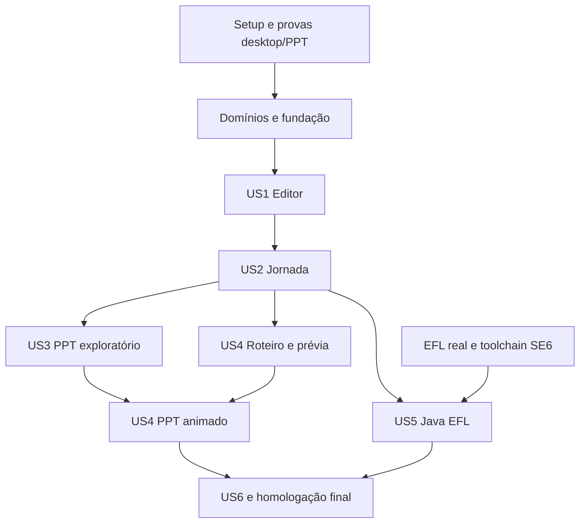

# Tasks: Gerador de Jornada

**Input**: [spec.md](spec.md), [plan.md](plan.md), [research.md](research.md), [data-model.md](data-model.md) e contracts/.
**Prerequisites**: constituição 1.2.0 e contratos revisados.
**Status**: implementação em andamento; backlog reconciliado em 2026-10-18. Caixas abertas podem ter implementação/cobertura parcial já existente, conforme notas individuais. Tarefas sem evidência integral permanecem abertas; a correção da toolchain Java 6 está registrada em T077 e quickstart.md. Homologação EFL e aprovação manual continuam pendentes.
**Tests**: incluídos porque os testes de contrato, integração e homologação fazem parte do plano aprovado.

## Format: `[ID] [P?] [Story] Description`

Txxx é local a esta feature; referenciar tarefas de domínio pelo caminho da feature + ID. [P] identifica trabalho sem conflito de arquivos após os pré-requisitos. US referencia as histórias de spec.md. Caminhos de código são relativos a apps/gerador-jornada; caminhos specs/ são relativos à raiz do workspace.

## Domain ownership

| Domínio | Especificação | Backlog detalhado | Responsabilidade |
| --- | --- | --- | --- |
| Projeto | [spec](../002-projeto/spec.md) | [tasks](../002-projeto/tasks.md) | Documento, recursos, revisão e invariantes de identidade |
| Catálogo | [spec](../003-catalogo/spec.md) | [tasks](../003-catalogo/tasks.md) | Definições e propriedades tipadas das sete famílias |
| Tela | [spec](../004-tela/spec.md) | [tasks](../004-tela/tasks.md) | Composição, geometria, camadas e duplicação |
| Jornada | [spec](../005-jornada/spec.md) | [tasks](../005-jornada/tasks.md) | Inicial e ações de navegação |
| Demonstração | [spec](../006-demonstracao/spec.md) | [tasks](../006-demonstracao/tasks.md) | Etapas, interpretação, tempo e ocorrências |

As tarefas de domínio implementam suas regras; as tarefas desta feature verificam sua conclusão e implementam integração/adaptadores. Não executar duas vezes a mesma alteração. Persistência e exportadores são adaptadores, não novos domínios de negócio.

## Phase 1: Setup — provas e preparação (Sprint 1)

**Goal**: reduzir riscos antes de desenvolver o produto.
**Independent Test**: provas registradas com ferramentas e resultados, sem declarar produto pronto.

- [X] T001 Fixar versões Go/Fyne/C em `go.mod`, `go.sum` e `scripts/build.ps1`; usar módulo local temporário descrito no plano. **Evidência técnica (2026-10-18)**: Versões confirmadas em go.mod/go.sum, scripts/toolchains-windows.json e build.ps1.
- [ ] T002 [P] Preparar checks de formatação, vet, importações e documentação em `scripts/check.ps1`; incluir revisão explícita de comentários privados/variáveis locais. **Estado parcial/pendência**: check.ps1 já executa formatação/vet/testes; falta auditoria integral de comentários/importações conforme NFR-003-catalogo/T073.
- [ ] T003 Provar drag/drop, limites visuais e DPI 100/150/200% em `internal/adapter/desktop/background_test.go`, registrando resultado em research.md. **Estado parcial/pendência**: testes de arraste/limites são headless; falta DPI 100/150/200% e prova nativa G-01.
- [ ] T004 Provar PPT com formas editáveis, links, cursor e digitação em `internal/adapter/pptx/export_test.go`; homologar PowerPoint 2016/Microsoft 365 e registrar em research.md. **Estado parcial/pendência**: XML/formas/animações testados; falta executar nas duas versões PowerPoint (G-02).
- [ ] T005 Levantar JARs, dependências e exemplo do hospedeiro EFL em `internal/adapter/javaefl/profile.go`; registrar inventário verificável em research.md, sem assinaturas inventadas. **Estado parcial/pendência**: CurrentProfile é não verificado; faltam JARs, dependências e bootstrap dos mantenedores.
- [ ] T006 Confirmar assinaturas das sete famílias e build SE 6 em `internal/adapter/javaefl/toolchain_test.go`; registrar perfil e gate G-03/G-04 em research.md. **Estado parcial/pendência**: T077 valida Java 6 estaticamente; faltam assinaturas EFL e execução real.

**Checkpoint**: G-01/G-02 resolvidos para iniciar adaptação definitiva. T005/T006 dependem dos mantenedores EFL; sua ausência não impede os domínios/editor/PPT, mas impede concluir a entrega Java.

## Phase 2: Foundational — integração dos domínios (Sprint 2)

- [ ] T007 Verificar conclusão de Projeto e Catálogo pelos respectivos tasks.md e integrar seus contratos em `internal/application/document.go`; sem duplicar entidades de `internal/project`/`internal/catalog`. **Estado parcial/pendência**: modelos já estão integrados e testados; conclusão integral de Projeto/Catálogo depende das lacunas em seus backlogs.
- [ ] T008 Verificar os modelos Tela/Jornada/Demonstração e completar validação de identidade entre domínios em `internal/application/document.go`, sem ciclos de importação. **Estado parcial/pendência**: telas/componentes e referências de navegação são validados; Scenario.Interpret recusa step ID vazio/duplicado dentro de um roteiro. Falta demonstrar UUID canônico e unicidade global incluindo todos os roteiros/etapas e colisões com outras entidades, conforme 002-projeto/FR-002 e 006-demonstracao/data-model.md. Testes atuais aprovados não fecham essa matriz.
- [ ] T009 Definir sessão, interfaces consumidoras de persistência/exportação e revisão de snapshot em `internal/application/session.go` e `internal/adapter/desktop/export.go`. **Estado parcial/pendência**: Session/snapshot existem; faltam ExportProject/Result/Artifact e fronteira consumidora na aplicação. Coordenação atual é desktop.startExport.
- [X] T010 Criar fixtures das sete famílias e teste de round-trip/erros em `internal/adapter/projectzip/package_test.go`, conforme project-format.md. **Evidência técnica (2026-10-18)**: TestRoundTripAllFamilies, TestRejectUnknownFieldAndTraversal e TestFileIDPersistenceAndMigration aprovados.
- [X] T011 Implementar DTOs, leitura com limites e gravação atômica em `internal/adapter/projectzip/package.go` e `internal/adapter/projectzip/wire.go`. **Evidência técnica (2026-10-18)**: Manifesto em wire.go, ZIP em package.go e publicação em atomicfile/write.go implementados; testes de pacote aprovados. Matriz adicional de falhas permanece em T013.
- [X] T012 Implementar autosave com debounce de 2 s e recuperação em `internal/adapter/desktop/files.go`, preservando revisões não salvas. **Evidência técnica (2026-10-18)**: scheduleAutosave/OfferRecovery em desktop/files.go usam cópia, debounce de 2 s e caminho nativo. Recuperação por interrupção real permanece em T013/T025.
- [ ] T013 Validar falhas de escrita, ZIP, hashes, versão e recuperação em `internal/adapter/projectzip/package_test.go`. **Estado parcial/pendência**: round-trip, campo desconhecido, traversal e migração testados; faltam todos os limites/hash, interrupção/recuperação, disco cheio e falhas de publicação.

**Checkpoint**: é possível criar projeto de teste, salvar/reabrir e recuperar sem UI completa. Todas as interfaces têm consumidor e finalidade.

## Phase 3: User Story 1 — editor visual (Priority: P1; Sprint 3)

**Goal**: desenhar e preservar uma tela com as sete famílias.
**Independent Test**: V-01 e V-02 em quickstart.md.

- [X] T014 [US1] Implementar expansão visual sem Fyne/XML em `internal/presentation/scene.go`, consumindo o catálogo e bounds dos domínios. **Evidência técnica (2026-10-18)**: presentation/scene.go puro é consumido pelo editor/PPT; testes estruturais de exportação aprovados.
- [X] T015 [US1] Montar shell e lista de telas em `internal/adapter/desktop/editor.go`; conectar criar/renomear/reordenar/duplicar/remover telas e comandos de arquivo aos casos de uso. **Evidência técnica (2026-10-18)**: Shell em editor.go, lista em tools.go e comandos em operations.go; TestEditorComposition e regressões desktop aprovados. Homologação nativa em T025.
- [X] T016 [US1] Implementar paleta das sete famílias em `internal/adapter/desktop/palette.go`, sem instanciar regras por reflexão. **Evidência técnica (2026-10-18)**: palette.go e sete Definitions implementados sem reflexão de instanciação; TestEditorComposition e round-trip aprovados.
- [X] T017 [US1] Implementar canvas, conversão zoom/DPI, seleção e drag/drop em `internal/adapter/desktop/board.go`. **Evidência técnica (2026-10-18)**: board.go, board_renderer.go e selection.go implementados; testes de arraste/seleção aprovados. DPI real permanece em T003.
- [ ] T018 [US1] Implementar inspector tipado e mensagens por propriedade em `internal/adapter/desktop/inspector.go`. **Estado parcial/pendência**: inspector tipado/Save/Discard testados; falta diagnóstico uniforme localizado por propriedade para toda a matriz.
- [X] T019 [US1] Conectar mover, redimensionar, alinhar, duplicar e camadas às regras de Tela em `internal/application/edit_screen.go`. **Evidência técnica (2026-10-18)**: Comandos em edit_screen.go/edit_selection.go/transform.go e arrangement.go usam Session.Change; regressões de geometria/seleção aprovadas. Conferir alinhamentos restantes em 004-tela/T004.
- [X] T020 [US1] Implementar histórico de 100 entradas e operação única por arraste em `internal/application/session.go`; nova edição após undo remove redo. **Evidência técnica (2026-10-18)**: Session limita histórico a 100, Change limpa redo e Board.DragEnd confirma uma operação. TestHistoryAndSnapshot/TestMultipleSelectionAndHistory aprovados; matriz 100/101 permanece em T023.
- [X] T021 [US1] Implementar zoom 25..400%, atalhos e cancelamento de arraste em `internal/adapter/desktop/keyboard.go`, respeitando foco de texto. **Evidência técnica (2026-10-18)**: keyboard.go/board.go implementam foco, atalhos e cancelamento; regressões desktop aprovadas. Teclas/DPI nativos continuam no teste manual.
- [X] T022 [US1] Conectar salvar/abrir/recuperar com diagnóstico e sessão limpa/alterada em `internal/adapter/desktop/files.go`. **Evidência técnica (2026-10-18)**: Fluxos implementados em desktop/files.go; leitura válida antecede troca da sessão. Testes de pacote aprovados; falhas de escrita/permissão em T013/T070.
- [ ] T023 [US1] Validar operações e histórico em `internal/application/session_test.go`, incluindo undo de remoção referenciada. **Estado parcial/pendência**: histórico, seleção e remoção têm testes; ampliar limite 100/101, limpeza de redo após nova Change e referências removidas.
- [ ] T024 [US1] Validar widgets, posições de drop e foco em `internal/adapter/desktop/selection_test.go`. **Estado parcial/pendência**: há regressões de seleção/foco/grupo/fundo/menu; completar posições de drop da paleta e matriz de resize/atalhos.
- [ ] T025 [US1] Executar V-01/V-02 e registrar evidências em quickstart.md, sem marcar domínio concluído com teste apenas de widget. **Estado**: teste/homologação manual integral não executado; roteiro em quickstart.md.

## Phase 4: User Story 2 — jornada navegável (Priority: P1; Sprint 4)

**Goal**: experimentar fluxo de três telas sem exportação.
**Independent Test**: V-03.

- [X] T026 [US2] Integrar ações none/navigate e tela inicial de Jornada em `internal/adapter/desktop/navigation.go`. **Evidência técnica (2026-10-18)**: Bind/Destination e configuração de inicial integrados; TestBindAndCycle/TestPreviewReset aprovados.
- [X] T027 [US2] Implementar painel de destinos e impacto de remoção em `internal/adapter/desktop/navigation.go`. **Evidência técnica (2026-10-18)**: Destinos em navigation.go e contagem de impacto em operations.go implementados. Localizador e alcançabilidade continuam em T030 e 005-jornada/T006.
- [X] T028 [US2] Implementar sessão de prévia isolada em `internal/application/preview.go`, restaurando valores iniciais a cada entrada de tela. **Evidência técnica (2026-10-18)**: Preview isolado implementado; TestPreviewReset e testes de escopo individual aprovados.
- [X] T029 [US2] Renderizar prévia interativa com campo, seleção e teclado vinculado em `internal/adapter/desktop/preview.go`. **Evidência técnica (2026-10-18)**: Campos, escolhas e teclado em desktop/preview.go implementados; regressões de prévia aprovadas. Fluxo nativo completo em T032.
- [ ] T030 [US2] Implementar navegação/localização de diagnósticos na UI em `internal/adapter/desktop/editor.go`. **Estado parcial/pendência**: Diagnostic tem Code/Severity/Message/ScreenID/ComponentID e diálogo textual; faltam lista clicável e localização completa de campo/roteiro/etapa.
- [ ] T031 [US2] Testar ciclos, remoções, estado isolado e reset em `internal/application/session_test.go`. **Estado parcial/pendência**: binding/reset testados; faltam todas as combinações de ciclos, remoção inválida e cenário A-B-C-A.
- [ ] T032 [US2] Executar V-03 e registrar evidências em quickstart.md. **Estado**: teste/homologação manual integral não executado; roteiro em quickstart.md.

## Phase 5: User Story 3 — PPT navegável (Priority: P1; Sprint 5)

**Goal**: compartilhar exploração editável sem depender de roteiro.
**Independent Test**: V-05 sem demonstração.

- [X] T033 [US3] Preparar fixtures e testes OPC/links/formas em `internal/adapter/pptx/export_test.go`. **Evidência técnica (2026-10-18)**: TestEditableNavigationAndTiming e testes de transição verificam OPC/XML, vínculos e formas. Não homologa execução Office.
- [X] T034 [US3] Implementar partes OPC, tema, master e layout em `internal/adapter/pptx/parts.go`. **Evidência técnica (2026-10-18)**: Partes OPC em parts.go verificadas por ValidatePackage e testes de exportação.
- [X] T035 [US3] Mapear primitivas a formas/grupos/textos em `internal/adapter/pptx/xml.go`, usando 9525 EMU por unidade lógica. **Evidência técnica (2026-10-18)**: xml.go emite formas/grupos/texto com 9525 EMU por unidade; estrutura aprovada, visual em T041.
- [X] T036 [US3] Implementar slides de menu/exploração e mapa de destinos em `internal/adapter/pptx/export.go`. **Evidência técnica (2026-10-18)**: Menu e mapa de slides/links em pptx/export.go; estrutura de destinos aprovada nos testes.
- [ ] T037 [US3] Incluir recursos decorativos e diagnósticos de layout em `internal/adapter/pptx/export.go`, sem rasterizar controles. **Estado parcial/pendência**: recursos decorativos são incorporados sem rasterizar controles; diagnóstico completo de layout/capacidades ainda é parcial.
- [ ] T038 [US3] Implementar staging, progresso e publicação do job PPT em `internal/adapter/desktop/export.go`. **Estado parcial/pendência**: job/snapshot/progresso/publicação existem no desktop/adaptadores; falta caso de uso na aplicação conforme export-service.md. Caminho indicado aponta a implementação atual, não um caso de uso já extraído.
- [X] T039 [US3] Implementar opções de percurso e aviso sobre entrada simulada em `internal/adapter/desktop/export.go`. **Evidência técnica (2026-10-18)**: Diálogo implementado em desktop/export.go com opções de percursos e aviso de entrada simulada.
- [ ] T040 [US3] Testar determinismo, cancelamento e falha antes de publicar em `internal/adapter/pptx/export_test.go`. **Estado parcial/pendência**: cancelamento prévio/rota inválida/determinismo testados; faltam falhas durante gravação/commit e destino anterior preservado.
- [ ] T041 [US3] Homologar navegação, edição e geometria nas duas versões do PowerPoint e registrar V-05 em quickstart.md. **Estado**: teste/homologação manual integral não executado; roteiro em quickstart.md.
- [ ] T042 [US3] Corrigir divergências da homologação em `internal/adapter/pptx/xml.go`/`navigation.go` e repetir somente cenários afetados. **Estado parcial/pendência**: correções concretas dependem de T041; nenhum resultado esperado foi apresentado como homologação executada.

## Phase 6: User Story 4 — demonstração guiada (Priority: P2; Sprints 4 e 6)

**Goal**: roteiro explícito reproduzível na prévia e no PPT.
**Independent Test**: V-04 e V-06.

- [X] T043 [US4] Integrar modelo/interpretador de Demonstração em `internal/adapter/desktop/scenarios.go`, respeitando clique visual e navigate separado. **Evidência técnica (2026-10-18)**: Interpret integrado com clique visual e navigate separados; TestRevisitAndUnicode/TestEditableNavigationAndTiming aprovados.
- [ ] T044 [US4] Implementar CRUD/reordenação de roteiros e etapas em `internal/adapter/desktop/scenarios.go`. **Estado parcial/pendência**: CRUD e reordenação de etapas existem; reordenação da lista de roteiros de FR-017 não está implementada.
- [ ] T045 [US4] Conectar reprodução, pausa, continuação e restart em `internal/adapter/desktop/player.go`, com relógio controlado. **Estado parcial/pendência**: pausa/continuação/reinício existem em player.go; falta controle temporal na aplicação com relógio controlado em testes.
- [ ] T046 [US4] Implementar validação incremental e localização de etapa em `internal/scenario/model.go`. **Estado parcial/pendência**: Interpret valida etapas e retorna erros; localização estruturada e navegação ao campo/etapa continuam parciais.
- [ ] T047 [US4] Testar reset, Unicode, tempo e revisitas em `internal/scenario/model_test.go`. **Estado parcial/pendência**: teste cobre revisita/grafemas/duração inválida; falta matriz de quadros, tempos, pausa e reinício.
- [ ] T048 [US4] Executar V-04 e registrar evidência em quickstart.md; este checkpoint encerra a parte da Sprint 4. **Estado**: teste/homologação manual integral não executado; roteiro em quickstart.md.
- [X] T049 [US4] Implementar ocorrências temporizadas e árvore timing em `internal/adapter/pptx/timing.go`. **Evidência técnica (2026-10-18)**: timing.go gera árvore temporizada; testes estruturais aprovados.
- [X] T050 [US4] Implementar trajetória de cursor e realce de clique em `internal/adapter/pptx/timing.go`. **Evidência técnica (2026-10-18)**: timing.go gera trajetória e realce; estrutura animada testada, reprodução real em T054.
- [X] T051 [US4] Implementar prefixos de digitação editáveis por cluster Unicode em `internal/adapter/pptx/timing.go`. **Evidência técnica (2026-10-18)**: scenario.Graphemes e timing.go emitem prefixos Unicode; testes de grafemas/exportação aprovados.
- [X] T052 [US4] Integrar blocos de demonstração, replay e separação da exploração em `internal/adapter/pptx/export.go`. **Evidência técnica (2026-10-18)**: export.go integra blocos/ocorrências e exploração isolada; estrutura aprovada, PowerPoint em T054.
- [ ] T053 [US4] Testar estados/tempos, revisitas e integridade de alvos em `internal/adapter/pptx/export_test.go`. **Estado parcial/pendência**: estrutura XML/links/animações testada; falta matriz temporal completa e revisita A-B-A.
- [ ] T054 [US4] Homologar V-06 nas duas versões-alvo e registrar tolerância SC-004 em quickstart.md. **Estado**: teste/homologação manual integral não executado; roteiro em quickstart.md.

## Phase 7: User Story 5 — fontes Java/EFL (Priority: P2; Sprint 7)

**Goal**: entregar projeto-fonte integrado e comprovado no ambiente real.
**Independent Test**: V-07; depende de T005/T006 concluídas.

- [ ] T055 [US5] Consolidar perfil EFL homologado e capacidades por propriedade em `internal/adapter/javaefl/profile.go`. **Estado parcial/pendência**: faltam JARs e bootstrap reais; perfil Swing exclusivo de teste não conclui a integração EFL.
- [X] T056 [US5] Criar testes de identificadores, colisões e escape em `internal/adapter/javaefl/names_test.go`. **Evidência técnica (2026-10-18)**: TestNamesAndEscaping, TestSourceFileIDs e validação de colisões FileID aprovados; independem de EFL real.
- [X] T057 [US5] Implementar nomes e escape de literais/Javadoc em `internal/adapter/javaefl/names.go` e `names.go`. **Evidência técnica (2026-10-18)**: Identifier/Literal/Comment/ValidatePackageName em names.go testados com Unicode e compilação estática Java 6.
- [ ] T058 [US5] Implementar templates das sete famílias em `internal/adapter/javaefl/component_source.go`, com documentação e APIs homologadas. **Estado parcial/pendência**: component_source.go implementa geração por fábrica; construções EFL reais das sete famílias não estão homologadas. Não existe diretório templates/java/component nesta revisão.
- [ ] T059 [US5] Implementar painéis/fábricas por tela em `internal/adapter/javaefl/sources.go`, sem classe central de todas as telas. **Estado parcial/pendência**: sources.go/component_source.go separam fontes/fábricas e passam em compilação estrutural; integração de painéis EFL real segue pendente.
- [ ] T060 [US5] Implementar navegação e integração na EDT em `internal/adapter/javaefl/sources.go` e `internal/adapter/javaefl/sources.go`. **Estado parcial/pendência**: controlador/EDT são gerados e compilados em perfil estrutural; HostSource e bootstrap EFL reais precisam de homologação.
- [ ] T061 [US5] Implementar projeto fonte, resources, sources.list e instruções em `internal/adapter/javaefl/profile.go`, sem publicar em diretório existente. **Estado parcial/pendência**: staging/resources/sources.list/instruções existem em profile.go; falta validar inventário/capacidades com perfil real antes de concluir saída EFL.
- [ ] T062 [US5] Conectar diálogo e job Java em `internal/adapter/desktop/export.go` e `internal/adapter/desktop/export.go`. **Estado parcial/pendência**: diálogo/job preservados no desktop; ação está visível e desabilitada por FR-029. Falta fronteira na aplicação e integração real; não reabilitar por revisão documental.
- [ ] T063 [US5] Compilar fixtures com Java SE 6/EFL real, verificar classfile 50.0 e executar navegação em `internal/adapter/javaefl/toolchain_test.go`. **Estado parcial/pendência**: JDK 17/ECJ/Animal Sniffer comprovam sintaxe/bytecode/API em perfil estrutural; falta compilar/executar com EFL real.
- [ ] T064 [US5] Homologar sete famílias, estilos suportados e integração V-07; registrar versões/evidências em quickstart.md. **Estado parcial/pendência**: faltam ambiente real e homologação das sete famílias/estilos; checks estáticos não substituem V-07.

## Phase 8: User Story 6 — distribuição Windows (Priority: P1; Sprint 8)

**Goal**: instalar nada e trabalhar offline.
**Independent Test**: V-08.

- [X] T065 [US6] Montar composição final por construtores em `cmd/gerador-jornada/main.go`, mantendo o entrypoint sem regras de negócio. **Evidência técnica (2026-10-18)**: main.go compõe adaptadores; pacote cmd compila e vet/suite passaram.
- [ ] T066 [US6] Empacotar recursos/templates e manifesto DPI em `scripts/build.ps1`. **Estado parcial/pendência**: ícone/recursos/VERSIONINFO embutidos; manifesto DPI Windows explícito e validação de escalas continuam pendentes.
- [ ] T067 [US6] Montar ZIP de release com EXE, licenças e inventário em `scripts/build.py`. **Estado parcial/pendência**: build.py gera pacote/inventário/hashes; faltam inventário completo de licenças distribuídas e verificação de conteúdo para release.
- [ ] T068 [US6] Validar UI thread, um job ativo, progresso e cancelamento em `internal/adapter/desktop/export.go`. **Estado parcial/pendência**: worker/fyne.Do/contexto e bloqueio de segundo job implementados; faltam testes da fronteira em export.go para transições de job/cancelamento/publicação e responsividade.
- [ ] T069 [US6] Executar V-08 em Windows 10/11 x64 limpos e offline, registrando dependências efetivas em quickstart.md. **Estado**: teste/homologação manual integral não executado; roteiro em quickstart.md.
- [ ] T070 [US6] Validar paths com acentos/espaços e falhas de permissão em `internal/adapter/desktop/files.go`. **Estado parcial/pendência**: há suporte Unicode/caminhos nativos; falta matriz de paths com acentos/espaços, arquivo bloqueado e falhas de permissão em Windows.

## Phase 9: Polish & Cross-Cutting Concerns (Sprint 8)

- [ ] T071 Medir tempos nominais NFR-007 em `internal/adapter/desktop/selection_bench_test.go`, registrando ambiente e mediana em quickstart.md. **Estado parcial/pendência**: BenchmarkSelect500 anterior não substitui NFR-007 (10×50 componentes/50 etapas), três execuções e mediana. Criar cenários nominais além do benchmark existente.
- [ ] T072 Executar integração completa V-09 e registrar evidências em quickstart.md. **Estado**: teste/homologação manual integral não executado; roteiro em quickstart.md.
- [ ] T073 Revisar GoDoc de pacotes/tipos/métodos/campos e comentários de todas as variáveis em `internal/` e `cmd/`, além de Javadoc em `internal/adapter/javaefl/`. **Estado parcial/pendência**: comentários em português presentes; falta revisão integral por declaração/variável e do Javadoc gerado. Vet/testes não comprovam documentação completa.
- [X] T074 Executar checks de importação, vet, contratos e regressões com `scripts/check.ps1`; corrigir falhas pertinentes. **Evidência técnica (2026-10-18)**: check.ps1 com JDK 17 executado: gofmt/vet, três testes de empacotador, nove testes Java e suite Go aprovados.
- [X] T075 Atualizar exemplos e inventário de distribuição em quickstart.md e research.md, distinguindo testes reais de dublês. **Evidência técnica (2026-10-18)**: Inventário, ambiente e evidências atualizados em quickstart.md/research.md com limites de cada verificação.
- [X] T076 Revisar rastreabilidade e fechar somente tarefas com evidência em tasks.md e checklists/requirements.md. **Evidência técnica (2026-10-18)**: Specs/planos/modelos/backlogs reconciliados por domínio nesta revisão; somente evidências técnicas fecham caixas técnicas. Checklists de aprovação não foram marcados.

## Dependencies & Execution Order

Catálogo precede Tela; Projeto agrega dados via aplicação; Jornada/Demonstração usam IDs, sem importar adaptadores. Domínios podem ter seus modelos preparados antes da UI. T005/T006 são gates apenas da geração Java.

US3 pode ser desenvolvida com fixture de jornada e sem US4. US5 não depende de PPT. O teste independente de cada história usa fixtures prontas para dispensar repetir criação manual das histórias anteriores.

## Sprint Planning

Sprints de duas semanas como referência, sem data de início nem promessa de prazo sem capacidade de equipe definida.

| Sprint | Tarefas desta feature / domínio | Entrega verificável |
| --- | --- | --- |
| 1 | T001–T006 | Provas desktop/PPT e levantamento EFL; registrar bloqueios externos sem inventar conclusão |
| 2 | T007–T013 + modelos dos cinco domínios | Contratos integrados, round-trip e recuperação |
| 3 | T014–T025 + conclusão de Tela/Catálogo | Editor utilizável, histórico e arquivos |
| 4 | T026–T032 e T043–T048 + Jornada/Demonstração | Prévia navegável e roteiro explícito |
| 5 | T033–T042 | PPT exploratório editável homologado |
| 6 | T049–T054 | PPT demonstrativo homologado |
| 7 | T055–T064 | Fontes Java/EFL homologadas |
| 8 | T065–T076 | Release offline e validação ponta a ponta |

A ordem no arquivo segue histórias, conforme Spec Kit; a execução temporal de US4 está explicitada na tabela. Sprint concluída exige entrega e evidência; tarefa externa ausente permanece aberta, mesmo se outro incremento avançar.

## Parallel Opportunities

Após fundação, plano visual e paleta podem ser feitos em arquivos distintos; PPT e Java podem avançar de forma independente após jornada válida. Dentro de US4, cursor e digitação podem ser implementados separadamente depois de timing estável. Essas possibilidades não autorizam delegação automática nem eliminam dependências.

## Implementation Strategy

MVP interno: US1 mais distribuição de desenvolvimento para validar desenho/salvamento. Primeiro incremento compartilhável: US1/US2/US3 e empacotamento mínimo validado. A release completa exige as seis histórias e os gates reais, incluindo Java/EFL.

Em cada tarefa: implementar responsabilidade coesa, documentar todos os elementos conforme constituição, executar testes pertinentes e atualizar sua evidência. Não marcar todas as tarefas da sprint somente por ter criado arquivos.

## Matriz de rastreabilidade

| Requisitos | História / tarefas | Validação |
| --- | --- | --- |
| FR-001, FR-009, FR-010; NFR-005 | US1; T007, T009–T013, T022, T025 | V-01, V-02 |
| FR-002 a FR-008; NFR-002 | US1; T007–T008, T014–T024; domínios Catálogo/Tela | V-01 |
| FR-011 a FR-013 | US2; T026–T032; Jornada | V-03 |
| FR-014 a FR-016 | US3; T033–T042 | V-05 |
| FR-017 a FR-019 | US4; T043–T048; Demonstração | V-04 |
| FR-020, FR-021 | US4; T049–T054 | V-06 |
| FR-022 a FR-025 | US5; T005–T006, T055–T064 | V-07 |
| FR-026 a FR-028 | US3/US5/US6; T038–T040, T062, T068, T070 | V-05, V-07, V-08 |
| NFR-001, NFR-006 | US6; T065–T070 | V-08 |
| NFR-003 | Todas; T002, T073 | V-09 |
| NFR-004 | T010, T033, T040, T056, T061 | V-02, V-05, V-07 |
| NFR-007 | T068, T071 | V-08, V-09 |
| NFR-008 | T004–T006, T041, T054, T063–T064 | V-05, V-06, V-07 |
| SC-001 a SC-007 | T025, T032, T041, T054, T064, T069, T071–T072 | V-01 a V-09 |

## Phase 10: Correção da toolchain Java (US5)

- [X] T077 [US5] Validar o alvo Java 1.6 usando o JDK 17 informado, conforme FR-022/FR-025 e contrato java-efl-export.md: implementar ECJ com versões/hashes fixados em `scripts/java6.py` e `scripts/java6-tools.json`, conferir bytecode major 50 e APIs SE 6 com `scripts/java6/CheckJava6.java`, exercitar incompatibilidades em `scripts/test_java6.py` e compilar os fontes do gerador em `internal/adapter/javaefl/toolchain_test.go`; atualizar instruções e registrar a evidência em quickstart.md.

T077 conclui a verificação estática e não conclui T005/T006, T063/T064 ou a história US5: continuam necessárias as bibliotecas reais, o bootstrap e a execução Java 6/EFL. O perfil estrutural de teste não é uma saída EFL publicável.

## Phase 11: Fundo e especificações individuais dos componentes

- [X] T078 [US1] Incorporar a imagem original ao EXE e aos novos projetos, oferecer seleção/troca de fundo, preservar arraste e histórico sobre a imagem, incluir fundo na prévia/demonstração e testar sua persistência e incorporação no PPT; separar a paleta da lista de telas e disponibilizar estrutura e conjuntos informativos do legado. Evidência: `internal/adapter/builtinassets/background_test.go`, `internal/adapter/desktop/background_test.go` e captura registrada em quickstart.md. Homologação humana continua pendente.
- [X] T079 [US1] Criar spec.md, DESIGN.md e checklist documental para cada uma das 24 responsabilidades individuais, relacionar o catálogo existente e os domínios, registrar origem legada, tokens, estados, critérios de aceitação e lacunas; conferir seções/IDs/links locais e preservar a seleção da feature 001. Inventário em research.md.

As features 007 a 030 permanecem Draft. T079 conclui sua documentação solicitada, não toda a implementação das capacidades que elas descrevem. O teclado de 14 teclas, o mapeamento integral dos estilos e a visualização de fontes com perfil EFL real precisam de planejamento e validação próprios; não são aprovados por estas caixas.

## Phase 12: Revisão de edição e apresentação

- [X] T080 [US1] Implementar regras de seleção/transformação de grupo em `internal/screen/selection.go` e comando transacional em `internal/application/transform.go`; Ctrl/Shift+clique, caixa de seleção, Ctrl+A, Escape, setas e Shift+setas nos adaptadores desktop. Fontes: 004-tela/FR-006–FR-007; 020-elemento-edicao/FR-008–FR-011.
- [X] T081 [US1] Separar renderer e eventos do canvas, reutilizar primitivas por revisão/zoom, evitar reconstrução de inspector na mesma seleção e medir 500 controles; cursores de movimento e resize. Fontes: 019-canvas-edicao/FR-009–FR-010; 020-elemento-edicao/FR-012.
- [X] T082 [US1] Oferecer Salvar alterações/Descartar em rodapé fixo e estado coletivo para multisseleção; dividir formulários por responsabilidade/família. Fontes: 028-propriedades/FR-008–FR-011; 027-painel-direito/FR-008–FR-009.
- [X] T083 [US1] Adicionar alinhamento textual ao modelo Tela, à persistência opcional e aos renderers editor/prévia/PPT; faixa pronta à direita, arquivos anteriores à esquerda. Fontes: 004-tela/FR-008; 018-faixa-titulo/FR-008–FR-009.
- [X] T084 [US3] Gerar transições nativas fade/deslizar/revelar/nenhuma, fade 300 ms por padrão; manter avanço e animações existentes, testar estrutura OPC/XML e entregar artefato para homologação PowerPoint. Fontes: 006-demonstracao/FR-007–FR-008 e contrato pptx-export.md.
- [X] T085 [US5] Manter botão Java/EFL visível e desabilitado, preservando implementação para retomada. Fontes: 025-barra-ferramentas/FR-008; 030-visualizacao-codigo/FR-008.
- [X] T086 [US1] Executar regressões de grupo, formulário, texto alinhado, foco, transições e benchmark comparável; recompilar EXE e registrar build e roteiro manual em quickstart.md. Homologação manual não é concluída por testes automáticos.
- [X] T087 [US6] Incorporar a imagem fornecida como ícone do aplicativo e recurso PE multirresolução, automatizar sua geração no build, ignorar intermediários e conferir os sete quadros no EXE. Fontes: FR-035; 025-barra-ferramentas/FR-010. Revisão visual humana em quickstart.md permanece pendente.

## Phase 13: Menu contextual e exclusão explícita

- [X] T088 [US1] Registrar FR-036–FR-037 e critérios por responsabilidade nas specs 004-tela, 020-elemento-edicao e 025-barra-ferramentas, com seus designs e plano; preservar confirmação fora do domínio.
- [X] T089 [US1] Implementar hit-test compartilhado/menu contextual no desktop, foco do formulário, Excluir à direita de Ajustar habilitado pela seleção e confirmação única Sim/Não compartilhada com Delete; reutilizar exclusão transacional existente.
- [X] T090 [US1] Testar menu, foco, cancelamento, confirmação, grupo, Undo e disponibilidade do botão; executar suite/vet, recompilar EXE e registrar hash/roteiro manual sem antecipar aprovação humana.
- [X] T091 [US6] Definir versão 1.0.0.0 com fonte única no adaptador buildinfo, exibir na interface e incorporar VERSIONINFO ao PE; compilar e verificar FileVersion/ProductVersion sem executar o EXE. Referência: FR-038.

## Phase 14: Prévia individual da tela

- [X] T092 [US1] Especificar a prévia individual nas responsabilidades Tela/Prévia/Barra; implementar `internal/application/screen_preview.go` com snapshot de uma tela sem navegação, manter prévia completa e adicionar botão Prévia Tela Atual com disponibilidade por tela ativa; testar isolamento, valores, escopo de validação e janelas, executar checks/build e registrar roteiro manual. Fontes: FR-039; 004-tela/FR-010; 029-previa-interativa/FR-008–FR-010; 025-barra-ferramentas/FR-014.

## Phase 15: IDs de arquivo por tela e componente

- [X] T093 [US1] Modelar FileID separado do UUID no domínio Tela; validar ASCII, prefixo Pnl somente em telas, limite inclusivo de 40 e dispositivos Windows. Implementar unicidade por contexto, sugestões/duplicação e transações de edição sem alterar vínculos. Fontes: FR-040–FR-041; 004-tela/FR-011–FR-012.
- [X] T094 [US1] Adicionar campo ID comum no inspector, limpeza de acentos/especiais e validação de tamanho/prefixo; preservar Name Unicode e salvar/desfazer separadamente do UUID. Fontes: 003-catalogo/FR-006; 028-propriedades/FR-012–FR-013; designs das famílias.
- [X] T095 [US1] Versionar manifesto em schemaVersion 2 com fileId; migrar v1 deterministicamente, recusar v2 inválida e versões desconhecidas, testar ida/volta e preservação de UUID. Fonte: FR-042; 002-projeto/FR-006; contrato project-format.md.
- [X] T096 [US5] Usar IDs confirmados para nomes exatos de arquivos/classes de tela/componente, separar fontes por tela e responsabilidades, manter gate Java/EFL; testar nomes, compilar os fontes estruturais para Java 1.6 com JDK 17/ECJ e registrar evidências, regressões, build e roteiro manual. Fonte: FR-041–FR-042; contrato java-efl-export.md.

## Phase 16: README e pacotes desktop de 64 bits

- [X] T097 [US6] Criar README completo da aplicação e portal na raiz, descrevendo componentes, propósito, versões, arquitetura, requisitos, build e limites reais; conferir links locais e registrar pendências de homologação. Fonte: FR-043.
- [X] T098 [US6] Preparar build/empacotamento por alvo em dist, metadados e checksums, validação PE/ELF/Mach-O e manifesto Windows versionado; compilar/testar Windows x64 e Linux x64 via Docker, preservar EXE antigo se estiver em uso e resolver recuperação por plataforma. Fontes: FR-044–FR-045; 002-projeto/FR-007.
- [X] T099 [US6] Configurar workflow manual nativo para Windows/Linux/macOS Intel/ARM64, SDK e bundle Apple, sem publicação automática; validar estrutura local e documentar ausência de execução remota/Mac nesta estação. Fonte: FR-044.
- [ ] T100 [US6] **Adiada; fora do escopo corrente por orientação do usuário (2026-10-18).** Executar os builds em Mac/runner Intel e ARM64, registrar versão de SDK/OS e validar janela, ícone, bundle, recuperação, projeto e PPT; homologar distribuição e aprovação humana em máquina limpa por plataforma. Não concluir esta tarefa apenas por configuração do workflow ou fixtures Mach-O.

## Phase 17: Maximização e tela cheia

- [X] T101 [US6] Isolar estado de janela e tradução de mensagens no adaptador desktop; converter Maximizar Windows em API Fyne de tela cheia, capturar F12/Escape sem polling e com repetição suprimida, restaurar procedimento ao fechar e manter implementação neutra nos outros alvos; adicionar botão Tela cheia/Restaurar sem alterar domínios/persistência. Fontes: FR-046–FR-047; 025-barra-ferramentas/FR-015; 019-canvas-edicao/FR-011.
- [X] T102 [US6] Testar traduções de mensagem, alternância, foco, rascunho/seleção/zoom/histórico preservados e ações após fechamento; executar vet/suite e recompilar o EXE Windows, atualizar README/specs e roteiro manual. A base Linux/macOS permanece como referência, sem novos builds exigidos no escopo corrente. Teste unitário de mensagens não conclui inspeção nativa das barras, monitores e DPI; homologação humana permanece pendente.

- [X] T103 [US6] Abrir o editor em tela cheia por padrão no adaptador desktop; manter Restaurar/F12/Escape, verificar estado inicial e retorno no teste existente, atualizar FR-047 e 025/FR-015, documentação e recompilar somente Windows x64. Homologação visual permanece manual.

- [X] T104 [US6] Corrigir a ordem de abertura no adaptador desktop: ShowWindow mostra a janela antes de solicitar tela cheia, pelo mesmo comando de F12. Testar sequência de estado inicial, retorno e preservação; executar checks e recompilar somente Windows. Teste nativo manual continua pendente.

## Phase 18: Temas e encerramento em tela cheia

- [X] T105 [US6] Implementar 025/FR-016: Sair somente em tela cheia e encerramento compartilhado com confirmação única Sim/Não para alterações e rascunhos (028/FR-014); janela principal encerra também com prévias abertas.
- [X] T106 [US6] Implementar 025/FR-017–FR-018: paletas Claro/Escuro/Azul, seletor, preferência local/fallback e atualização de controles/cabeçalho sem alterar domínio ou rascunhos; isolar controles de prévia (029/FR-011).
- [X] T107 [US6] Testar visibilidade, encerramento/cancelamento, preferência e isolamento, conferir contraste das paletas, atualizar documentação, executar checks e entregar EXE Windows para teste manual.

## Evidências e interpretação do backlog — reconciliação 2026-10-18

IDs preservados. Caminhos planejados foram substituídos pelos pontos reais da implementação;
responsabilidades e testes ainda ausentes permanecem abertos nas notas individuais.
Não executar novamente uma implementação existente apenas porque seu arquivo foi reorganizado.

Checks desta revisão: [quickstart.md](quickstart.md#reconciliação-documental-por-domínio--2026-10-18).
T100 está adiada por decisão do usuário, não aprovada. Esta revisão é documental:
sem novos builds Linux/macOS, sem mudança de código e sem substituição do EXE atual.
