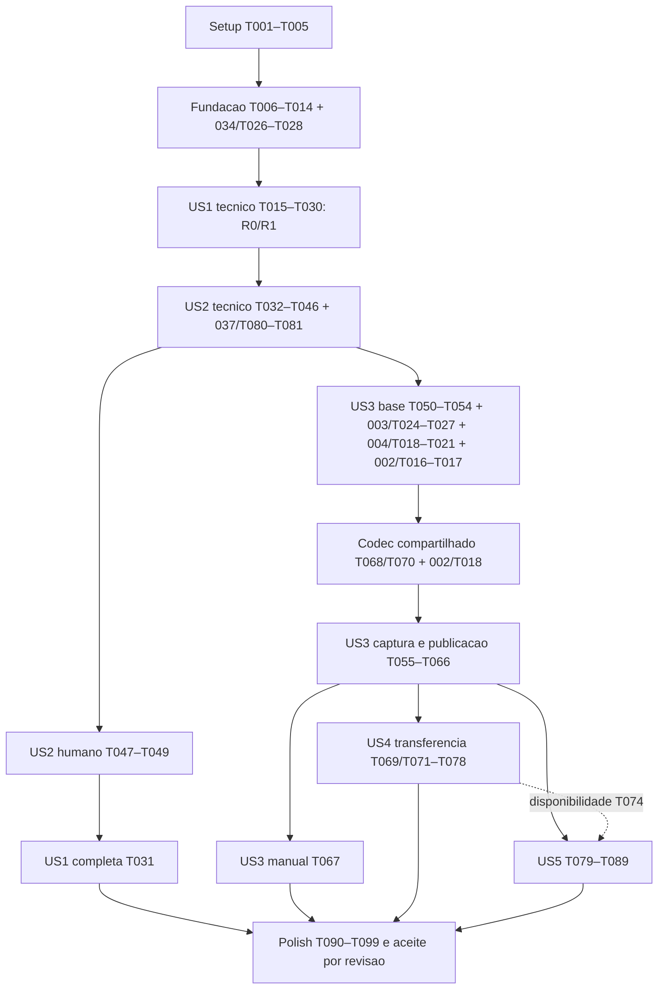

# Tasks: 038 — MCP, agentes e componentes reutilizáveis

**Input:** [spec v0.4](spec.md), [plan](plan.md), [research](research.md), [data-model](data-model.md), [contracts](contracts/mcp.md), [DESIGN](DESIGN.md) e [quickstart](quickstart.md).
**Data:** 2026-10-25. **Estado atual:** implementação parcial autorizada por speckit-implement reiterado e pedidos de continuidade, após análise prévia. Tarefas concluídas possuem evidência específica; demais continuam abertas. Não constitui homologação técnica/funcional nem autorização para commit/merge/publicação.
**Constituição:** 1.4.0; emenda MCP aprovada/aplicada. Nenhum commit, merge, push ou build é realizado pela geração de tarefas.
**Tests:** obrigatórios onde a spec exige invariantes, consentimento, persistência, paridade e homologação; escrever os casos antes da implementação e comprovar a falha relevante quando tecnicamente viável. Teste manual e aceite humano são tarefas distintas.

**Histórico de sincronização do replanejamento:** U1/I1/I2/I3/U2 tratados nos contratos e nas tarefas existentes abaixo por invocação de speckit-plan. IDs, responsáveis e checkboxes preservados; nenhuma tarefa executada. Nova análise spec/plan/tasks permanece pendente. T068/T070 são pré-requisitos compartilhados antecipados de US3, apesar da etiqueta US4.

**Histórico do segundo replanejamento U3/U4/I4:** ligação explícita de análise/captura, chamada de revisão da biblioteca e admissão de importação separada da confirmação definidas nos contratos e integradas às tarefas existentes. IDs/checkboxes preservados; Q038-26/Q038-27 são cenários futuros. A análise solicitada na sequência será somente leitura.

## Format e responsabilidade

Formato: `- [ ] Tnnn [P?] [USn?] descrição com caminho`. IDs daqui são `038-integracao-mcp-agentes/Tnnn`; IDs de outra feature sempre usam prefixo qualificado. `[P]` permite trabalho em arquivos distintos depois dos pré-requisitos indicados, sem exigir agentes ou execução paralela.

Caminhos partem da raiz do repositório; uma referência secundária `internal/...` na mesma tarefa usa o prefixo `apps/gerador-jornada/`. Caminhos propostos de implementação/teste ainda podem não existir; o trabalho desta fase é definir as tarefas, não criá-los.

Projeto, Catálogo e Tela conservam implementação de regras em seus backlogs; 034 possui extração de workspace e 037 sua adaptação ao gate comum. As tarefas abaixo integram esses resultados, sem implementá-los duas vezes. 023/028 possuem DESIGN mas não tasks locais; a integração visual específica da biblioteca é coordenada aqui, com referências aos desenhos existentes.

Backlogs amplos existentes, como `003/T004` e `004/T004`, podem conter escopo além da parcela necessária à 038. Registrar a evidência da parcela e manter a tarefa original aberta se seu escopo integral não foi cumprido. Nenhuma tarefa antiga é renumerada ou encerrada por esta geração.

## Phase 1: Setup — preparação do incremento

- [X] T001 Registrar baseline de requisitos, revisão atual do código e contratos em `specs/038-integracao-mcp-agentes/quickstart.md`, delimitando I1/I2/I3, modos manual/MCP complementares, estilo legado e domínios; manter gates Windows/host/Office abertos. Refs.: FR-001/FR-002/FR-032–FR-035. Evidência: seção Início da implementação, HEAD/hash inicial e toolchain locais registrados; autorização de código recebida por nova invocação após o gate, sem marcar checklist de homologação.
- [X] T002 Fixar SDK oficial `github.com/modelcontextprotocol/go-sdk v1.8.0` em `apps/gerador-jornada/go.mod` e `apps/gerador-jornada/go.sum` somente na implementação autorizada, conferindo Go mínimo e licença real no inventário `apps/gerador-jornada/scripts/third_party.py`; não adicionar runtime, módulo ou EXE. Dep.: T001. Refs.: FR-001/FR-034/FR-035. **Evidência:** SDK v1.8.0 fixado como dependência direta; coletor third_party conferido em pasta temporária, preservando LICENSE real Apache/MIT/documentação CC-BY.
- [X] T003 [P] Preparar fixtures válidas/inválidas dos quatro schemas (incluindo library-operations.schema.json) e payloads grandes em `apps/gerador-jornada/internal/adapter/mcp/testdata/contracts.json`, incluindo duplicatas, campos extras, uint64, base64 canônico e distinção entre validade, autorização e homologação. Incluir materialization null/vínculo e Review com análise/captura; ReviewRequest discriminado por quatro operações, PrepareImportRequest e CommitRequest, referência de Authorization resolvida pelo $id, rejeição de campos de outra variante. Dep.: T002. Refs.: FR-004/FR-011/FR-029/FR-037. **Evidência:** testdata/contracts.json contém 12 fixtures de schema validadas, três wire, cinco semânticas e quatro geradores de payload; casos wire/semânticos serão exercitados pelos handlers futuros.
- [X] T004 [P] Preparar fixture determinística de duas telas, presets, referências internas, dez Kinds e imagens em `apps/gerador-jornada/internal/application/mcp_fixture_test.go`, com caso sem skin e overrides/alpha/fontes do legado; sem dados pessoais ou Java executado. Dep.: T002. Refs.: FR-002/FR-007/FR-032; SC-001/SC-009. **Evidência:** mcp_fixture_test.go cobre duas telas, dez Kinds, cinco presets, imagem alpha e vínculos; TestMCPFixture PASS em Go 1.27.2 Windows/amd64.
- [X] T005 Criar prova mínima G0 em `apps/gerador-jornada/internal/adapter/mcp/startup_probe_test.go` e ramificação opt-in em `cmd/gerador-jornada/main.go`, iniciar SDK stdio no mesmo EXE Windows padrão com descoberta mínima e nenhuma operação persistente; comprovar pipes/EOF/stdout/ausência de Fyne/splash/preferências antes da extração de workspace. Registrar revisão/hash/ambiente em `specs/038-integracao-mcp-agentes/quickstart.md`; falha exige decisão de pesquisa, não outro EXE/HTTP automático. Dep.: T002–T004. Refs.: FR-001/FR-034/FR-035; código/build são trabalho futuro, não execução desta geração. **Evidência:** Falhou antes com EXE 1.0.0.15 sem --mcp; PASS com EXE windowsgui 1.0.0.16, SHA256 0ebb1ece6e7e2cb1918068b0fc3dd27736c723b84d2e5553e4c074e99efa7ab0, SDK Go cliente em processo separado, sem janelas Win32/preferências/arquivos, EOF normal. Ver quickstart, prova G0; não conclui I1/R2/host real.

## Phase 2: Foundational — contratos e fronteiras compartilhadas

**Bloqueio:** histórias dependem destes fundamentos técnicos, não de aprovação funcional fictícia. O estado de cada código citado segue seus marcadores/evidências abaixo; arquivos ainda ausentes permanecem futuros. Segurança de gravação será completada e comprovada em US2 antes de liberar o MVP com persistência.

- [X] T006 [P] Criar testes de isolamento, histórico, concorrência e limites em `apps/gerador-jornada/internal/application/authoring_test.go`: 8 sessões, 4 chamadas simultâneas, uma mutação/sessão, 30 min, retenção 256 MiB incluindo undo/recursos/reserva de finalização, 1.024 IDs de edição sem eviction, até 32 anexos e controle separado (uma revisão corrente/16 registros recentes/high-water). Provar 1.024ª edição seguida de revisão/negações/expirações/repreparo/commit/descarte sem nona sessão; 63 commits mais vários alvos, reserva por alvo/limite total 64, recovery sem 65ª posição e staging 250 MiB/alvo/1 GiB global reservado antes da edição, sem mudança parcial quando recusar admissão. Dep.: T005. Refs.: FR-009/FR-010/FR-016/FR-037; Q038-21/Q038-25. **Evidência:** authoring_test.go, authoring_draft_test.go e authoring_budget_test.go: PASS com -race, incluindo 8/9 sessões, quatro chamadas, busy, 1.024/1.025 edições, 32/33 anexos, cache/CAS, expiração, memória/histórico/staging, 63+reserva/64 e recovery na mesma posição. Casos de IO/journal reais continuam US2.
- [X] T007 [P] Criar testes de raiz física, nomes, links/junctions, criação exclusiva e gate entre processos em `apps/gerador-jornada/internal/adapter/workspaceguard/guard_windows_test.go`, usando pastas temporárias e bloqueio real Windows, sem exigir vínculo Git. Dep.: T005. Refs.: FR-012/FR-013/FR-036. **Evidência:** Testes Windows -race PASS: nomes, homônimo, snapshot/base, cancelamento, exclusão entre processos, aliases, leitura sem escrita e junction/troca de caminho. Symlink de arquivo não disponível no ambiente; junction foi executada, não pulada.
- [X] T008 [P] Criar testes de framing/decoder fechado em `apps/gerador-jornada/internal/adapter/mcp/codec_test.go`: frames completos 1 MiB incluindo LF, ID JSON-RPC até 128 bytes, Content até 1 KiB sem duplicação de StructuredContent, rejeição de UTF-8/escapes surrogate inválidos antes do SDK e contagem de pontos de código após decodificar; nenhum frame parcial. Dep.: T005. Refs.: FR-004/FR-034/FR-037/FR-039; Q038-23. **Evidência:** codec_test/result_test e validador comum authoring_validation_test PASS -race: limite com LF/ID/Unicode/chaves duplicadas, Content curto, revisão de 512 KiB sem duplicação, frame de resposta e contagem por pontos de código. Integração aos formulários continua em T022.
- [X] T009 Implementar registro/coordenador de sessões em `apps/gerador-jornada/internal/application/authoring.go` e reuso de `session.go`, mutex/snapshot/expiração e cache de edição sem eviction. Anexos da mesma sessão têm revisão própria/baseRevision e documentDirty/proposalDirty/dirty; sem registro MCP paralelo. Controle usa controlGeneration, replay corrente antes de comparar high-water, aposentado sem efeito/cache ilimitado; reservar finalização por alvo antes da admissão. Não levar DTO MCP ao domínio. Dep.: T006. Refs.: FR-002/FR-009/FR-010/FR-016. **Evidência:** authoring.go/authoring_draft.go implementam registro, snapshots/copias, CAS, cache sem eviction, geração/controle, anexos, dirty separado e orçamento/reserva por alvo; testes -race e vet PASS. Integração dos adaptadores segue T012–T014 e US1/US2.
- [X] T010 Implementar adaptação estrita de JSON, paginação/orçamento e erros tipados em `apps/gerador-jornada/internal/adapter/mcp/codec.go`, com DTO por operação/família, rejeição de Unicode inválido antes do SDK/chave duplicada/campo desconhecido, validação comum por pontos de código, deadlines 30/120 s e cursor vinculado à revisão; saída grande deve usar Content curto explícito e guarda de frame. Dep.: T008/T009. Refs.: FR-004/FR-037/FR-039; Q038-23. **Evidência:** codec/dto/component_dto/tool/result/pagination/budget implementados; -race e vet PASS. DTOs de operações e união fechada por família, uint64 decimal, null recusado para mutação I1, Unicode/chaves/obrigatórios/case exata, orçamento/cursores e concorrência/deadline testados. Integração de validação semântica de conteúdo à GUI/comandos segue T022.
- [X] T011 Implementar coordenação por raiz em `apps/gerador-jornada/internal/adapter/workspaceguard/guard_windows.go` e `guard.go`, com “Capturada ao abrir; revalidada sob gate de raiz; ausência é precondição de criação exclusiva”; não chamar hash+rename de CAS, nem habilitar substituição sem a prova T043. Dep.: T007. Refs.: FR-012/FR-013/FR-017/FR-036. **Evidência:** guard.go/guard_windows.go e provider fail-closed para outros SOs; testes reais Windows -race e vet PASS. Criação exclusiva ancorada por handle e base de leitura; sem habilitar substituição existente. D13 registra APIs e namespace comum.
- [X] T012 Integrar extração `034/T026–T028` ao escopo/inventário e fonte de documentos em `apps/gerador-jornada/internal/application/authoring_workspace.go`, fixando raízes por finalidade no startup, sem percorrer jornadas descendentes ou conceder novos caminhos pelo agente. Dep.: T009/T011 e 034/T026–T028. Refs.: FR-005/FR-036. **Evidência:** AuthoringWorkspace/fonte workspace e MaterialScopes imutáveis implementados; abertura da mesma leitura/hash, replay antes de IO, construtor comum, raízes por finalidade/identidade, rejeição de troca de raiz e ausência de escrita em leitura: testes -race e vet PASS. Composição no processo segue T014; inventários especializados seguem T071/T081.
- [X] T013 Implementar auditoria mínima de aplicação/MCP em `apps/gerador-jornada/internal/adapter/mcp/audit.go`, allowlist de metadados/revisões/resultados e stderr seguro, sem texto integral, credencial, segredo de autorização, telemetria ou tráfego externo. Dep.: T010. Refs.: FR-028/FR-034/FR-038/FR-039. **Evidência:** audit.go composto pelo registro de ferramentas; teste de allowlist e teste SDK real PASS -race/vet, sem argumentos, paths ou texto interno em erros/auditoria; destino explícito stderr, sem arquivo ou logger desktop.
- [X] T014 Evoluir a composição mínima de T005 em `apps/gerador-jornada/internal/adapter/mcp/server.go` e `apps/gerador-jornada/cmd/gerador-jornada/main.go` antes de logger desktop/Fyne/splash/GitHub, usando IOTransport stdio com leitor/writer limitados, perfil 2025-11-25 e flags incompatíveis recusadas; manter abertura manual padrão e `persistentWrites=false` sem host qualificado. Dep.: T010–T013. Refs.: FR-001/FR-003/FR-034/FR-035. **Evidência:** server.go compõe fonte/núcleo/raízes fixadas por finalidade, erros seguros/auditoria e stdio limitado antes da GUI. TestDistributedFoundation falhou na G0 antiga e PASS no EXE windowsgui 1.0.0.17, hash 86e622956a0a6e8548e083feb2181b40f3d1be5e9a8ae70d18c646c13a35a0cb. Sem janelas/preferências/efeitos no workspace, EOF normal e flags incompatíveis recusadas. Só descoberta oferecida; autoria em ferramentas segue US1, R2 indisponível.

## Phase 3: US1 — autoria pelos dois canais (P1)

**Objetivo:** descobrir, abrir/criar e editar com regras/tipos/estilo existentes. **Teste independente:** fixture de duas telas com botão/campo e navegação, reaberta manualmente; não depende da biblioteca I2 ou da fábrica I3. A parcela R0/R1 termina em T030; aceite completo com salvamento T031 depende da segurança US2. Não marcar US1 inteira concluída pela parcela transitória.

### Testes antes da implementação

- [X] T015 [P] [US1] Criar testes de descoberta em `apps/gerador-jornada/internal/adapter/mcp/discovery_test.go`, unindo sete famílias e três compostos, distinguindo Kind/skin/preset, capacidade instalada/planejada e alvos; “Sem ações novas implícitas por instalar definição ou Kind” em prévia/roteiro/PPT. Dep.: T014. Refs.: FR-003/FR-004/FR-008/FR-033; SC-003. **Evidência:** discovery_test cobre sete famílias/três compostos, cinco presets, capacidades e ausência de ações implícitas; skins consultadas por todos os Kinds, hashes/fontes físicas conferidos. Primeiro RED por catalogo_listar ausente; depois PASS -race.
- [X] T016 [P] [US1] Criar testes de contrato por família em `apps/gerador-jornada/internal/adapter/mcp/edit_contract_test.go`, cobrindo sete patches tipados, dez inserções, alterações comuns e recusa de propriedades avançadas não ofertadas, sem apagar recursos da GUI. Dep.: T014. Refs.: FR-004/FR-005/FR-007; Q038-19. **Evidência:** edit_contract_test cobre dez inserções, sete patches, campos comuns/geometria/aparência em composto, recusa de propriedade de outra família e avançada não ofertada, Unicode, movimento/replay e remoção com referências. Primeiro RED por ferramenta ausente, depois PASS -race.
- [X] T017 [P] [US1] Criar testes de duas telas, duplicação, navegação, validação de rascunho e ausência de alteração parcial em `apps/gerador-jornada/internal/adapter/mcp/authoring_flow_test.go`, preservando UUID/FileID/ordem e “Apenas referências explícitas válidas; sem resolver arquivo externo oculto”. Dep.: T014/T004. Refs.: FR-005–FR-008/FR-014/FR-015; SC-001. **Evidência:** authoring_flow_test cobre duas telas, navegação, alvo inválido sem alteração, duplicação/mapa de UUID/FileID/ordem e validação draft; histórico excedente preservado e origem intacta. Primeiro RED por jornada_criar ausente, depois PASS -race.
- [X] T018 [US1] Criar regressão cruzada manual/MCP de presets/defaults em `apps/gerador-jornada/internal/adapter/desktop/mcp_parity_test.go`, demonstrando mesma decoração `pageTitle`, fundo, fonte e skin sem override e preservação de overrides válidos. Verificar textos Unicode/limites por pontos de código nos dois canais, recusa sem mutação e preservação de dados históricos na leitura. Dep.: T014/T004. Refs.: FR-001/FR-002/FR-032; US1.6/US1.7/Q038-23. **Evidência:** desktop/mcp_parity_test compara faixa manual com chamada MCP/stdio real (mesma decoração/fonte/skin/bounds) e formulário real aceita 65.536 pontos de código e recusa 65.537 sem revisão. Fluxo de pacote histórico e overrides válido coberto em MCP/application. Primeiro RED por jornada_abrir ausente; depois PASS. Cena/Office/DPI têm tarefas próprias.

### Implementação e integração

- [X] T019 [US1] Integrar parcela de metadados dos Kinds instalados de `003/T004` em `apps/gerador-jornada/internal/adapter/mcp/discovery.go`, incluindo defaults/enums/dimensões/capacidades reais e motivos; não implementar expansão de novas famílias para fechar essa tarefa. Dep.: T015 e parcela comprovada 003/T004. Refs.: FR-003/FR-004/FR-008/FR-033. **Evidência:** discovery.go adapta metadados instalados de catalog/capabilities.go; defaults de screen.NewComponent e descoberta usam catalog.DefaultProperties. Enum getters compartilhados com Validate; skins expõem bytes/hash/fonte física disponíveis, Java/EFL não ofertado e PPT estático. Testes -race/vet PASS; 003/T004 amplo continua aberto.
- [X] T020 [US1] Implementar listar workspace, criar/abrir sessão e obter resumos em `apps/gerador-jornada/internal/adapter/mcp/projects.go`, nomes regulares da raiz e paginação até 100 itens/orçamento do frame; criação é apenas rascunho. Dep.: T012/T016. Refs.: FR-005/FR-009/FR-036/FR-039. **Evidência:** projects.go oferece inventário, criar/abrir e resumo paginado/filtrado com cursor vinculado à revisão; Admissão preserva nome/revisão originais e replay antes de IO. InspectMetadata dispensa imagens; origem histórica lida sem truncar e sem persistir edições. Testes SDK -race/vet PASS; nenhum salvamento implícito.
- [X] T021 [US1] Adaptar criação/configuração/duplicação de tela aos comandos compartilhados existentes e à parcela `004/T004` em `apps/gerador-jornada/internal/adapter/mcp/screens.go`; FileID/limites/ordem obedecem ao domínio, sem regras em widget ou DTO. Dep.: T017/T020; 004/T004 na parcela necessária. Refs.: FR-002/FR-005/FR-007. **Evidência:** authoring_screen.go e screens.go compartilham criação/configuração com operações/inspector manuais; redução incompatível recusa sem mover controles, nomes/FileID validados. Duplicação comum remapeia componentes/partes/opções/linhas/seleção/teclado e retorna idMap. Teste de IDs falhou ao reexecutar chamada antiga RegenerateCompoundIDs e passou com RegenerateInstanceIDs; regressões PASS.
- [X] T022 [US1] Implementar inserir/atualizar/mover/remover componente em `apps/gerador-jornada/internal/adapter/mcp/components.go`, com política explícita de referências, structs tipadas, mesmos comandos e enums do catálogo; recusar campos de outra família sem mutação. Criar validação comum de novas entradas/alterações em `internal/application/authoring_validation.go`, com testes em `authoring_validation_test.go`, e integrá-la aos formulários `internal/adapter/desktop/properties_*.go` e aos casos de uso MCP: limites por pontos de código e campos específicos iguais, sem truncar leitura histórica. A guarda de Unicode/frame da borda T010 permanece independente da validação de conteúdo comum. Dep.: T016/T018/T021. Refs.: FR-004/FR-005/FR-007; Q038-23. **Evidência:** components.go converte união fechada por família a ComponentChanges tipado; casos comuns, movimento/clamp e remoção de bindings próprios. authoring_validation e builtinassets/appearance são usados pela GUI e MCP; texto novo/alterado validado por pontos de código, histórico preservado, colisão de opção/linha recusada e recursos indisponíveis sem fallback. Testes MCP -race, formulário manual e vet PASS.
- [X] T023 [US1] Tornar integral a inserção dos presets em `apps/gerador-jornada/internal/application/presets.go` e adaptar `internal/adapter/desktop/presets.go` para que recursos/decoração hoje exclusivos da GUI sejam aplicados pelo caso de uso comum, sem mudar visual legado. Dep.: T018/T022. Refs.: FR-002/FR-005/FR-032. **Evidência:** InsertPreset recebe explicitamente o recurso de faixa e aplica decoração dentro do caso de uso; GUI remove pós-processamento exclusivo. presets.go MCP usa a mesma operação/bytes com replay de IDs. Comparação manual/MCP de pageTitle PASS; fixture sintética continua identificada como sintética, não substitui visual real.
- [X] T024 [US1] Implementar início e vínculos de navegação em `apps/gerador-jornada/internal/adapter/mcp/navigation.go`, reutilizando Jornada e recusando origem/destino inválidos; action=none não aceita target, metadados de negócio não inferem rota. Dep.: T017/T021/T022. Refs.: FR-006/FR-007. **Evidência:** authoring_navigation.go centraliza BindNavigation/SetJourneyStart, usados por formulários e MCP. Apenas botão/telas existentes; none exige ausência de destino e remove a ação própria, sem arquivo externo ou operação implícita. Testes do fluxo e regressões de navegação PASS.
- [X] T025 [US1] Integrar validação por alvo em `apps/gerador-jornada/internal/adapter/mcp/validation.go`, distinguindo rascunho legível, corrupção, prévia e PPT e expondo localizações; demonstrar ausência de novas ações/Java/EFL desabilitado sem chamar exportador automaticamente. Dep.: T019/T024. Refs.: FR-008/FR-014/FR-015/FR-033/FR-039. **Evidência:** validation.go e Authoring.Diagnostics retornam legibilidade, validade e diagnósticos paginados por alvo, sem copiar imagens nem chamar exportador. presentation.ValidateStyle verifica aparência para preview/PPT; códigos/localização preservados com mensagens seguras. Draft histórico continua legível. Testes -race/vet PASS; sem homologação de Office ou ações novas.
- [X] T026 [US1] Preparar revisão/bytes congelados em `apps/gerador-jornada/internal/application/authoring_review.go` conforme schema, com controlGeneration e proposal identificado quando aplicável; usar staging reservado/IO limitado sem clone integral adicional. Preparação/repreparo não consome ID de edição, mantém uma revisão corrente e não renova validade por replay; aposentar revisão exige nova decisão. Separar requestId de preparação/commit; não gravar jornada nessa etapa. Dep.: T025/T011. Refs.: FR-011/FR-012/FR-014/FR-016; Q038-21. **Evidência:** revisão de jornada (proposal/materialization null), provider consent e projectzip.Write/Verify implementados; schema/ordem/hash/ZIP real, replay byte a byte, repreparo, base alterada, limpeza nativa/cancelamento e golden PASS -race. Reserva global/per-session e staging retido até liberação comprovados, sem publicação. Exposição MCP/configuração segue T035/T038; extensões de anexo seguem I2/I3. Ver research D14/quickstart.
- [ ] T027 [US1] Integrar os mesmos recursos/defaults às cenas de teste em `apps/gerador-jornada/internal/presentation/mcp_parity_test.go`, comparando criação manual/MCP e primitivas de canvas/prévia/PPT sem skin explícita, fonte real, alpha e partes compostas; registrar limitações de saída. Dep.: T018/T023. Refs.: FR-002/FR-032/FR-033; SC-009.
- [X] T028 [US1] Implementar consultar/descartar/encerrar sessões em `apps/gerador-jornada/internal/adapter/mcp/sessions.go`, expondo documentDirty/proposalDirty/dirty/controlGeneration/quotas/reservas; dirty agregado sem discardUnsaved não fecha. Controles funcionam com quota de edição cheia; expiradas não recriam, descarte invalida propostas/review sem gravar e libera reservas; liberar snapshots/locks no cancelamento/EOF. Dep.: T009/T026. Refs.: FR-009/FR-010/FR-016/FR-017; Q038-21/Q038-25. **Evidência:** três tools/SessionStatus/varredura implementadas; dirty de anexo isolado, CAS/replay, quota cheia, restauração/limpeza e expiração sem ressurreição PASS -race. TestDistributedSessionControls RED em 1.0.0.18 e PASS em 1.0.0.19 windowsgui, incluindo prazo/política na admissão, fechamento/replay terminal, EOF sem janela/escrita e R2 indisponível. Intenção incerta permanece para T037/T041, não descartada como conteúdo comum.
- [ ] T029 [US1] Executar integração R0/R1 e regressões de GUI existente com `apps/gerador-jornada/internal/adapter/mcp/authoring_flow_test.go`, incluindo mesmas propriedades/defaults por canais e nenhuma transmissão externa, e registrar resultado real em `specs/038-integracao-mcp-agentes/quickstart.md`. Dep.: T019–T028. Refs.: FR-001–FR-010/FR-032–FR-039. **Parcial:** TestDistributedAuthoringDraft PASS no EXE windowsgui 1.0.0.18 (RED na fundação 1.0.0.17); criação, botão, segunda tela, navegação, validação e EOF sem janela/efeito persistente. Concluir revisão/controles antes de fechar a integração inteira.
- [ ] T030 [US1] Disponibilizar prova Windows R0/R1 do mesmo EXE distribuído e executar harness `TestDistributedStdio` em `apps/gerador-jornada/internal/adapter/mcp/distributed_test.go`, com pipes, limites, EOF, startup sem janela/preferências e abertura normal manual; registrar revisão/hash real no quickstart. Dep.: T029. Refs.: FR-001/FR-034/FR-035; SC-010; gate G0, sem alegar salvamento homologado.
- [ ] T031 [US1] Executar aceitação manual completa US1.1–US1.7 em `specs/038-integracao-mcp-agentes/quickstart.md`, criando/salvando/reabrindo nos dois sentidos e sem LLM/rede no manual; somente após T047/T048 de US2, preservar evidência e deixar aceite explícito separado em T098. Dep.: T030/T047/T048. Refs.: SC-001/SC-003/SC-009/SC-010.

## Phase 4: US2 — consentimento, concorrência e persistência (P1)

**Objetivo:** proteger operações duráveis e trabalhos concorrentes. **Teste independente:** sessão/arquivos temporários e host com aceitar/negar; independe de biblioteca ou novo Kind. Compartilha infraestrutura R0/R1 de US1; testa falhas e autoria simultânea sem exigir uso dos fluxos I2/I3.

### Testes antes da implementação

- [ ] T032 [P] [US2] Criar testes de HostApproval-v1 em `apps/gerador-jornada/internal/adapter/consent/verify_test.go`: chave pinada, assinatura, tamanho/base64, campos/bytes assinados na ordem do contrato, accept/decline/cancel, escopo, expiração de 5 min, clock skew de 30 s e rejeição de approved:true/arquivo gravável pelo agente. Dep.: T030/T003. Refs.: FR-011/FR-034; Q038-01–Q038-08.
- [ ] T033 [P] [US2] Criar testes de commit/journal/replay e falhas injetadas em `apps/gerador-jornada/internal/adapter/consent/journal_test.go`, incluindo resposta perdida, reinício, intenção sem resultado, reserva por alvo até posição 64, recuperação na posição original e não restaurar arquivo alterado por terceiro. Dep.: T030/T026. Refs.: FR-012/FR-016/FR-017; Q038-05–Q038-10/Q038-21.
- [ ] T034 [P] [US2] Criar testes de gravações GUI/MCP/Git e bases obsoletas em `apps/gerador-jornada/internal/application/authoring_commit_test.go`, cobrindo as duas ordens e criação exclusiva sem Git obrigatório; controlar cancelamento antes/depois do ponto de publicação. Dep.: T030/T011. Refs.: FR-012/FR-013/FR-017; SC-002/SC-008.

### Implementação e integração

- [ ] T035 [US2] Implementar perfil de host/chaves/escopos do operador em `apps/gerador-jornada/internal/adapter/consent/profile.go`, carregado só no startup; “Não é dado de projeto; verificador consulta chave pinada, origem e escopo, nunca chave do chamador”. Cliente não qualificado mantém R0/R1, sem acesso ao emissor/configuração por tools. Dep.: T032. Refs.: FR-011/FR-034/FR-036.
- [ ] T036 [US2] Implementar verificador Ed25519 e estados em `apps/gerador-jornada/internal/adapter/consent/verify.go`, vínculo ao Review exato, decisão/actor/host/key, challenge 32 bytes, bytes LF e timestamps do contrato; revogar por reinício sem chave e novo serverInstanceId, sem pretender isolamento de shell ilimitado do mesmo usuário. Dep.: T032/T035. Refs.: FR-011/FR-034.
- [ ] T037 [US2] Implementar commit/journal/recuperação em `apps/gerador-jornada/internal/adapter/consent/journal.go` e coordenação específica em `internal/application/authoring_commit.go`, journal antes do efeito/confirmação após e idempotência. Converter reserva do alvo em intent/commit, conservar posição incerta para recovery/replay sem consumir outra; falha sem efeito comprovado devolve reserva, 64 commits selam edições. Persistir bytes congelados sob gate, sem esperar humano segurando trava. Dep.: T033/T034/T036/T026. Refs.: FR-011–FR-017; Q038-21.
- [ ] T038 [US2] Implementar `jornada_salvar` em `apps/gerador-jornada/internal/adapter/mcp/persistence.go`, aceitando somente requestId do commit/reviewId/authorization verificados, diagnósticos de rascunho revisados e erro seguro sem canal confiável; não receber outro conteúdo/destino no commit. Dep.: T037. Refs.: FR-011/FR-014–FR-017/FR-034.
- [ ] T039 [US2] Integrar baseline/gate comum ao salvamento GUI em `apps/gerador-jornada/internal/adapter/desktop/files.go`, detecção de obsolescência em ambas as direções, recarga ou novo destino e confirmação humana real; não aceitar DTO MCP como autorização da GUI. Dep.: T034/T037. Refs.: FR-002/FR-012/FR-013.
- [ ] T040 [US2] Integrar resultado `037/T080–T081` com a gravação comum e comprovar serialização/recuperação em `apps/gerador-jornada/internal/application/authoring_git_test.go`, sem add/commit/push implícitos e sem duplicar engine Git nesta feature. Dep.: T037/T039 e 037/T080–T081. Refs.: FR-013/FR-017.
- [ ] T041 [US2] Implementar propagação de cancelamento, expiração e resultado incerto entre sessão/commit em `apps/gerador-jornada/internal/adapter/mcp/persistence.go` e regressões `persistence_test.go`; negar antes de persistir e reconciliar depois do ponto de publicação. Negação/expiração não consome commit nem remove reserva do alvo sujo; novo controle permite revisão nova sem liberar replay antigo. Dep.: T038/T040. Refs.: FR-010/FR-011/FR-016/FR-017; Q038-21.
- [ ] T042 [US2] Integrar perfil HostApproval-v1 a um host externo real e registrar produto/versão/fronteira em `specs/038-integracao-mcp-agentes/research.md`, com teste de ligação em `apps/gerador-jornada/internal/adapter/mcp/host_approval_integration_test.go`; o emissor deve apresentar revisão humana e manter chave/API fora das ferramentas da LLM. Se indisponível, registrar bloqueio de R2, não substituir por signer automático. Dep.: T036/T038. Refs.: FR-011/FR-034/FR-035.
- [ ] T043 [US2] Provar ou recusar substituição Windows sob interferência externa em `apps/gerador-jornada/internal/adapter/workspaceguard/replace_windows.go` e `replace_windows_test.go`, preservando base por identidade/hash e novo destino quando a garantia não puder ser demonstrada; hash+MoveFileEx não é CAS. Dep.: T011/T034/T039/T040. Refs.: FR-012/FR-017/FR-036; Q038-20.
- [ ] T044 [US2] Executar matriz adversarial do envelope/journal e schemas em `apps/gerador-jornada/internal/adapter/consent/verify_test.go`, `journal_test.go` e `internal/adapter/mcp/persistence_test.go`, conferindo replay, campos extras, segredo em logs, assinatura forjada, validade e bases alteradas. Dep.: T035–T043. Refs.: FR-011–FR-017/FR-037–FR-039; SC-008/SC-011.
- [ ] T045 [US2] Executar fluxo MCP de persistência autorizado e fallback sem host em `apps/gerador-jornada/internal/adapter/mcp/persistence_integration_test.go`, usando harness com chave efêmera apenas como teste técnico e provando um efeito por solicitação. Dep.: T044. Refs.: FR-011/FR-016/FR-034; Q038-01–Q038-10.
- [ ] T046 [US2] Gerar revisão Windows x64 com a persistência integrada e executar harness do EXE real em `apps/gerador-jornada/internal/adapter/mcp/distributed_test.go`, registrando resultado/revisão/hash em `specs/038-integracao-mcp-agentes/quickstart.md`; console build não substitui artefato distribuído. Dep.: T045. Refs.: FR-035; SC-010.
- [ ] T047 [US2] Executar com humano os cenários Q038-01–Q038-08 no host real qualificado, registrando aceitar/negar/corrigir e tentativas de autoaprovação em `specs/038-integracao-mcp-agentes/quickstart.md`; sem host qualificado deixar pendente, mesmo que o harness passe. Dep.: T042/T046. Refs.: SC-011.
- [ ] T048 [US2] Executar Q038-09/Q038-10/Q038-20 no Windows e duas instâncias com GUI/MCP/Git em `specs/038-integracao-mcp-agentes/quickstart.md`, comprovando preservação, recuperação e política de substituição; indisponibilidade deve ser explícita, não sobrescrita insegura. Dep.: T043/T046. Refs.: SC-002/SC-008/SC-010.
- [ ] T049 [US2] Consolidar o resultado técnico/manual de US2 e seus gates em `specs/038-integracao-mcp-agentes/quickstart.md` e `checklists/requirements.md`, mantendo falhas ou host não qualificado como pendências e aprovação funcional separada em T098. Dep.: T047/T048. Refs.: FR-011–FR-017/FR-034/FR-035.

## Phase 5: US3 — criar, publicar e inserir composição (P2)

**Objetivo:** biblioteca comum, utilizável pelo autor sem LLM e pelo MCP. **Teste independente:** cabeçalho de Kinds existentes criado manualmente e instanciado pelo agente, depois caminho inverso; sem importação externa US4 ou interpretação de legado US5. Persistência MCP exige US2, mas o trabalho de domínio/GUI não fica bloqueado pela homologação externa do host.

### Testes antes da implementação

- [ ] T050 [P] [US3] Criar testes do índice/objetos imutáveis em `apps/gerador-jornada/internal/adapter/componentstore/store_test.go`, colisão identity/version, hash, publicação interrompida e oferta separada do blob; usar bytes opacos estáveis de fixture para testar armazenamento, sem exigir codec ainda inexistente. Validade `.jcomp` pertence a T068/T070 e publicação T055/T056, sem segundo serializador de componentes. Dep.: T037/T004. Refs.: FR-020/FR-021/FR-025.
- [ ] T051 [P] [US3] Criar testes de estados e ações manuais em `apps/gerador-jornada/internal/adapter/desktop/library_test.go`, biblioteca vazia, incompatibilidade, recurso ausente, foco/teclado e revisão cancelada, conforme DESIGN 038/023/028. Dep.: T037/T004. Refs.: FR-001/FR-020/FR-032; SC-012.

### Implementação e integração

- [ ] T052 [US3] Integrar definições/versões/parâmetros/disponibilidade de `003/T024–T027` em `apps/gerador-jornada/internal/application/component_library.go`, sem regras em IO/MCP e com validação independente de autorização/homologação. Dep.: 003/T024–T027 e T050. Refs.: FR-018–FR-021/FR-025/FR-026.
- [ ] T053 [US3] Integrar captura/expansão de `004/T018–T021` e recursos de `002/T016–T017` em `apps/gerador-jornada/internal/application/component_library.go`, operação integral reversível e referência externa recusada, sem vínculo vivo. Dep.: T052 e 004/T018–T021/002/T016–T017. Refs.: FR-007/FR-022–FR-024.
- [ ] T054 [US3] Implementar store imutável/índice/journal de biblioteca em `apps/gerador-jornada/internal/adapter/componentstore/store.go`, `objects/<packageSha256>.jcomp`, oferta published/withdrawn e caminhos fora do workspace; tratar bytes como opacos, sem depender do codec T070. O caso de uso de publicação posterior exige codec/validação antes de oferecer conteúdo; não colocar pacote grande em userconfig.Store. Dep.: T050/T052. Refs.: FR-020/FR-021/FR-025/FR-036.
- [ ] T055 [US3] Implementar criar rascunho/capturar/validar definição e parâmetros em `apps/gerador-jornada/internal/application/component_library.go`, UUID de definição distinto de instância, anexo/revisão própria da mesma AuthoringSession e preservação dos componentes de origem; validar bytes pelo codec compartilhado antes da revisão. Captura origin=selection devolve baseRevision/templateSha256 do servidor; é snapshot independente, único alvo persistível quando associado à análise do legado. Dep.: T053/T054/T070. Refs.: FR-020–FR-026; Q038-22/Q038-25.
- [ ] T056 [US3] Integrar revisão/consentimento à publicação local em `apps/gerador-jornada/internal/application/component_publication.go`, congelando versão/conteúdo/dependências e pacote `.jcomp` final produzido por T070, impedindo mudança pós-revisão; não publicar no GitHub. Implementar a preparação comum de componente_revisar com ReviewRequest/ReviewResponse, proposal/materialization e bytes/proveniência/índice congelados; indexContentHash integra o resumo assinado. Dep.: T055/T037/T070. Refs.: FR-011/FR-020/FR-025/FR-030; Q038-22.
- [ ] T057 [US3] Implementar nova versão e retirada da oferta em `apps/gerador-jornada/internal/application/component_publication.go`, mantendo blob e instâncias anteriores, com revisão R2; conteúdo publicado nunca é editado in place. Dep.: T056. Refs.: FR-021/FR-025/FR-030.
- [ ] T058 [US3] Implementar descoberta/captura/validação/instanciação MCP I2 em `apps/gerador-jornada/internal/adapter/mcp/library.go`, origin=selection fechado, mesmos casos de uso/versões e resultado com mapa de IDs; não oferecer novo Kind pendente. Dep.: T055/T019. Refs.: FR-003/FR-018–FR-024/FR-031.
- [ ] T059 [US3] Implementar publicação/retirada MCP em `apps/gerador-jornada/internal/adapter/mcp/library_publication.go`, reaproveitando HostApproval/journal sem ferramenta de aprovação pelo modelo; mesma falha segura de R2. Expor componente_revisar como controle R1 separado de edição e os commits R2 fechados; conferir operation do Review, hash/revisões vinculadas e proibir novo conteúdo/destino no commit. Dep.: T056/T057/T038. Refs.: FR-011/FR-020/FR-025/FR-030.
- [ ] T060 [US3] Implementar entrada Biblioteca, listagem/detalhes e estados em `apps/gerador-jornada/internal/adapter/desktop/library.go` e integração `palette.go`, usando DESIGN 038/023 e disponibilidade comum, nomes/versão/categoria/motivo legíveis, sem tema ou catálogo paralelo. Dep.: T051/T055. Refs.: FR-001/FR-002/FR-020/FR-032.
- [ ] T061 [US3] Implementar edição de rascunho/parâmetros tipados em `apps/gerador-jornada/internal/adapter/desktop/library_properties.go`, integrado ao inspector e DESIGN 028, sem campo arbitrário ou atualização automática de instâncias; manter foco e dados após erro. Dep.: T060/T052. Refs.: FR-004/FR-020–FR-026.
- [ ] T062 [US3] Implementar revisão/publicação/nova versão/retirada manuais em `apps/gerador-jornada/internal/adapter/desktop/library_review.go`, com Confirmar/Cancelar/Corrigir distintos e consentimento por evento humano da GUI, reutilizando validação/revisão de aplicação. Dep.: T056/T057/T061. Refs.: FR-020/FR-025/FR-030; US3.7.
- [ ] T063 [US3] Integrar clique/drop da versão publicada e seleção dos componentes criados em `apps/gerador-jornada/internal/adapter/desktop/library_insert.go`, mesma instanciação MCP, parâmetros/bounds válidos e Undo/Redo do conjunto; sem perder imagem ou vínculo interno. Dep.: T053/T058/T060. Refs.: FR-002/FR-007/FR-022–FR-024/FR-032.
- [ ] T064 [US3] Acrescentar fixtures da composição à matriz de aparência em `apps/gerador-jornada/internal/presentation/library_parity_test.go` e `internal/adapter/pptx/library_parity_test.go`, defaults do legado/overrides, fonte física/alpha/partes e saída estática coerente. Dep.: T063/T027. Refs.: FR-032/FR-033; SC-009.
- [ ] T065 [US3] Executar integração manual→MCP e MCP→manual com cópia/Undo/recursos em `apps/gerador-jornada/internal/application/component_library_integration_test.go`, incluindo testes das rotas R2 sem confundir signer de teste com host humano. Dep.: T058–T064. Refs.: SC-003/SC-004/SC-006/SC-008/SC-012.
- [ ] T066 [US3] Disponibilizar revisão Windows I2 com criar/publicar/inserir e estados do DESIGN, registrando comandos/revisão/hash reais em `specs/038-integracao-mcp-agentes/quickstart.md`; importação/exportação ainda não implementada deve aparecer indisponível, não botão fictício. Dep.: T065. Refs.: FR-035; SC-010/SC-012.
- [ ] T067 [US3] Executar teste manual US3/Q038-13–Q038-17 de criação/inserção/publicação/cancelamento, foco e independência de LLM no editor em `specs/038-integracao-mcp-agentes/quickstart.md`, com executor/resultado/evidência e aceite separado em T098. Dep.: T066; persistência MCP real também exige T047. Refs.: SC-003/SC-004/SC-006/SC-009/SC-012.

## Phase 6: US4 — portabilidade e evolução (P2)

**Objetivo:** importar/exportar e abrir jornadas sem biblioteca de origem. **Teste independente:** pacotes e jornadas em duas pastas/ambientes com versão compatível; não exige análise de Java. Usa modelo publicado de US3; não requer executar o teste humano US3 para começar testes técnicos.

### Testes antes da implementação

- [ ] T068 [P] [US4] Criar testes de `.jcomp` externo/interno em `apps/gerador-jornada/internal/adapter/componentstore/package_test.go`, exatamente definition.json/template.jornada, rejeição de extras/links/traversal/chaves duplicadas, limite 250 MiB/manifesto 1 MiB e codec interno 250 MiB/1.000 entradas/10 MiB/25 MiB; antecipar estes testes antes de T055/T056 como pré-requisito compartilhado de US3. Dep.: T054/T003. Refs.: FR-024–FR-026/FR-036/FR-037; Q038-22/Q038-23.
- [ ] T069 [P] [US4] Criar testes de jornada portátil em `apps/gerador-jornada/internal/application/library_portability_test.go`, inexistência da biblioteca original, imagem deduplicada/remapeada, skin/fonte instalada por integridade, pacote colidente e retirada sem alteração antiga. Dep.: T053/T057. Refs.: FR-024–FR-026; SC-005/SC-006.

### Implementação e integração

- [ ] T070 [US4] Implementar leitura/escrita de pacote v1 em `apps/gerador-jornada/internal/adapter/componentstore/package.go`, JSON fechado/schema e template `.jornada` de uma tela pelo codec existente, hash dos bytes exatos e validação cumulativa sem executar conteúdo; consumir `002/T018` para a fronteira do codec. Pré-requisito compartilhado: executar antes da captura validada/publicação US3 T055/T056, sem aguardar a UI de transferência US4. Dep.: T068 e 002/T018. Refs.: FR-015/FR-021/FR-024/FR-026; Q038-22.
- [ ] T071 [US4] Implementar inventário de entrada e preparação/revisão de import/export em `apps/gerador-jornada/internal/application/library_transfer.go` e `internal/adapter/workspace/materials.go`, IDs de import-root autorizada, até 2.000 arquivos/profundidade 16 sem links, bytes congelados e destino por finalidade. componente_preparar_importacao admite anexo/bytes originais como edição R1 por materialId/hash, com quota e reserva; somente depois componente_revisar(importDefinition) prepara consentimento. Exportação v1 é criação exclusiva de filename .jcomp no workspace autorizado. Dep.: T070/T056/T012. Refs.: FR-020/FR-024/FR-036/FR-037.
- [ ] T072 [US4] Implementar listar importáveis e confirmar import/export MCP em `apps/gerador-jornada/internal/adapter/mcp/library_transfer.go`, R0/R1 na preparação e R2 só com revisão/consentimento; não receber diretório arbitrário da LLM. Usar ReviewRequest/PrepareImportRequest/CommitRequest de library-operations.schema.json e ReviewResponse existente; oferecer componente_preparar_importacao, componente_revisar e confirmações sem bool de aprovação ou ampliação de raiz. Dep.: T071/T059. Refs.: FR-011/FR-020/FR-024/FR-025/FR-036.
- [ ] T073 [US4] Implementar importação/exportação manual e estados de falha/conflito em `apps/gerador-jornada/internal/adapter/desktop/library_transfer.go`, mesma aplicação e DESIGN, seleção de origem/destino pelo autor, prévia não publica e confirmação não sobrescreve versão imutável. Manter admissão de importação separada de revisão/confirmar, mesmo serviço da aplicação, e exportação exclusiva na raiz autorizada; nenhum fluxo manual exige MCP ou LLM. Dep.: T071/T062. Refs.: FR-001/FR-020/FR-024/FR-025; US4.5.
- [ ] T074 [US4] Integrar leitura de requisitos instalados à disponibilidade em `apps/gerador-jornada/internal/adapter/componentstore/availability.go`, consultando regras `003/T027`, nomes/hashes reais de skin/fontes e motivo por alvo; recurso ausente impede inserção sem substituir aparência. Dep.: T070/T052/T069. Refs.: FR-003/FR-025/FR-026/FR-032.
- [ ] T075 [US4] Executar round-trip `.jcomp`→jornada em ambiente sem biblioteca e combinações históricas válidas em `apps/gerador-jornada/internal/application/library_portability_test.go` com `002/T016–T018`, preservando pacote/versões em erro. Dep.: T069–T074. Refs.: FR-015/FR-024–FR-026; SC-005/SC-006/SC-008.
- [ ] T076 [US4] Executar conflitos, falhas transacionais e autorização de transferência em `apps/gerador-jornada/internal/adapter/componentstore/transfer_integration_test.go`, sem duplicar efeito em retry nem apagar publicação anterior; registrar casos reais no quickstart. Cobrir as quatro operações: confirmação em ferramenta trocada, campos extras, requestId de preparo versus commit, hash/base/índice alterados, finalização de importação já admitida após esgotar a quota; nova admissão recusada, replay sem duplicar anexo e exportação com homônimo recusada. Dep.: T075/T072/T073. Refs.: FR-011/FR-016/FR-017/FR-025; Q038-13/Q038-14/Q038-19.
- [ ] T077 [US4] Disponibilizar revisão Windows com import/export/indisponibilidade e comandos reais em `specs/038-integracao-mcp-agentes/quickstart.md`, incluindo origem ausente, pacote inválido e destino sem permissão. Dep.: T076. Refs.: FR-035; SC-008/SC-010/SC-012.
- [ ] T078 [US4] Executar US4.1–US4.5/Q038-13/Q038-16 com humano em dois ambientes/pastas compatíveis em `specs/038-integracao-mcp-agentes/quickstart.md`, comprovando portabilidade, recurso ausente/conflito e biblioteca independente; aceite permanece T098. Dep.: T077. Refs.: SC-005/SC-006/SC-008/SC-009/SC-012.

## Phase 7: US5 — evidência de legado e propostas (P3)

**Objetivo:** agente interpreta, aplicativo fornece evidência/valida e usuário decide. **Teste independente:** ComboBox, duas legendas e cabeçalho com arquivos autorizados, sem executar Java, desenvolver Kind novo ou presumir equivalência sem evidência. Usa catálogo/definição de US3; não exige concluir homologação de importação US4.

### Testes antes da implementação

- [ ] T079 [P] [US5] Criar testes de schema/proposta em `apps/gerador-jornada/internal/application/legacy_proposal_test.go`, wrapper com sessionId/requestId/expectedRevision, ownership/CAS/replay de anexos sem alterar Project.Revision/undo e dirty agregado. Cobrir defaults unknown/observed/proposed e seis tipos, enum/evidência inválidos, referência sem caminho, coleção homogênea sem objeto livre e caracteres Unicode até o limite; ausência de default obrigatório impede publicação. Não aceitar alegação do agente como fato/autorização. Incluir materialization null/captura válida, newKind com vínculo proibido, sessão/revisão/hash errados e análise sem captura válida mas não publicável; nenhum statement constrói template. Dep.: T055/T003. Refs.: FR-018/FR-027–FR-031; Q038-23–Q038-25.
- [ ] T080 [P] [US5] Criar testes de inventário/evidência em `apps/gerador-jornada/internal/adapter/workspace/legacy_materials_test.go`, roots por finalidade, 2.000 arquivos/16 níveis, arquivo textual 10 MiB/trecho 64 KiB, links/caminhos recusados e instrução maliciosa tratada como dado. Dep.: T012/T004. Refs.: FR-027/FR-028/FR-036–FR-039.

### Implementação e integração

- [ ] T081 [US5] Implementar evidências/materialIds/hashes/trechos e dependências estruturalmente identificáveis em `apps/gerador-jornada/internal/adapter/workspace/legacy_materials.go`, reutilizando registro autorizado e sem interpretar Java semanticamente, executar código ou consultar rede. Dep.: T080/T012. Refs.: FR-027/FR-028/FR-038.
- [ ] T082 [US5] Implementar modelo/coordenador de proposta em `apps/gerador-jornada/internal/application/legacy_proposal.go`, anexo da AuthoringSession existente, revisão própria/baseRevision/ownership e defaults tipados do schema; sem Session.Change/Project.Revision/undo por editar anexo. Invalidação por mudança de base, replay, 32 anexos e dirty agregado seguem contratos; proposta não instala tipo, dimensões separadas. Texto/objetivo/hipóteses pertencem à LLM externa. Resolver vínculo materialization apenas para captura selection da mesma AuthoringSession, conservar bytes/hash da análise para Review e reusar uma reserva do alvo de captura, sem segundo commit para análise transitória. Dep.: T079/T081/T009. Refs.: FR-028/FR-029/FR-031; Q038-24/Q038-25.
- [ ] T083 [US5] Integrar validação determinística à classificação/capacidades de Catálogo em `apps/gerador-jornada/internal/application/legacy_proposal.go`, confrontando composição/variante/novo Kind com contratos instalados e recurso/portabilidade; estrutura válida não comprova equivalência funcional/visual. Confrontar propriedades/classificação/defaults/evidências com conteúdo da captura; validar e congelar proveniência sanitizada. Vínculo ausente/obsoleto bloqueia publicabilidade sem invalidar análise estruturalmente válida. Dep.: T082/T052/T074 na parcela de disponibilidade necessária. Refs.: FR-018/FR-019/FR-029–FR-031.
- [ ] T084 [US5] Implementar tools I3 de listar/analisar evidências e propor/validar em `apps/gerador-jornada/internal/adapter/mcp/legacy.go`, wrapper fechado origin=legacy/sessionId/requestId/expectedRevision/proposal distinto de selection; usar a sessão existente (blank em memória quando necessário), mesmas permissões/limites/Unicode e revisão independente. Sem tools para compilar/alterar Go ou aprovar proposta por conta própria. Captura I2 é criada por comandos I1 ou editor e ligada via atualização CAS de proposal.materialization; usar componente_revisar/publicar de I2, sem nova ferramenta para interpretar statements ou duplicar template. Dep.: T083/T010. Refs.: FR-027–FR-031/FR-036–FR-039; Q038-23–Q038-25.
- [ ] T085 [US5] Apresentar proposta/evidência/classificação/diferenças e estados de suporte na biblioteca manual em `apps/gerador-jornada/internal/adapter/desktop/library_proposal.go`, sem exigir LLM para usar o editor e sem ofertar Kind pendente como inserível. Mostrar captura vinculada, revisão/hash e motivo de publicabilidade bloqueada, permitir vincular captura pelo mesmo caso de uso CAS e avisar que publicar conteúdo conserva análise transitória pendente; editor manual funciona sem LLM. Dep.: T083/T060. Refs.: FR-001/FR-018/FR-029–FR-032; SC-007/SC-012.
- [ ] T086 [US5] Vincular propostas dependentes de Go ao backlog existente de Catálogo e seus gates em `specs/003-catalogo/tasks.md` e `specs/038-integracao-mcp-agentes/research.md`, preservando classificações ComboBox/UF/duas legendas/Report; aprovação declarativa não libera engenharia. Não implementar Kind nesta tarefa. Dep.: T083/T085. Refs.: FR-019/FR-030/FR-031.
- [ ] T087 [US5] Executar fixtures reais autorizadas de ComboBox com dependências incompletas, botão de duas legendas e cabeçalho em `apps/gerador-jornada/internal/application/legacy_proposal_test.go`, validando ausência explícita, evidências/hipóteses, publicação declarativa suportada e recusa de código/instrução executável. Executar Q038-26 de análise→construção I1/manual→captura I2→vínculo CAS→revisão→publicação; alteração de captura/análise/evidência recusa Review antigo. Conferir provenance, uma reserva e dirty da análise preservado após publicar captura. Dep.: T084–T086/T059. Refs.: US5.1–US5.6; SC-007/SC-008.
- [ ] T088 [US5] Disponibilizar revisão Windows I3, fixture/caminhos autorizados e comandos reais em `specs/038-integracao-mcp-agentes/quickstart.md`, sem fonte pessoal ou dependência Java instalada, mantendo histórico de versões e limitações. Dep.: T087. Refs.: FR-027/FR-035/FR-038.
- [ ] T089 [US5] Executar com humano US5/Q038-11/Q038-12 e registrar observações em `specs/038-integracao-mcp-agentes/quickstart.md`, distinguindo revisão da proposta, homologação de equivalência e componente realmente disponível; manter aceite separado. Dep.: T088. Refs.: SC-007/SC-012/SC-013.

## Phase 8: Polish — evidências e entrega por revisão

- [ ] T090 Revisar GoDoc e comentários em português nos arquivos alterados de `apps/gerador-jornada/internal/application/`, `internal/catalog/`, `internal/screen/` e adaptadores 038, incluindo campos/variáveis/testes, efeitos, unidades e erros; registrar pendências reais no quickstart. Dep.: tarefas técnicas do incremento escolhido.
- [ ] T091 Executar checks Go/gofmt/vet, testes focados e `apps/gerador-jornada/scripts/import_legacy_skin.py --check` conforme toolchain existente, registrando comandos/saídas em `specs/038-integracao-mcp-agentes/quickstart.md`; sem instalar ferramentas no usuário final. Dep.: T090. Refs.: FR-032/FR-035.
- [ ] T092 Executar matriz integrada de regressão/cobertura FR-001–FR-039 e SC-001–SC-013 em `apps/gerador-jornada/internal/adapter/mcp/end_to_end_test.go`, alinhada a Q038-01–Q038-27, incluindo os cinco achados do replanejamento e capacidades adiadas explicitamente indisponíveis; não confundir matriz escrita com execução. Dep.: T091 e testes técnicos das histórias entregues.
- [ ] T093 Conferir licenças/transitivas ligadas, custo real de tamanho/memória e uso offline no inventário `apps/gerador-jornada/scripts/third_party.py` e em `specs/038-integracao-mcp-agentes/research.md`, preservando LICENSE real do SDK e sem números inventados. Dep.: T092. Refs.: FR-001/FR-035/FR-038.
- [ ] T094 Gerar revisão Windows x64 final pelo fluxo existente `apps/gerador-jornada/scripts/build.ps1`, com identidade/hash e comandos em `specs/038-integracao-mcp-agentes/quickstart.md`, mesmo EXE manual/MCP, sem serviço/HTTP/novo executável. Dep.: T093. Refs.: FR-001/FR-034/FR-035.
- [ ] T095 Executar homologação visual aplicável em 100/150/200% DPI e PowerPoint real, fixture idêntica manual/MCP/canvas/prévia/PPT, fontes/alpha/partes/limitações e biblioteca por teclado, registrando capturas/resultados reais em `specs/038-integracao-mcp-agentes/quickstart.md`. Dep.: T094. Refs.: FR-002/FR-032/FR-033; SC-009/SC-012.
- [ ] T096 Conferir fronteiras e regressões de arquitetura em `apps/gerador-jornada/internal/application/domain_boundaries_test.go`, usando modelo por Projeto/Catálogo/Tela/Jornada/Demonstração, sem Fyne/MCP/IO no domínio, catálogo ou aparência paralelos; registrar evidência de SC-013 no quickstart. Dep.: T092. Refs.: FR-002; Q038-18.
- [ ] T097 Sincronizar requisitos/contratos/modelos/planos/DESIGN/backlogs afetados e `apps/gerador-jornada/README.md` com a revisão real, estados de capacidade, configuração segura do cliente e modo manual independente, sem copiar requisitos ou apagar lacunas. Dep.: T094–T096; tarefas de domínio referentes ao incremento.
- [ ] T098 Obter e registrar aprovação funcional explícita do usuário sobre a mesma revisão testada em `specs/038-integracao-mcp-agentes/quickstart.md`, somente após cenários manuais/gates aplicáveis e correção/reteste de falhas; ausência de manifestação permanece pendente e não autoriza publicação. Dep.: T031/T049/T067/T078/T089/T095/T097 para a feature completa; aceite de incremento deve declarar escopo menor.
- [ ] T099 Consolidar estado real, riscos residuais e próximos incrementos em `specs/038-integracao-mcp-agentes/quickstart.md` e `checklists/requirements.md`, mantendo gate ou tarefa não executada aberta; mudanças após teste invalidam cenários afetados e exigem reteste, sem commit/merge/push automático. Dep.: T098 ou registro explícito de pendência que impeça seu aceite, sem declarar conclusão funcional.

## Dependencies & Execution Order

IDs são sequenciais por fase/história; o DAG abaixo determina prontidão. T031 é o checkpoint final de US1 e espera US2, sem bloquear T032–T048. Não há ciclo: US2 utiliza a parcela técnica de US1 até T030, não seu aceite T031. Homologação externa pendente não impede trabalho técnico independente, mas impede alegar o comportamento não homologado.

T083 precisa da parcela de disponibilidade de T074, não do aceite US4/T078. Códigos do núcleo/GUI podem avançar enquanto T042/T047 aguardam host real; R2 MCP continua indisponível nesse ambiente. Substituição exige T043/T048: provider não comprovado recusa overwrite e oferece novo destino, sem reduzir FR-012.

T068/T070 mantêm IDs/etiqueta US4, mas são executadas depois de T054 e antes de T055/T056/T066: publicação US3 já usa o pacote definitivo. A UI de import/export T071–T073 continua posterior. Não exigir conclusão integral de uma fase numerada para iniciar esse pré-requisito, nem duplicar o codec em US3.

Dependências locais detalhadas de cada tarefa prevalecem sobre faixas resumidas. Em particular, testes de contrato precedem respectivos modelos/handlers; snapshots são independentes; locks nunca permanecem durante interação humana. Usar uma única ordem de coordenação de raiz/sessão definida no plano e registrar qualquer ajuste necessário antes de codificar.

## Backlogs e ownership por domínio

| Feature dona | Tarefas próprias consumidas | Parcela da integração 038 |
| --- | --- | --- |
| [002 Projeto](../002-projeto/tasks.md) | T016–T018; reusar modelo/codec existente | T053/T070/T075; imagens/template e portabilidade, sem novo formato da jornada |
| [003 Catálogo](../003-catalogo/tasks.md) | T004 na parcela instalada; T024–T027 | T019/T052/T074/T083; metadados/definições/capacidades, sem novos Kinds automáticos |
| [004 Tela](../004-tela/tasks.md) | T004 na parcela comum; T018–T021 | T021/T053/T063; captura, cópia/remapeamento e histórico |
| [034 Workspace](../034-launcher-estrutura-projeto/tasks.md) | T026–T028 | T012; extração mínima e GUI preservada |
| [037 GitHub](../037-integracao-github/tasks.md) | T080–T081 | T040; participar do gate comum sem publicar implicitamente |
| 005 Jornada / 006 Demonstração | Nenhuma regra nova de domínio no I1 | T015/T017/T024/T025 testam contratos existentes e recusam capacidade adiada; ampliação futura exige tarefas próprias |
| 023 Paleta / 028 Propriedades / 029 Prévia | DESIGNs e contratos existentes, sem tasks locais novos | T018/T027/T060–T064/T073/T085/T095; fluxo visual é coordenado pela 038 |

Não criar atividade duplicada no backlog 001 para código já atribuído acima. Acrescentar apontador de integração quando necessário, mantendo revisão/resultado real em quickstart da entrega.

## Parallel Examples — arquivos distintos, pré-requisitos concluídos

| História/grupo | Pré-requisito | Exemplo permitido |
| --- | --- | --- |
| Setup | T002 | T003 fixtures JSON e T004 fixture de documento |
| Fundação | T005 | T006 authoring_test, T007 guard_windows_test e T008 codec_test |
| US1 | T014 | T015 discovery_test, T016 edit_contract_test e T017 authoring_flow_test |
| US2 | T030 | T032 verify_test, T033 journal_test e T034 authoring_commit_test |
| US3 | T037 e fixtures prontas | T050 store_test e T051 desktop/library_test; trabalhos puros 003/004 em arquivos distintos conforme seus deps |
| US4 | T053/T057/T070 | T069 library_portability_test; T068 já concluída como pré-requisito compartilhado de US3 |
| US5 | T055/T012 | T079 legacy_proposal_test e T080 legacy_materials_test |

Não paralelizar tarefas que escrevem o mesmo arquivo, a mesma revisão executável, fixtures mutáveis ou quickstart. `[P]` não é autorização para subagentes, commits ou publicação e não significa que histórias inteiras sejam independentes.

## Rastreabilidade — requisitos da 038

Esta matriz aponta tarefas executáveis, não uma declaração de cobertura já testada. Tarefas de domínio usam seus prefixos; IDs FR/SC desta tabela pertencem exclusivamente a `specs/038-integracao-mcp-agentes/spec.md`.

| Requisito | Tarefas principais / verificação |
| --- | --- |
| FR-001 | T001/T014/T018/T030/T031/T060/T067/T094; Q038-17 |
| FR-002 | T009/T018/T021/T023/T027/T053/T063/T096; 004/T018–T021; Q038-15/Q038-18 |
| FR-003 | T015/T019/T058/T074; 003/T004/T027; SC-003 |
| FR-004 | T003/T008/T010/T016/T019/T022/T061/T079; Q038-19 |
| FR-005 | T012/T016/T017/T020–T023/T029; 034/T026–T028 |
| FR-006 | T017/T024; menus avançados só quando houver contrato/handler, T015 testa indisponibilidade |
| FR-007 | T017/T021/T022/T053/T063; 004/T018–T021; SC-004 |
| FR-008 | T015/T025; ações de demonstração/simulação são posteriores e não anunciadas como instaladas; nenhuma implementação avançada implícita |
| FR-009 | T006/T009/T020/T028 |
| FR-010 | T006/T028/T041; Q038-10 |
| FR-011 | T026/T032/T035–T038/T042/T044/T047/T056/T059; Q038-01–Q038-08 |
| FR-012 | T007/T011/T026/T034/T037/T039/T043/T048; Q038-05/Q038-09/Q038-20 |
| FR-013 | T011/T034/T040/T048; 037/T080–T081 |
| FR-014 | T017/T025/T026/T038; preservar rascunho legível, não corrupção |
| FR-015 | T017/T025/T070/T075; 002/T018; sem campos de agente no manifesto |
| FR-016 | T006/T009/T026/T033/T037/T041/T045/T076 |
| FR-017 | T011/T028/T033/T037/T040/T041/T048/T076 |
| FR-018 | T052/T058/T079/T083/T086; 003/T024–T027 |
| FR-019 | T083/T086; backlog existente de Catálogo preservado |
| FR-020 | T050–T063/T071–T073; DESIGN manual e MCP sobre mesma biblioteca |
| FR-021 | T050/T052/T054/T057/T070; 003/T024–T027 |
| FR-022 | T053/T063/T065; 004/T018–T021 |
| FR-023 | T053/T055; 004/T018–T021; referências externas recusadas na v1 |
| FR-024 | T053/T068–T075; 002/T016–T018; SC-005 |
| FR-025 | T050/T052/T054/T057/T069/T073/T074/T076 |
| FR-026 | T052/T068/T070/T074/T075; 003/T027; sem fonte/skin/código novo instalado |
| FR-027 | T080/T081/T084/T087/T088 |
| FR-028 | T013/T079–T082/T084/T087; sem Java/instrução executados |
| FR-029 | T079/T082/T083/T087 |
| FR-030 | T056/T057/T059/T062/T086/T087 |
| FR-031 | T058/T082–T086; proposta não instala novo Kind |
| FR-032 | T004/T018/T023/T027/T060/T064/T074/T095 |
| FR-033 | T015/T025/T027/T064/T095; limites PPT e suspensão Java explícitos |
| FR-034 | T008/T013/T014/T030/T035–T038/T045–T047 |
| FR-035 | T030/T046/T047/T066/T077/T088/T094; mesmo EXE distribuído |
| FR-036 | T007/T011/T012/T020/T035/T068/T071/T072/T080/T081 |
| FR-037 | T003/T006/T008/T010/T068/T071/T080/T092; limites quantitativos do contrato |
| FR-038 | T013/T029/T081/T088/T093; offline do aplicativo não garante cliente LLM local |
| FR-039 | T008/T010/T013/T020/T025/T044/T080/T092 |

| Critério de sucesso | Tarefas de comprovação futura |
| --- | --- |
| SC-001 | T017/T029/T031 |
| SC-002 | T034/T043/T048 |
| SC-003 | T015/T019/T031/T058/T065/T067 |
| SC-004 | T053/T063/T065/T067; 004/T020–T021 |
| SC-005 | T069/T075/T078; 002/T016–T018 |
| SC-006 | T050/T057/T065/T069/T076/T078 |
| SC-007 | T079/T083/T086/T087/T089 |
| SC-008 | T033/T044/T048/T068/T076/T087 |
| SC-009 | T018/T027/T064/T095 |
| SC-010 | T030/T046/T094 |
| SC-011 | T032/T044/T045/T047 |
| SC-012 | T051/T060–T063/T067/T073/T078/T085/T095 |
| SC-013 | T009/T052/T053/T082/T096 |

## Implementation Strategy

1. **Antes de código:** executar `speckit-analyze` sobre spec/plan/tasks, tratar achados na fase autorizada e obter autorização explícita de implementação. Esta lista não a concede.
2. **Primeiro checkpoint técnico:** fundação + US1 até T030, somente R0/R1 quando não há host; é parcial e não conclui o fluxo solicitado de salvar.
3. **MVP funcional:** US1 + US2, com host real qualificado, EXE Windows e proteção de gravação demonstrados. US1 não precisa de biblioteca/fábrica para ser útil; não remover US2 para aparentar MVP mais simples.
4. **Biblioteca comum:** US3, seguida de portabilidade US4; a GUI funciona sem IA e pode avançar independentemente da homologação de um host externo. A disponibilidade MCP real continua limitada pelos gates aplicáveis.
5. **Fábrica assistida:** US5 interpreta por agente externo e valida pelo Go; novo Kind é trabalho futuro de domínio autorizado separadamente, sem recompilação pelo MCP.
6. **Entrega:** para cada incremento selecionado, executar polish e cenários pertinentes, disponibilizar revisão executável e registrar resultado observado. Aceite humano é explícito e separado; falhas retornam a correção/reteste com IDs preservados, sem alterar requisitos para apagar lacunas.

**Resumo de geração:** 99 tarefas desta coordenadora (setup 5, fundação 9, US1 17, US2 18, US3 18, US4 11, US5 11, polish 10), mais 16 tarefas novas nos cinco backlogs responsáveis. Todas abertas; nenhuma execução, build ou aprovação funcional foi registrada nesta geração.
